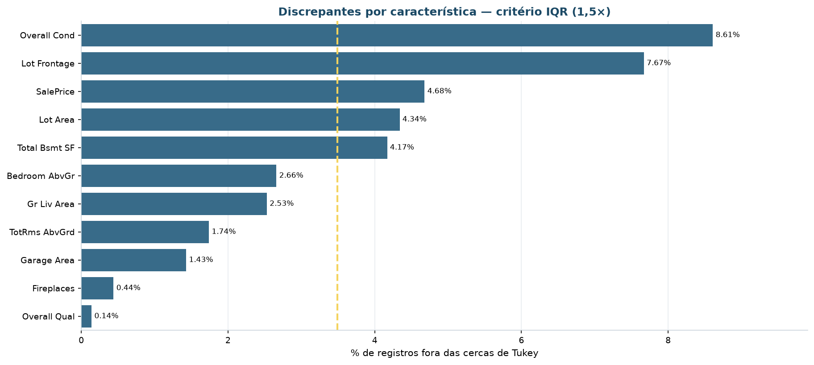

# Análise exploratória

Esta página resume **o desenho** da análise exploratória: quais notebooks existem, o
que cada um responde e as decisões metodológicas que valem para todos. Os resultados em
si ficam nas figuras de `reports/figures/` e nas tabelas de `reports/tables/`.

## Mapa dos notebooks

| Notebook | Fase | Recorte | Saída principal |
|:---|:-:|:---|:---|
| `00-dicionario-dados` | 2.2 | camada bruta, 2.930 × 82 | Dicionário gerado a partir do código, com papel de cada coluna |
| `01-analise-exploratoria` | 2.3 | camada bruta, 2.930 × 82 | 55 figuras, 63 tabelas, coleção de 12 insights |
| `02-ajustes-dados` | 3 | bruta → curada | O funil de curadoria, de 2.930 a 2.350 imóveis |
| `03-preparacao` | 3 | base curada, 2.350 × 83 | Espaço de 17 variáveis e o experimento de escala |
| `04-modelagem` | 4 | espaço euclidiano e Gower | 47 execuções, escolha de *k*, personas |
| `05-avaliacao` | 5 | base segmentada, com o rótulo aberto | Confronto com os critérios e varredura ampla de 90 configurações |
| `06-implantacao` | 6 | modelo aprovado | Contrato, regra de fronteira, monitoramento e o pacote `.pkl` |

Um notebook por **fase do CRISP-DM**, não por técnica. É o que permite rastrear cada
entrega até o critério de aceite que ela atende — ver
[critérios de sucesso](criterios-sucesso.md).

## Desenho da EDA

O fluxo é o das oito etapas, aplicado sobre a **camada bruta** — antes da curadoria,
justamente porque é a exploração que descobre o que precisa ser ajustado.

```
Base de dados
   ├─ 1ª  Distribuição dos atributos
   ├─ 2ª  Análise univariada
   ├─ 3ª  Análise bivariada
   ├─ 4ª  Análise multivariada
   ├─ 5ª  Valores ausentes
   ├─ 6ª  Valores discrepantes
   ├─ 7ª  Detecção de correlação
   └─ 8ª  Seleção de características
   ▼
Coleção de insights
```

| Fase | Técnica | O que responde |
|:---|:---|:---|
| **1ª** Distribuição dos atributos | Perfil por coluna: tipo, cardinalidade, concentração | Que natureza de dado existe, e o que é constante demais para servir? |
| **2ª** Univariada | Histograma, boxplot padronizado, assimetria e curtose | Como cada variável se distribui, e qual precisa de transformação? |
| **3ª** Bivariada | Spearman (numérica × numérica), V de Cramér (nominal × nominal), η² (nominal × numérica) | Quais variáveis andam juntas — respeitando a natureza de cada uma? |
| **4ª** Multivariada | PCA exploratório, cargas, perfil padronizado por estilo | Que estrutura existe quando se olham todas de uma vez? |
| **5ª** Valores ausentes | Percentual por coluna, matriz de coocorrência, inventário de sentinelas | A ausência é aleatória ou estrutural? |
| **6ª** Discrepantes | IQR de Tukey, escore z robusto (MAD), Isolation Forest | Há valor implausível — ou apenas cauda longa legítima? |
| **7ª** Correlação | Pearson **e** Spearman, com poda de pares acima de 0,70 | Onde há redundância que pesaria dobrado na distância? |
| **8ª** Seleção de características | Decisão registrada por variável, com motivo | O que entra no espaço de atributos, e por quê? |


### Por que três métodos de detecção de discrepantes

Cada um enxerga uma coisa diferente, e usar um só é como escolher a resposta antes da
pergunta:

- **IQR de Tukey** é o padrão do boxplot; sensível a distribuições assimétricas, marca
  muita coisa em variáveis de cauda longa;
- **escore z robusto** usa mediana e MAD, em vez de média e desvio padrão — que são
  contaminados justamente pelos valores que se quer detectar;
- **Isolation Forest** olha a **combinação** de atributos. Um imóvel pode ter área
  normal, idade normal e qualidade normal, e ainda assim ser atípico pela combinação
  das três.



O achado que mudou a curadoria veio daqui: `Overall Cond` concentra 56% dos imóveis na
nota 5, e por isso 8,6% dos registros caem fora das cercas de Tukey. É **discrepância de
escala**, não imóvel atípico — e foi o que levou a fase 3 a adotar 3×IQR em vez do 1,5
de Tukey, que marcava cerca de um quinto da carteira.

## Escolhas metodológicas

Cada item declara **a decisão** e **o motivo**. O motivo é o que evita que a decisão
seja revertida por engano depois.

- **Sentinelas declaradas explicitamente na leitura, em vez do padrão do `pandas`** —
  porque a palavra `None` em `Mas Vnr Type` é categoria legítima, e a conversão
  automática transformava 1.752 imóveis descritos em desconhecidos.

- **Ausência estrutural vira rótulo, não imputação** — porque `NA` em `Garage Type`
  significa "não tem garagem", e imputar pela moda criaria garagens inexistentes.

- **Mediana do bairro, e não mediana global, para `testada_lote`** — porque a ausência
  é MAR (explicada pela geometria do lote) e a mediana global achataria a variação
  entre bairros, que é a informação útil da coluna.

- **Spearman em vez de Pearson na leitura de redundância** — porque as variáveis de
  área têm relação monotônica, mas não linear. Pearson e Spearman divergem justamente
  nelas, e a divergência é o sinal que confirma a necessidade de `log1p`.

- **V de Cramér para nominais, η² para nominal × numérica** — porque Pearson não se
  aplica a variável sem ordem, e usá-lo assim mesmo produz um número que parece uma
  correlação e não é.

- **`log1p` só acima de 0,75 de assimetria** — porque abaixo desse limiar o ganho não
  compensa a perda de legibilidade da unidade original. A área do porão, com 0,40,
  fica de fora: transformá-la seria hábito, não decisão.

- **Discrepante legítimo não é removido** — porque remover os lotes grandes apagaria
  justamente o segmento de alto padrão que a diretoria quer enxergar. A exceção são os
  5 imóveis acima de 4.000 pés², removidos por recomendação explícita do autor da base.

- **Redundância estatística não é sinônimo de redundância de negócio** —
  `area_habitavel` e `comodos` têm ρ = 0,81 e **ambas ficam**. Dois imóveis de mesma
  área com 5 e 9 cômodos são produtos diferentes, e o número de cômodos é o que separa
  os dois.

## Coleção de insights

O produto da fase exploratória são **12 insights**, cada um com o **achado** e a
**consequência** para a análise. Um insight sem consequência é curiosidade.

A tabela completa está em `reports/tables/eda-exploratoria/insights.csv`. Os que mais
influenciaram o resto do projeto:

| # | Etapa | Achado | Consequência |
|:-:|:---|:---|:---|
| 1 | 1ª | Duas linhas são idênticas nas 24 características e só diferem em `Order` e `PID` | O mesmo imóvel contado duas vezes em qualquer média — removido na curadoria |
| 2 | 5ª | Das 27 colunas com célula vazia, 14 são **ausência estrutural** (`Pool QC` 99,6%, `Alley` 93,2%) | Rótulo próprio e área zero, não imputação. `Lot Frontage` (16,7%) é a única ausência de fato desconhecida com peso |
| 3 | 2ª | `Lot Area` tem assimetria **12,8**, a maior da base — máximo de 215.245 pé² | Transformação obrigatória antes de qualquer distância… até a curadoria remover os lotes extremos e a assimetria cair para 0,42 |
| 4 | 6ª | `Overall Cond` concentra 56% dos imóveis na nota 5, e 8,6% caem fora das cercas de Tukey | É discrepância **de escala**, não imóvel atípico — e é o que motivou adotar 3×IQR |
| 5 | 3ª | A qualidade explica o preço melhor que a área: ρ = 0,81 contra 0,72 | O padrão construtivo é eixo de produto, não só de preço |
| 7 | 3ª | O bairro sozinho responde por η = 0,76 do preço; NoRidge vende a 183% da média | É o motivo de `Neighborhood` ficar **reservada** para validação externa |
| 10 | 2ª | 2010 tem 341 registros e termina em julho: a série está **truncada** | Qualquer leitura de queda no último ano é artefato de coleta, não de mercado |
| 11 | 2ª | 82% das vendas são `Normal`; `Partial` (8,4%) carrega preço acima da média **por construção** | Fundamentou a regra de curadoria que remove 492 vendas não normais |

### As 8 fases, em uma imagem cada

=== "2ª · Univariada"
    

=== "3ª · Bivariada"
    

=== "4ª · Multivariada"
    

=== "5ª · Ausentes"
    

=== "6ª · Discrepantes"
    

=== "7ª · Correlação"
    

As 24 análises bivariadas e as 24 univariadas completas estão em `docs/imagens/eda/`,
cada uma com o CSV que a originou em `reports/tables/eda-exploratoria/`.

## Reprodução

```bash
uv run invoke eda           # as oito fases, do zero
uv run invoke notebooks     # executa os sete notebooks e confere que rodam
```

Os notebooks são versionados **sem saída** (`nbstripout` no `pre-commit`). Por isso
toda figura e toda tabela relevante é persistida em disco: o que não for gravado
desaparece do repositório.

## Dados por trás de cada gráfico

Regra do projeto: **nenhuma figura é gravada sem a tabela que a originou**. A função
`src.utils.io.salvar_figura` grava as duas no mesmo momento, de modo que o dado não
tem como divergir do gráfico.

| Destino | Conteúdo | Formato |
|:---|:---|:---|
| `reports/figures/<seção>/<nome>.png` | Figura, 150 dpi | PNG |
| `docs/imagens/<seção>/<nome>.png` | Cópia que o MkDocs enxerga | PNG |
| `reports/tables/<seção>/<nome>.csv` | Tabela-fonte, com o **mesmo nome** da figura | CSV, `;` e decimal `,`, UTF-8 com BOM |

O separador `;` com decimal `,` abre direto no Excel em português — detalhe pequeno
que decide se a área de negócio consegue ou não conferir o número.
