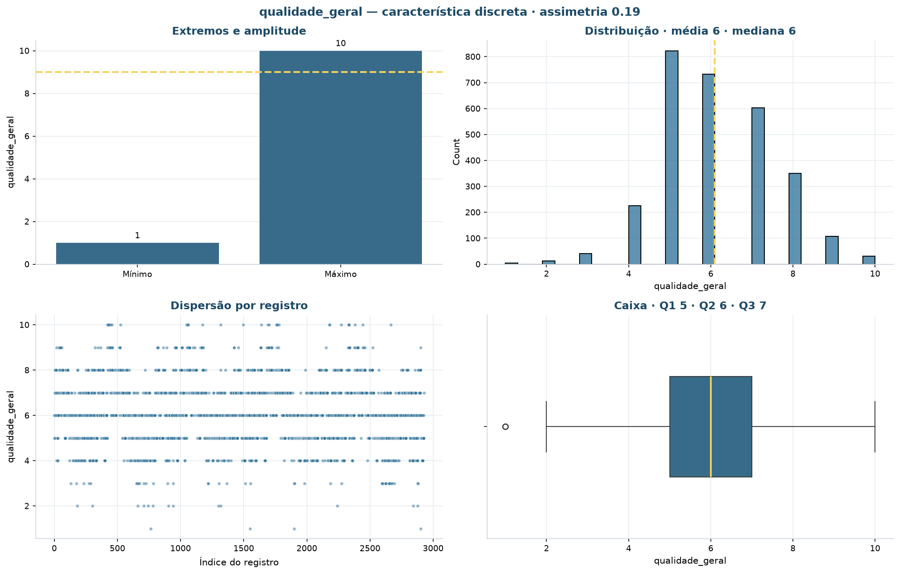
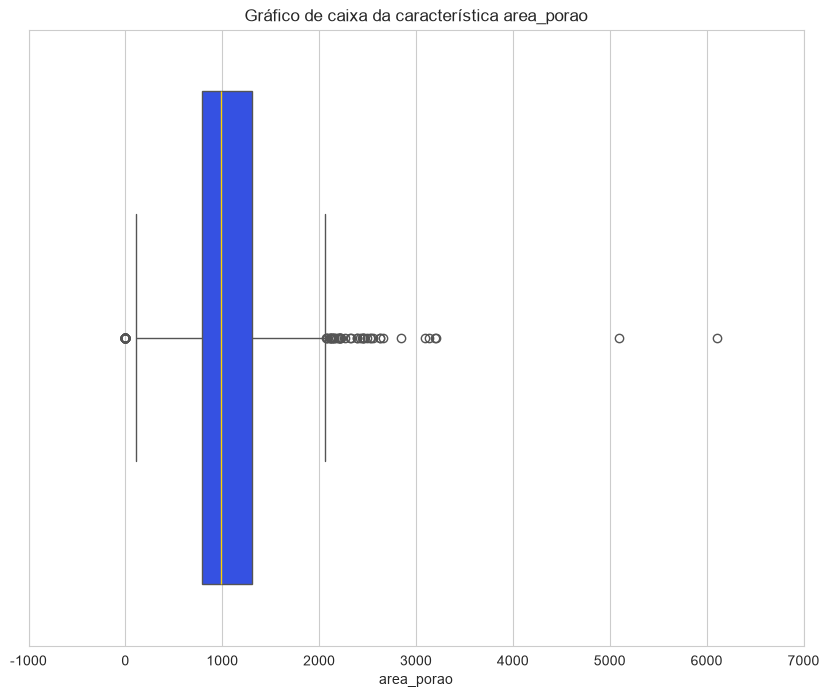
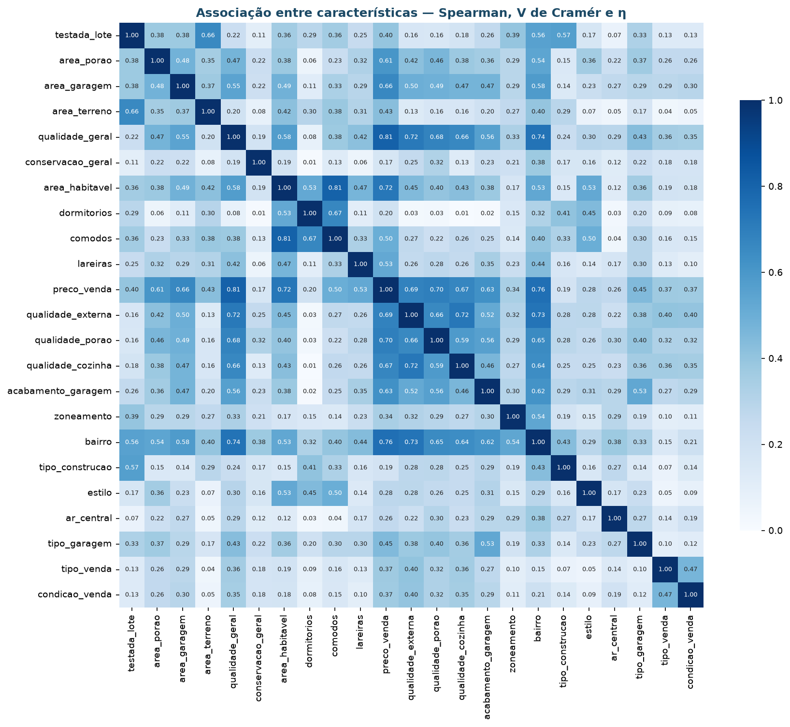

# Análise exploratória

Esta página resume **o desenho** da análise exploratória: quais notebooks existem, o
que cada um responde e o que a exploração encontrou. As figuras ficam em
`docs/imagens/eda/` e as tabelas que as originaram em `docs/tabelas/`.

## Mapa dos notebooks

| Notebook | Fase | Recorte | Saída principal |
|:---|:-:|:---|:---|
| `00-dicionario-dados` | 2.2 | camada bruta, 2.930 × 82 | Dicionário com o tipo de cada coluna e as escalas ordinais |
| `01-analise-exploratoria` | 2.3 | camada bruta, 2.930 × 82 | 22 figuras, 4 tabelas, 12 insights e a base de colunas selecionadas |
| `02-ajustes-dados` | 3 | colunas selecionadas → base tratada | 2.927 imóveis × 90 colunas, sem nenhuma célula vazia |
| `03-preparacao` | 3 | base tratada | Base normalizada e codificada: 238 colunas, 236 no modelo |
| `04-0` a `04-3` | 4 | base pré-processada | Varredura de onze algoritmos, cotovelos, PCA/UMAP e regras de associação |
| `05-avaliacao` | 5 | segmentos do 04-0, com o preço aberto | Critérios de sucesso, cenários financeiros e próxima ação |
| `06-implantacao` | 6 | modelo do 04-0 | Classificação de imóveis novos, completados pelo imóvel mais parecido |
| `07_modelagem_bonus` | 4 | base curada do `invoke preparacao` | Pipeline com busca em grade; alimenta `app/app_imobiliario.py` (ver [Modelagem](modelagem.md#o-modelo-bonus)) |

Um notebook por **fase do CRISP-DM**, e a modelagem desdobrada em quatro. É o que
permite rastrear cada entrega até o critério de aceite que ela atende — ver
[critérios de sucesso](criterios-sucesso.md).

## Desenho da EDA

O fluxo é o das oito etapas, aplicado sobre a **camada bruta** — antes dos ajustes,
justamente porque é a exploração que descobre o que precisa ser ajustado.


| Etapa | O que o notebook 01 faz | O que responde |
|:---|:---|:---|
| **1ª** Distribuição dos atributos | `info`, contagem por tipo do dicionário e estatísticas descritivas | Que natureza de dado existe? |
| **2ª** Univariada | Barras, histograma, dispersão e caixa — `zoneamento`, `area_porao`, `area_terreno`, `qualidade_geral` e `ano_construcao` | Como cada variável se distribui? |
| **3ª** Bivariada | Cada variável acima cruzada com `zoneamento` | A variação de uma acompanha a de outra? |
| **4ª** Multivariada | Análise de correspondência entre `zoneamento`, `tipo_via` e `qualidade_geral` | Que estrutura aparece quando se olham várias juntas? |
| **5ª** Valores ausentes | Células preenchidas por coluna, na base bruta | Onde falta dado, e quanto? |
| **6ª** Discrepantes | Limites de Tukey (1,5 × IQR) para `area_terreno` e `area_porao` | Há valor fora do esperado? |
| **7ª** Correlação | Correlograma de Pearson entre as variáveis numéricas | Onde há redundância? |
| **8ª** Seleção de características | Descarta `ordem`; as 81 colunas restantes seguem para o 02 | O que entra nos ajustes? |

!!! note "Um recorte didático"
    O notebook 01 aplica cada etapa a poucas colunas, escolhidas para ilustrar cada tipo
    de dado. A varredura completa, coluna a coluna, existe em script:
    `uv run invoke eda` executa as oito fases sobre a base curada de
    `src.data.preparacao` e grava 17 figuras em `reports/figures/eda/` e 27 tabelas em
    `reports/tables/eda/`.

### O que cada etapa mostrou

=== "2ª · Univariada"
    

=== "3ª · Bivariada"
    

=== "4ª · Multivariada"
    

=== "5ª · Ausentes"
    

=== "6ª · Discrepantes"
    

=== "7ª · Correlação"
    

**Multivariada.** Dos pares testados, só `qualidade_geral × zoneamento` passa do mínimo
de 80% de inércia em duas dimensões (88,5%), e é o único que vira figura. O par com
`tipo_via` fica de fora: com só duas categorias (pavimentada e cascalho), a análise
de correspondência tem uma única dimensão e não há plano para desenhar.

**Discrepantes.** Pela régua de Tukey, `area_terreno` tem valores atípicos acima de
17.727,75 pés², até um máximo de 215.245; `area_porao`, abaixo de 29,5 e acima de
2.065,5, até 6.110. São lotes e porões grandes de verdade, não erro de digitação, e
nenhum deles é removido. A tabela está em `docs/tabelas/outliers.csv`.

## Escolhas metodológicas

Cada item declara **a decisão** e **o motivo**. O motivo é o que evita que a decisão
seja revertida por engano depois.

- **Sentinelas declaradas explicitamente na leitura, em vez do padrão do `pandas`** —
  porque a palavra `None` em `Mas Vnr Type` (`tipo_alvenaria_aparente`) é categoria
  legítima, e a conversão automática transformava 1.752 imóveis descritos em
  desconhecidos. Está em `src.data.ingestao`.

- **Ausência estrutural vira rótulo, não imputação** — porque `NA` em `tipo_garagem`
  significa "não tem garagem", e imputar pela moda criaria garagens inexistentes. O
  notebook 02 aplica `Sem porão`, `Sem garagem`, `Sem lareira`, `Sem piscina`,
  `Sem cerca`, `Sem viela` e `Nenhum`.

- **Mediana do bairro, e não mediana global, para `testada_lote`** — porque a ausência
  (490 imóveis, 16,7%) se explica pela geometria do lote, e a mediana global achataria
  a variação entre bairros.

- **Discrepante legítimo não é removido** — porque remover os lotes grandes apagaria
  justamente o alto padrão que a diretoria quer enxergar. A exceção são as três vendas
  parciais acima de 4.000 pés², com preço incompatível, que o 02 remove.

!!! note "O que a exploração não pegou"
    A etapa de valores ausentes conta as células vazias da base bruta. Numa versão
    anterior da cadeia, o defeito estava **depois**: a escala do notebook 00 não
    reconhecia o nível "Típico", e o 01 o transformava em ausente — ver
    [Entendimento dos dados](entendimento-dados.md#as-escalas-ordinais). Uma contagem de
    ausentes repetida sobre `ames_housing_columns_selected.csv`, a saída do 01, teria
    mostrado o problema. Hoje essa conferência está no próprio notebook 00.

## Coleção de insights

O notebook 01 registra **12 insights** em `docs/tabelas/insights.csv`. Eles foram
escritos sobre a base bruta, e alguns propõem decisões que a cadeia atual não tomou —
a tabela abaixo indica o que aconteceu com cada um.

| # | Insight | Na cadeia atual |
|:-:|:---|:---|
| 1 | Duas linhas são idênticas nas 24 características analisadas e só diferem em `ordem` e `pid` | Nenhuma linha é removida por duplicidade |
| 2 | Das 27 colunas com célula vazia, 14 são ausência estrutural; `testada_lote` (16,7%) é a única ausência de fato com peso | Rótulo de ausência e mediana do bairro, no 02 |
| 3 | `area_terreno` tem assimetria 12,8: mediana de 9.437 pés² contra máximo de 215.245 | Sem transformação: o 03 aplica só MinMax |
| 4 | `conservacao_geral` concentra 56% dos imóveis na nota 5, e 8,6% caem fora das cercas de Tukey | Discrepância de escala, sem remoção |
| 5 | A qualidade explica o preço melhor que a área: Spearman de 0,81 contra 0,72 | Confirmado indiretamente: o Segmento A tem a maior qualidade mediana (7) e o maior preço |
| 6 | `area_habitavel` e `comodos` medem quase a mesma coisa (0,81) | As duas entram no modelo |
| 7 | O bairro responde por η = 0,76 do preço | O bairro entra no modelo pelo *one-hot* e é a variável de maior peso no PCA |
| 8 | Ar central está em 93% dos imóveis, e os 7% sem ele valem 102 mil contra 186 mil | `ar_central=Sim` é descartado nas regras do 04-3 por estar em mais de 90% |
| 9 | Junho e julho concentram 33% das vendas; janeiro e dezembro, 8% | Mês da venda é temporal e fica fora do modelo |
| 10 | 2010 tem 341 registros e termina em julho: a série está truncada | Sem efeito no agrupamento; afeta só leituras por ano |
| 11 | 82% das vendas são `Normal`; `Parcial` (8,4%) carrega preço acima da média por construção | A condição da venda entra no modelo; 21,4% do Segmento A são vendas parciais |
| 12 | `zoneamento` e `tipo_garagem` compartilham 99% da inércia em duas dimensões | As duas entram no modelo |

## Reprodução

```bash
uv run invoke notebooks     # executa os notebooks e confere que rodam
uv run invoke eda           # a varredura completa das oito fases, em script
```

Os notebooks são versionados **sem saída** (`nbstripout` no `pre-commit`). Por isso
toda figura e toda tabela relevante é persistida em disco: o que não for gravado
desaparece do repositório. As versões executadas, com saída, ficam em
`reports/notebooks/` depois de `uv run invoke notebooks`.

## Dados por trás de cada gráfico

| Destino | Conteúdo | Quem grava |
|:---|:---|:---|
| `docs/imagens/eda/*.png` | Figuras da EDA do notebook | notebook 01 |
| `docs/tabelas/*.csv` | Ausentes, discrepantes, inércia dos pares e insights | notebook 01 |
| `reports/figures/eda/*.png` e `docs/imagens/evidencias/eda/*.png` | As 17 figuras das oito fases em script | `uv run invoke eda` |
| `reports/tables/eda/*.csv` | A tabela-fonte de cada figura, com o mesmo nome | `uv run invoke eda` |

No script, a regra é **nenhuma figura gravada sem a tabela que a originou**: a função
`src.utils.io.salvar_figura` grava as duas no mesmo momento, com separador `;` e
decimal `,`, que abre direto no Excel em português.
