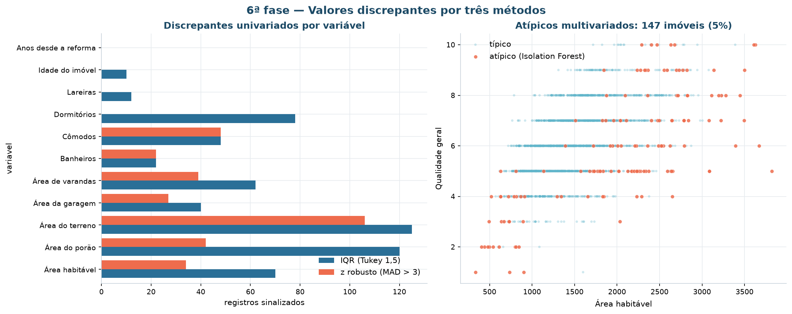
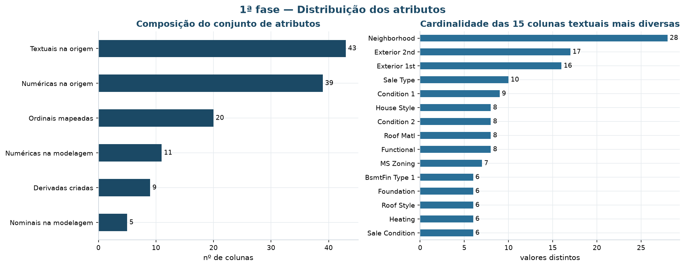
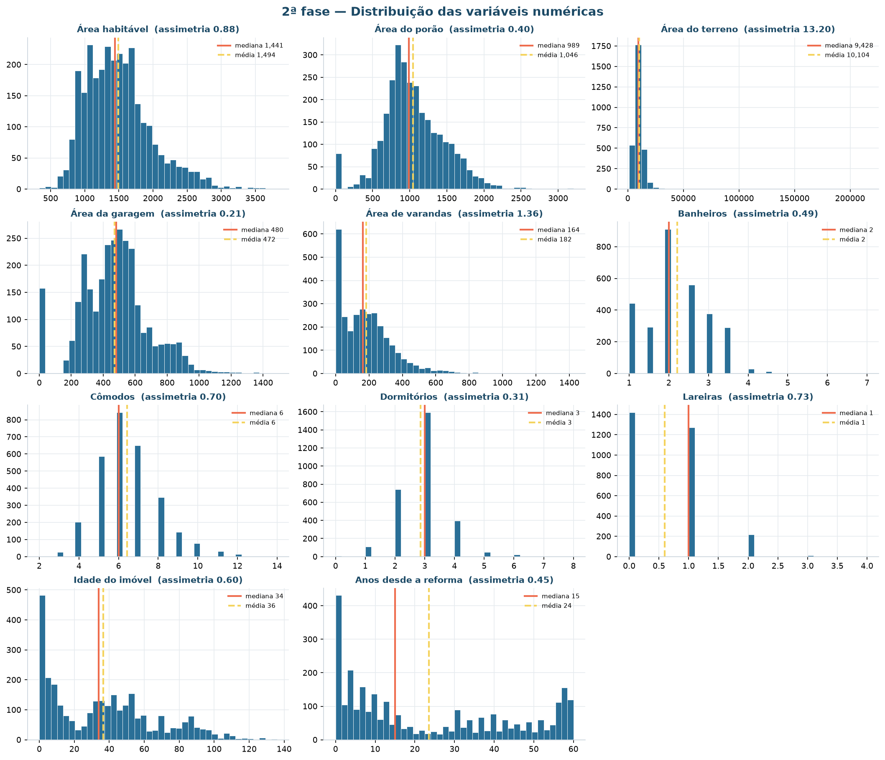
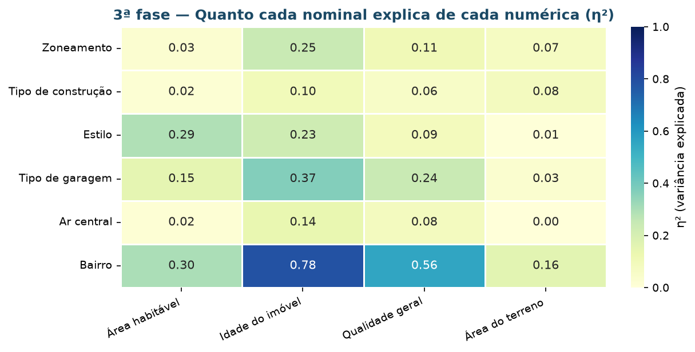
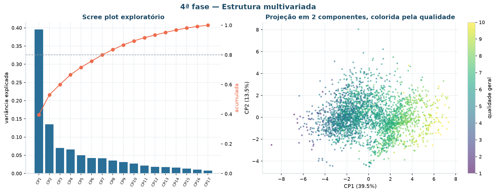
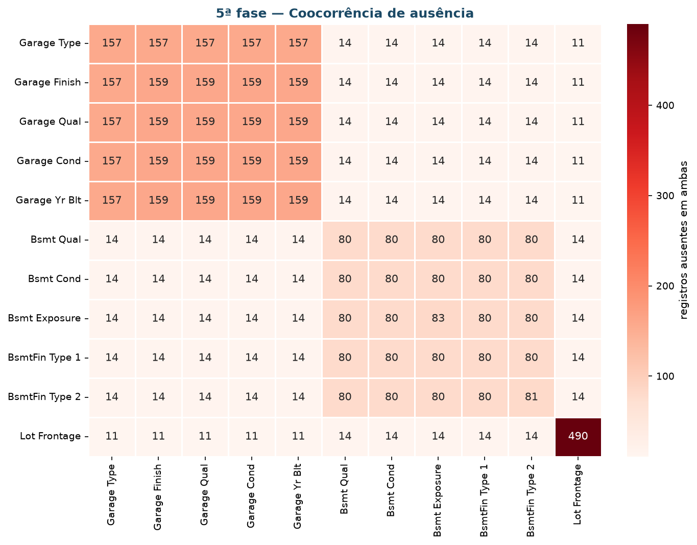
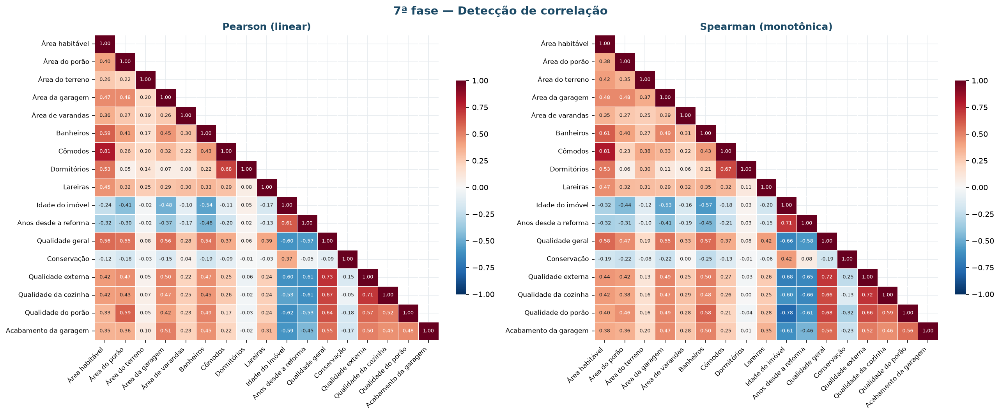

# Análise exploratória

Esta página resume **o desenho** da análise exploratória: quais notebooks existem, o
que cada um responde e as decisões metodológicas que valem para todos. Os resultados em
si ficam nas figuras de `reports/figures/` e nas tabelas de `reports/tables/`.

## Mapa dos notebooks

| Notebook | Objetivo | Recorte | Saída principal |
|:---|:-:|:---|:---|
| `01-entendimento-e-descricao-dos-dados` | 1 | camada bruta, 2.930 × 82 | Manifesto de carga, perfil de qualidade, Canvas preenchido |
| `02-eda-fluxo-8-fases` | 1, 3 | base curada, 2.925 × 91 | 18 figuras, 26 tabelas, coleção de 21 insights |
| `02b-sensibilidade-escala` | 1 | matriz de modelagem | Experimento com quatro escalonadores, comparados por ARI |
| `03-clusterizacao-particional-hierarquica` | 1, 2 | espaço euclidiano e Gower | Escolha de *k*, três partições comparadas, personas |
| `04-densidade-gmm-reducao-dimensional` | 1, 4 | espaço euclidiano | Matriz comparativa de seis algoritmos, PCA e Kernel PCA |
| `05-regras-de-associacao` | 3 | 2.925 × 62 itens | 256 regras podadas, 252 diferenciais por segmento |
| `06-avaliacao-e-implantacao` | 2, 5 | base segmentada | Confronto com critérios, drift, artefatos publicados |

A coluna **Objetivo** referencia a numeração dos [critérios de sucesso](criterios-sucesso.md).

Um notebook por **objetivo de negócio**, não por técnica. É o que permite rastrear
cada entrega até o critério de aceite que ela atende.

## Desenho da EDA

O fluxo é o das oito fases, aplicado sobre as 22 variáveis do espaço de atributos mais
as reservadas, quando a fase exige.

```
Base de dados
   ├─ 1ª  Distribuição dos atributos
   ├─ 2ª  Análise univariada
   ├─ 3ª  Análise bivariada
   ├─ 4ª  Análise multivariada
   ├─ 5ª  Valores ausentes
   ├─ 6ª  Valores discrepantes
   ├─ 7ª  Detecção de correlação
   └─ 8ª  Seleção de características
   ▼
Coleção de insights
```

| Fase | Técnica | O que responde |
|:---|:---|:---|
| **1ª** Distribuição dos atributos | Perfil por coluna: tipo, cardinalidade, concentração | Que natureza de dado existe, e o que é constante demais para servir? |
| **2ª** Univariada | Histograma, boxplot padronizado, assimetria e curtose | Como cada variável se distribui, e qual precisa de transformação? |
| **3ª** Bivariada | Spearman (numérica × numérica), V de Cramér (nominal × nominal), η² (nominal × numérica) | Quais variáveis andam juntas — respeitando a natureza de cada uma? |
| **4ª** Multivariada | PCA exploratório, cargas, perfil padronizado por estilo | Que estrutura existe quando se olham todas de uma vez? |
| **5ª** Valores ausentes | Percentual por coluna, matriz de coocorrência, inventário de sentinelas | A ausência é aleatória ou estrutural? |
| **6ª** Discrepantes | IQR de Tukey, escore z robusto (MAD), Isolation Forest | Há valor implausível — ou apenas cauda longa legítima? |
| **7ª** Correlação | Pearson **e** Spearman, com poda de pares acima de 0,70 | Onde há redundância que pesaria dobrado na distância? |
| **8ª** Seleção de características | Decisão registrada por variável, com motivo | O que entra no espaço de atributos, e por quê? |


### Por que três métodos de detecção de discrepantes

Cada um enxerga uma coisa diferente, e usar um só é como escolher a resposta antes da
pergunta:

- **IQR de Tukey** é o padrão do boxplot; sensível a distribuições assimétricas, marca
  muita coisa em variáveis de cauda longa;
- **escore z robusto** usa mediana e MAD, em vez de média e desvio padrão — que são
  contaminados justamente pelos valores que se quer detectar;
- **Isolation Forest** olha a **combinação** de atributos. Um imóvel pode ter área
  normal, idade normal e qualidade normal, e ainda assim ser atípico pela combinação
  das três.



Os 147 imóveis (5%) marcados pelo Isolation Forest não foram removidos: viraram
hipótese para a fase de modelagem. A pergunta era se o DBSCAN os reencontraria como
ruído — e, em boa medida, reencontrou.

## Escolhas metodológicas

Cada item declara **a decisão** e **o motivo**. O motivo é o que evita que a decisão
seja revertida por engano depois.

- **Sentinelas declaradas explicitamente na leitura, em vez do padrão do `pandas`** —
  porque a palavra `None` em `Mas Vnr Type` é categoria legítima, e a conversão
  automática transformava 1.752 imóveis descritos em desconhecidos.

- **Ausência estrutural vira rótulo, não imputação** — porque `NA` em `Garage Type`
  significa "não tem garagem", e imputar pela moda criaria garagens inexistentes.

- **Mediana do bairro, e não mediana global, para `testada_lote`** — porque a ausência
  é MAR (explicada pela geometria do lote) e a mediana global achataria a variação
  entre bairros, que é a informação útil da coluna.

- **Spearman em vez de Pearson na leitura de redundância** — porque as variáveis de
  área têm relação monotônica, mas não linear. Pearson e Spearman divergem justamente
  nelas, e a divergência é o sinal que confirma a necessidade de `log1p`.

- **V de Cramér para nominais, η² para nominal × numérica** — porque Pearson não se
  aplica a variável sem ordem, e usá-lo assim mesmo produz um número que parece uma
  correlação e não é.

- **`log1p` só acima de 0,75 de assimetria** — porque abaixo desse limiar o ganho não
  compensa a perda de legibilidade da unidade original. A área do porão, com 0,40,
  fica de fora: transformá-la seria hábito, não decisão.

- **Discrepante legítimo não é removido** — porque remover os lotes grandes apagaria
  justamente o segmento de alto padrão que a diretoria quer enxergar. A exceção são os
  5 imóveis acima de 4.000 pés², removidos por recomendação explícita do autor da base.

- **Redundância estatística não é sinônimo de redundância de negócio** —
  `area_habitavel` e `comodos` têm ρ = 0,81 e **ambas ficam**. Dois imóveis de mesma
  área com 5 e 9 cômodos são produtos diferentes, e o número de cômodos é o que separa
  os dois.

## Coleção de insights

O produto da fase exploratória são 21 insights, cada um com três campos: o **achado**,
a **consequência** para a análise e a **evidência** que o sustenta. Um insight sem
consequência é curiosidade.

A tabela completa está em `reports/tables/eda/colecao-de-insights.csv`. Os que mais
influenciaram o resto do projeto:

| # | Fase | Achado | Consequência |
|:-:|:---|:---|:---|
| I13 | 5ª | A palavra `None` em `Mas Vnr Type` é categoria legítima, mas a leitura padrão a converte em nulo | Sem declarar `na_values`, a coluna aparenta 60,6% de ausência contra 0,8% reais |
| I12 | 5ª | As 5 colunas de garagem faltam nos mesmos 157–159 imóveis; as de porão, nos mesmos 79–83 | Ausência estrutural: rótulo próprio e área zero, não imputação |
| I04 | 2ª | 3 variáveis superam o limiar de assimetria de 0,75; a área do terreno chega a 13,2 | Só essas recebem `log1p`. Sem a transformação, o K-Means devolve um cluster gigante com satélites de um elemento |
| I05 | 2ª | Massa concentrada em zero: 2,7% sem porão, 5,4% sem garagem, 16,5% sem varanda | O zero é categoria ("não tem"), não medida. As flags binárias preservam o que a área sozinha esconde |
| I08 | 3ª | `bairro` explica 56% da variância da qualidade geral e 78% da idade do imóvel | Reforça mantê-lo fora da modelagem: é proxy de preço por caminho indireto |
| I15 | 6ª | A área do terreno tem 125 discrepantes por Tukey, mas são lotes grandes legítimos | Discrepante legítimo não se remove: a resposta é `log1p`, não exclusão |
| I18 | 7ª | 5 pares ultrapassam \|ρ\| = 0,70; o mais forte é área habitável × cômodos (0,81) | Redundância tratada par a par na 8ª fase, não em bloco |
| I21 | 8ª | A redundância entre área e cômodos foi mantida **deliberadamente** | Redundância estatística não é redundância de negócio |

### As 8 fases, em uma imagem cada

=== "1ª · Distribuição"
    

=== "2ª · Univariada"
    

=== "3ª · Bivariada"
    

=== "4ª · Multivariada"
    

=== "5ª · Ausentes"
    

=== "6ª · Discrepantes"
    

=== "7ª · Correlação"
    

=== "8ª · Seleção"
    

## Reprodução

```bash
uv run invoke eda           # as oito fases, do zero
uv run invoke notebooks     # executa os sete notebooks e confere que rodam
```

Os notebooks são versionados **sem saída** (`nbstripout` no `pre-commit`). Por isso
toda figura e toda tabela relevante é persistida em disco: o que não for gravado
desaparece do repositório.

## Dados por trás de cada gráfico

Regra do projeto: **nenhuma figura é gravada sem a tabela que a originou**. A função
`src.utils.io.salvar_figura` grava as duas no mesmo momento, de modo que o dado não
tem como divergir do gráfico.

| Destino | Conteúdo | Formato |
|:---|:---|:---|
| `reports/figures/<seção>/<nome>.png` | Figura, 150 dpi | PNG |
| `docs/imagens/evidencias/<seção>/<nome>.png` | Cópia que o MkDocs enxerga | PNG |
| `reports/tables/<seção>/<nome>.csv` | Tabela-fonte | CSV, `;` e decimal `,`, UTF-8 com BOM |

O separador `;` com decimal `,` abre direto no Excel em português — detalhe pequeno
que decide se a área de negócio consegue ou não conferir o número.
