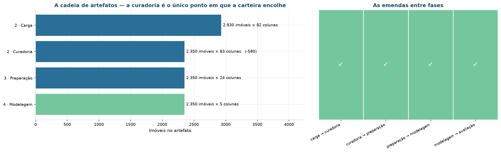
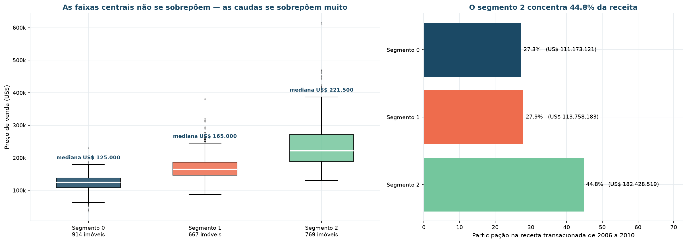
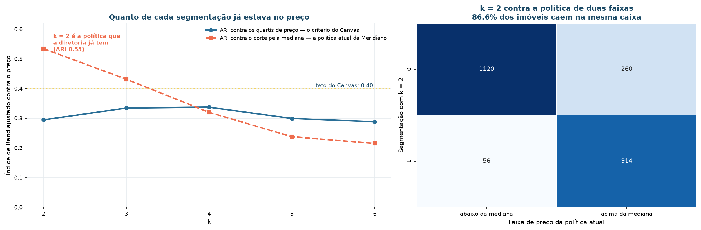
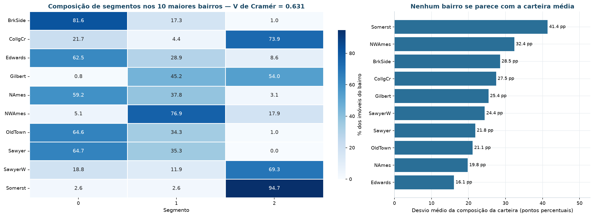
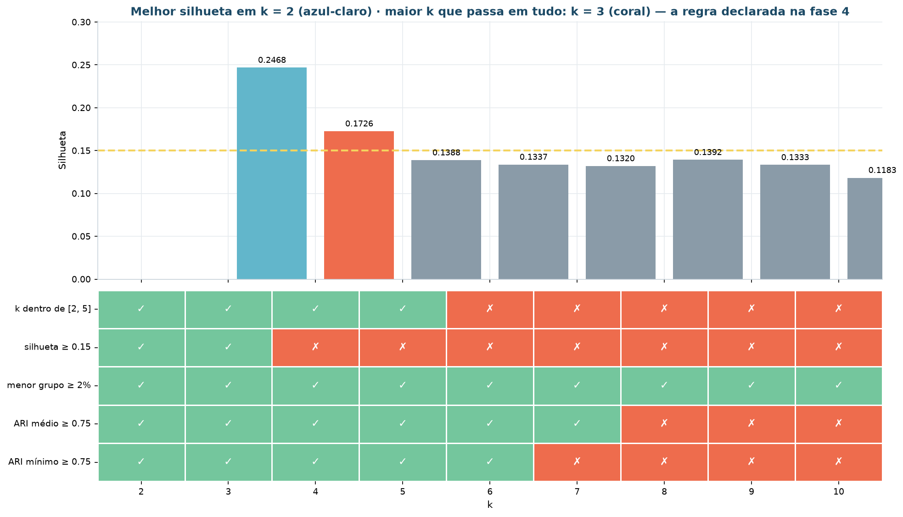
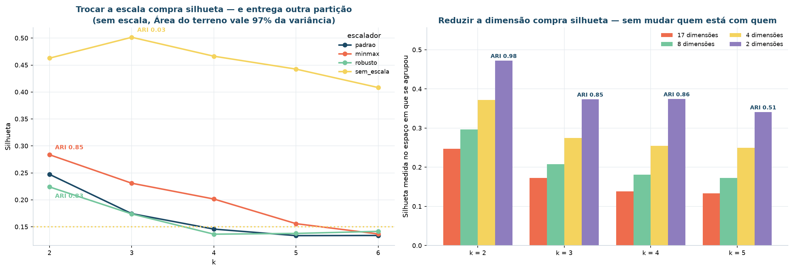
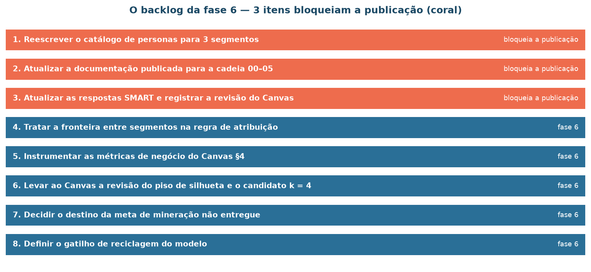

# Avaliação dos resultados

**CRISP-DM fase 5.** A fase 4 entregou um modelo. Esta fase pergunta se ele serve — e
faz isso com o **rótulo reservado aberto**, o que não era permitido até aqui.

São quatro perguntas:

1. o modelo cumpre o que o Canvas exigiu?
2. a segmentação é uma tabela de preço disfarçada?
3. os grupos existem fora do espaço em que foram criados?
4. a fase 4 deixou um modelo melhor na mesa?

## Confronto com os critérios de aceite


| Origem | Critério | Medida | Situação |
|:---|:---|:---|:-:|
| Canvas §6 · técnico | Silhueta ≥ 0,15 | **0,1726** | ✅ |
| Canvas §6 · técnico | Número de grupos entre 2 e 5 | **3 grupos** | ✅ |
| Canvas §6 · técnico | Menor segmento ≥ 2% da carteira | **28,4%** | ✅ |
| Canvas §6 · técnico | Estabilidade sob reamostragem: ARI ≥ 0,75 | médio **0,9575** · mínimo **0,9354** | ✅ |
| Canvas §6 · técnico | ARI contra quartis de preço < 0,40 | **0,3345** | ✅ |
| Canvas §6 · técnico | Ruído ≤ 10% da carteira | 0% — o modelo escolhido atribui grupo a todo imóvel | ✅ |
| Canvas §11 · ação | Cada linha admite política de preço, teto de reforma, canal e métrica | 3 linhas com perfil, valor e geografia distintos | ✅ |
| Canvas §4 · negócio | 100% do estoque com linha atribuída em 30 dias | 2.350 de 2.350 classificados; o prazo depende da fase 6 | ⏳ |
| Canvas §4 · negócio | Ganho de preço sobre custo de reforma ≥ 1,8× | exige reformas executadas e revendas concluídas | ⏳ |
| Canvas §4 · negócio | Giro do segmento de entrada: de 90 para 60 dias | exige a política em operação | ⏳ |

**7 de 7 critérios técnicos atendidos.** Os critérios de negócio não são falhas: são
medições que só existem depois de a política entrar em operação, e estão instrumentadas
no [plano de monitoramento](implementacao.md).

> Evidência: `reports/tables/avaliacao/criterios-do-canvas.csv`

### A cadeia inteira, conferida

Antes de julgar o resultado, a fase 5 reconstruiu a contagem de cada artefato:

| Fase | Artefato | Imóveis | Colunas | Variação |
|:---|:---|---:|---:|---:|
| 2 · Carga | `data/raw/ames_housing.parquet` | 2.930 | 82 | — |
| 2 · Curadoria | `data/processed/imoveis_curados.parquet` | 2.350 | 83 | **−580** |
| 3 · Preparação | `data/processed/base_modelagem.parquet` | 2.350 | 24 | 0 |
| 4 · Modelagem | `data/processed/base_segmentada.parquet` | 2.350 | 5 | 0 |



E a auditoria de vazamento conferiu, artefato por artefato, que nenhuma das três
variáveis reservadas — `preco_venda`, `preco_por_pe2` e `bairro` — chegou perto de um
algoritmo:

| Artefato | Papel | Reservadas encontradas |
|:---|:---|:-:|
| `data/processed/base_modelagem.parquet` | entrada de todo algoritmo | nenhuma ✅ |
| `data/processed/base_segmentada.parquet` | saída da fase 4 | nenhuma ✅ |
| `manifesto_modelagem.json · variaveis` | declaração do espaço do modelo | nenhuma ✅ |
| `models/modelo-segmentacao.joblib` | o objeto que a fase 6 vai executar | nenhuma ✅ |
| `models/preprocessador-euclidiano.joblib` | receita de pré-processamento | nenhuma ✅ |

A reserva foi **física**, não disciplinar: as colunas não estavam no arquivo.

## Quanto vale cada segmento



| Código | Linha | Imóveis | Preço mediano | US$/pé² | p10 – p90 | % da receita |
|:--|:--|--:|--:|--:|:--|--:|
| **S1** | Compacto herdado | 914 | US$ 125.000 | US$ 116,31 | 86 k – 150 k | 27,3% |
| **S2** | Amplo para requalificar | 667 | US$ 165.000 | **US$ 105,42** | 135 k – 215 k | 27,9% |
| **S3** | Recente de alto padrão | 769 | US$ 221.500 | **US$ 133,90** | 171 k – 325 k | **44,8%** |

Três leituras que a diretoria consegue usar:

1. **Um terço das unidades responde por 44,8% da receita.** O S3 tem 32,7% da carteira e
   quase metade do valor transacionado — é onde o desconto custa caro;
2. **A alavanca de reforma está no S2, não no segmento mais caro.** O S2 tem o **menor
   preço por pé² da carteira** (US$ 105,42 contra US$ 133,90 do S3), com 55% mais área
   que o S1. É espaço barato que a reforma reprecifica;
3. **O S1 é decisão de destino, não de preço.** 38,9% das unidades e 27,3% da receita,
   com 39 anos desde a última reforma. A pergunta ali não é "por quanto vendo", é "vendo,
   alugo ou desinvisto".

## A segmentação é uma tabela de preço disfarçada?

Esta é a pergunta que decide se o projeto valeu a pena — e o critério foi declarado no
Canvas **antes** de qualquer modelagem: ARI contra os quartis de `preco_venda` < 0,40.



| *k* | Silhueta | ARI contra quartis | ARI contra a mediana | Passa |
|:-:|---:|---:|---:|:-:|
| 2 | 0,2468 | 0,2944 | 0,5343 | ✅ |
| **3** | **0,1726** | **0,3345** | 0,4314 | ✅ |
| 4 | 0,1388 | 0,3373 | 0,3198 | ✅ |
| 5 | 0,1337 | 0,2991 | 0,2377 | ✅ |
| 6 | 0,1320 | 0,2880 | 0,2151 | ✅ |

**ARI 0,3345** — a segmentação e a faixa de preço concordam parcialmente, como não
poderia deixar de ser (imóvel melhor custa mais), mas **não são a mesma partição**. Um
terço de concordância é o que se espera de duas leituras correlacionadas e distintas.

!!! note "O que a coluna da mediana mostra"
    Contra um corte binário pela mediana de preço, o ARI sobe para **0,4314** em *k* = 3
    — acima do teto. Isso é coerente e não contradiz o resultado: com três grupos
    ordenados por padrão, separar "acima" e "abaixo" da mediana acerta mais do que
    separar quatro quartis. O critério declarado é o dos **quartis**, e é ele que vale;
    o número da mediana fica registrado para não parecer omissão.

## Validação externa: o bairro

`bairro` **nunca entrou em algoritmo nenhum** — foi reservado fisicamente junto com o
preço. Se os segmentos se distribuírem por bairro de forma não aleatória, eles existem
fora do espaço em que foram criados.



Distribuição percentual dos segmentos nos dez maiores bairros:

| Bairro | S1 | S2 | S3 |
|:---|---:|---:|---:|
| Somerst | 2,6 | 2,6 | **94,7** |
| CollgCr | 21,7 | 4,4 | **73,9** |
| SawyerW | 18,8 | 11,9 | **69,3** |
| Gilbert | 0,8 | 45,2 | **54,0** |
| NWAmes | 5,1 | **76,9** | 17,9 |
| BrkSide | **81,6** | 17,3 | 1,0 |
| Sawyer | **64,7** | 35,3 | 0,0 |
| OldTown | **64,6** | 34,3 | 1,0 |
| Edwards | **62,5** | 28,9 | 8,6 |
| NAmes | **59,2** | 37,8 | 3,1 |

**V de Cramér = 0,630.** A associação é forte e a leitura é geográfica: Somerset,
College Creek e Sawyer West são loteamentos novos e concentram o S3; Brookside, Old Town
e Sawyer são áreas consolidadas e concentram o S1. Northwest Ames é quase inteiramente
S2 — bairro de casas amplas e antigas, exatamente a linha de requalificação.

Nenhum piso foi declarado para este número: ele não é critério de aceite, é
**confirmação independente**. Os grupos que o algoritmo achou no espaço construtivo têm
correspondência num eixo que ele não viu.

## A fase 4 deixou um modelo melhor na mesa?

A fase 5 não confia na fase 4: refez uma varredura ampla e independente, com **90
configurações** — 10 algoritmos × *k* de 2 a 10 — e ordenou tudo por silhueta.



As dez maiores silhuetas da varredura:

| Algoritmo | *k* | Silhueta | Menor grupo | Maior grupo | Admissível |
|:---|:-:|---:|---:|---:|:-:|
| Hierárquica (single) | 2 | **0,3213** | 1 (0,04%) | 100,0% | ❌ |
| Hierárquica (single) | 3 | 0,3125 | 1 | 99,9% | ❌ |
| Hierárquica (single) | 4 | 0,2950 | 1 | 99,9% | ❌ |
| Hierárquica (average) | 2 | 0,2858 | 1 | 100,0% | ❌ |
| K-Medoids (Gower) | 2 | 0,2543 | 46,6% | 53,4% | ❌ |
| GMM (spherical) | 2 | 0,2471 | 39,9% | 60,1% | ✅ |
| K-Means | 2 | 0,2468 | 41,3% | 58,7% | ✅ |



!!! danger "As maiores silhuetas da varredura são degeneradas"
    As quatro primeiras colocadas separam **um imóvel** do resto da carteira. A silhueta
    é excelente porque a pergunta que ela responde — *os pontos estão perto dos seus e
    longe dos outros?* — é trivialmente satisfeita por um grupo de tamanho 1.

    É a demonstração mais limpa do projeto de que **métrica interna não é critério de
    aceite**. Sem a regra do menor grupo ≥ 2%, escolhida antes de olhar o resultado, o
    ranking por silhueta entregaria uma partição inútil.

Entre as **28 configurações admissíveis**, as melhores são todas de *k* = 2 — e *k* = 2
já havia sido descartado pela regra declarada na fase 4 (o maior *k* que passa em tudo).
O K-Means com *k* = 3 é a melhor configuração admissível dentro da regra.

### Confronto de *k* na ótica do negócio

| *k* | Silhueta | Menor grupo | Menor receita | Desequilíbrio da receita | ARI vs. quartis | Passa nos critérios |
|:-:|---:|---:|---:|---:|---:|:-:|
| 2 | 0,2468 | 41,3% | 45,3% | 4,7 p.p. | 0,2944 | ✅ |
| **3** | 0,1726 | 28,4% | 27,3% | 11,5 p.p. | 0,3345 | ✅ |
| 4 | 0,1388 | 16,7% | 23,6% | **2,1 p.p.** | 0,3373 | ❌ |
| 5 | 0,1337 | 14,6% | 11,8% | 8,2 p.p. | 0,2991 | ❌ |

!!! warning "O candidato *k* = 4 e a fragilidade do piso único"
    *k* = 4 tem a **receita mais equilibrada** de toda a faixa — 2,1 p.p. de
    desequilíbrio contra 11,5 do *k* = 3 — e reprova por **0,0112** de silhueta.

    Um piso único de 0,15 favorece *k* pequeno por construção: a silhueta decresce com
    *k*, então um piso fixo é, na prática, um teto de granularidade. A recomendação que
    saiu daqui é **declarar o piso por faixa de *k*, antes da próxima execução** — e ela
    é uma revisão de critério, não de resultado. Enquanto o critério vigente for este,
    *k* = 3 é a resposta.

## As duas sensibilidades

### Escala

O agrupamento é sensível ao escalonador — e a evidência mostra por quê a padronização
não é uma escolha estética:

| Escalador | *k* = 3 · silhueta | Menor grupo | ARI contra a escala padrão |
|:---|---:|---:|---:|
| `padrao` | 0,1745 | 27,7% | — |
| `minmax` | 0,2309 | 21,1% | **0,420** |
| `robusto` | 0,1739 | 20,7% | **0,395** |
| `sem_escala` | **0,5015** | 18,7% | **0,026** |

**Sem escalonar, a silhueta triplica e a partição some.** ARI de 0,026 contra a escala
padrão significa que é outro agrupamento — dominado por `area_terreno`, cuja amplitude é
milhares de vezes maior que a de `banheiros_total`. A silhueta alta mede a separação de
uma única variável, não da estrutura da carteira.

### Dimensão

| Dimensões | Variância retida | Silhueta **no espaço reduzido** | Silhueta **medida em 17** | ARI contra o espaço de 17 |
|:-:|---:|---:|---:|---:|
| 17 | 100,0% | 0,1726 | 0,1726 | 1,000 |
| 8 | 82,8% | 0,2081 | 0,1695 | 0,942 |
| 4 | 65,8% | 0,2749 | 0,1738 | 0,882 |
| 2 | 51,7% | **0,3735** | 0,1719 | 0,850 |

A armadilha está nas duas colunas do meio. Reduzir para 2 dimensões faz a silhueta
saltar de 0,17 para **0,37** — se medida no espaço reduzido. Medida no espaço original,
continua **0,17**. A redução não melhorou o agrupamento: melhorou a régua.

## As perguntas SMART, respondidas

| # | Pergunta | Resposta nesta cadeia | Situação |
|:-:|:---|:---|:---|
| 1 | Quantos grupos emergem, com silhueta ≥ 0,15 e no máximo 5? | **3** (silhueta 0,1726; base de 2.350) | resposta mudou |
| 2 | Qual grupo concentra mais de 40% da receita? | **S3**, com 44,8% | mudou de rótulo, conclusão preservada |
| 3 | Que combinações de até 3 atributos ocorrem com suporte ≥ 10% e lift ≥ 1,30? | **não refeita** — a cadeia não contém a etapa de regras | sem resposta |
| 4 | Que percentual é ruído num DBSCAN com minPts = 2*d*? | a varredura **não encontrou** configuração com ruído no teto e grupos na faixa | resposta mudou |
| 5 | A segmentação é distinguível de uma faixa de preço (ARI < 0,40)? | **sim** — ARI 0,3345 | conclusão confirmada, número atualizado |

Três das cinco respostas mudaram em relação à cadeia anterior, e uma ficou sem resposta.
Registrar isso é parte do resultado: a comparação entre o que se prometeu e o que se
mediu é o que dá crédito ao que sobrou.

> Evidência: `reports/tables/avaliacao/perguntas-smart.csv`

## Limitações e hipóteses derrubadas

### Hipóteses derrubadas

!!! failure "«O DBSCAN encontraria grupos de densidade que o K-Means não vê.»"
    **Derrubada, e prevista.** O diagnóstico do espaço mediu razão joelho/mediana de
    1,29 — sem degrau — antes de o algoritmo rodar. A varredura de 13 valores de `eps`
    confirmou: ou 70% da carteira vira ruído, ou tudo colapsa num grupo com 98,7%.
    Não há vale de densidade entre as linhas de produto.

!!! failure "«A dissimilaridade de Gower, por tratar dados mistos, daria a melhor segmentação.»"
    **Derrubada pela leitura do resultado.** Com peso igual por variável, `estilo`
    domina: o segmento 0 fica com 78,3% de casas de um pavimento e o segmento 1 com
    43,3% de 1.5Fin. É uma partição por fato construtivo, não por linha de produto. A
    silhueta era maior — e medida em outro espaço métrico, portanto não comparável.

!!! failure "«A maior silhueta indica o melhor modelo.»"
    **Derrubada duas vezes.** As quatro maiores silhuetas da varredura ampla isolam
    **um imóvel**; e sem escalonamento a silhueta triplica enquanto o ARI contra a
    partição de referência cai para 0,026.

### Limitações declaradas

| Limitação | Natureza | Impacto |
|:---|:---|:---|
| **Não há tempo de permanência em estoque** | dado indisponível | A meta de giro do S1 é proposta de meta, não medição. Precisa de instrumentação |
| **Não há custo de reforma executada** | dado indisponível | O retorno da reforma no S2 é estimado pelo diferencial de preço, não medido |
| **A base descreve o produto, não o comprador** | limitação estrutural | Nenhuma ação de segmentação de **demanda** pode ser derivada daqui. É a limitação mais importante do projeto |
| **Período 2006–2010** | restrição do dado | Inclui a crise imobiliária americana. A estrutura é estável no período, mas os patamares de preço não são preço corrente |
| **O S2 é a linha assistida** | qualidade do agrupamento | 25,6% dos seus imóveis têm silhueta negativa. Não invalida a linha, mas exige revisão humana — ver a regra de fronteira |
| **Mercado único** | escopo | Ames, Iowa, ~60 mil habitantes. A estrutura não se transfere sem reciclagem |

## Próximas etapas

!!! info "Decisão formal"
    - [x] **Implantar** — seguir para [Implementação](implementacao.md)
    - [ ] Iterar
    - [ ] Encerrar

    **Justificativa.** Os 7 critérios técnicos foram atendidos, a segmentação é estável
    sob reamostragem (ARI 0,9575), generaliza ao conjunto retido (silhueta 0,1782, ARI
    0,9403) e é reprodutível pelo artefato serializado. As limitações declaradas afetam
    a **medição do efeito** das ações, não a validade da segmentação.

O backlog que a fase 5 abriu para a fase 6, com critério de conclusão por item:

| # | Etapa | Onde | Bloqueia a publicação |
|:-:|:---|:---|:-:|
| 1 | Reescrever o catálogo de personas para 3 segmentos | `src/model/personas.py` | sim |
| 2 | Atualizar a documentação publicada para a cadeia 00–06 | `docs/`, `README.md`, `mkdocs.yml` | sim |
| 3 | Atualizar as respostas SMART e registrar a revisão do Canvas | `docs/pbl/canvas-do-problema.md` | sim |
| 4 | Tratar a fronteira entre segmentos na regra de atribuição | regra de atribuição | sim |
| 5 | Instrumentar as métricas de negócio do Canvas §4 | plano de monitoramento | não |
| 6 | Levar ao Canvas a revisão do piso de silhueta e o candidato *k* = 4 | Canvas §6 | não |
| 7 | Decidir o destino da meta de mineração não entregue | Canvas §5 | não |
| 8 | Definir o gatilho de reciclagem do modelo | plano de monitoramento | não |



O que a fase 6 fez com cada um está em [Implementação](implementacao.md).

## Reprodução

```bash
uv run invoke notebooks     # a fase 5 é o notebook 05
```

As tabelas desta página estão em `reports/tables/avaliacao/`.
