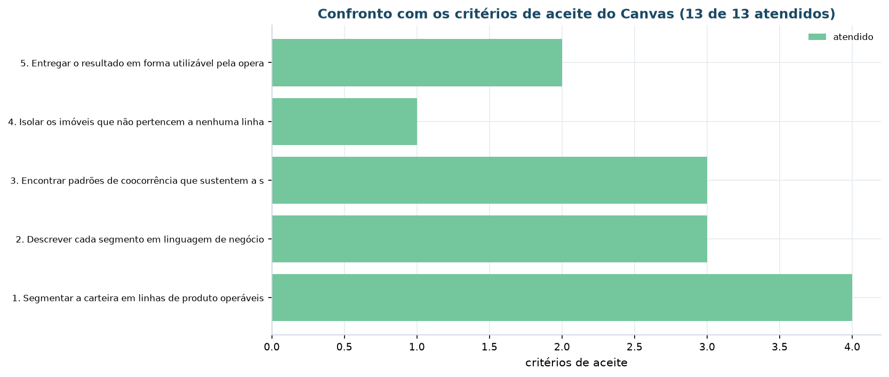
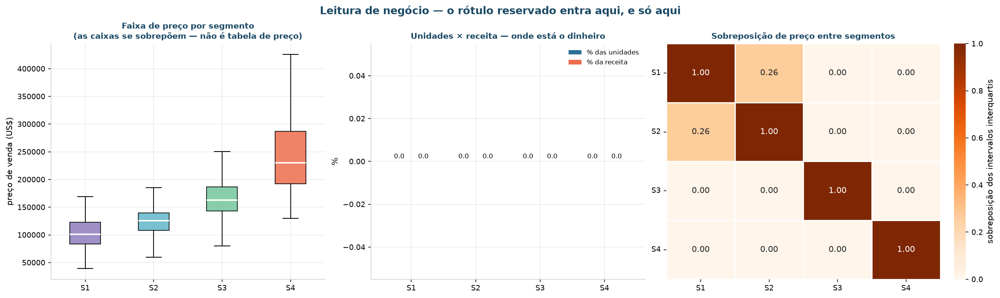
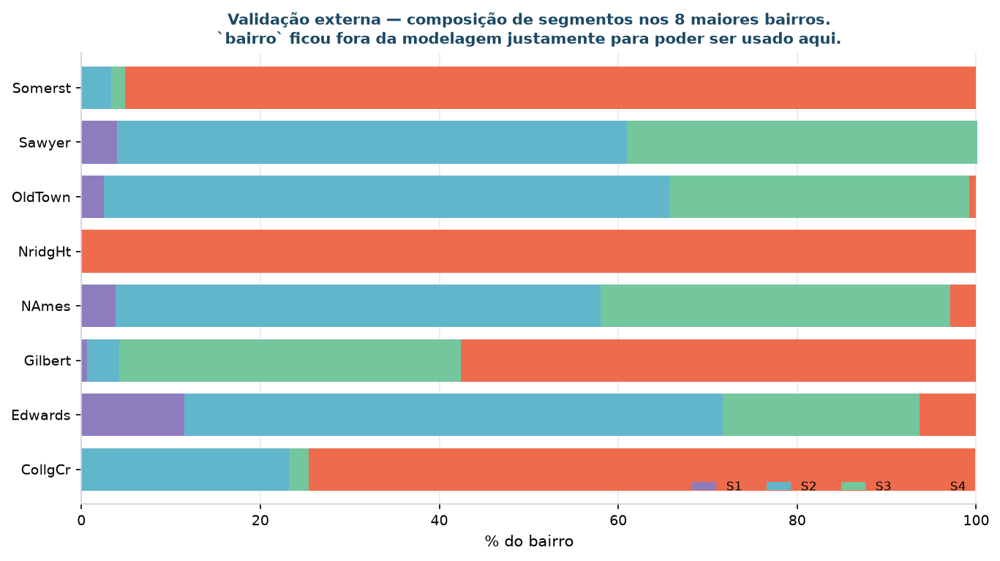
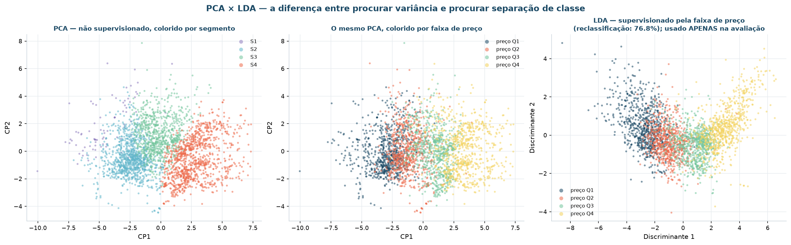

# Avaliação dos resultados

**CRISP-DM fase 5.** Enquanto a avaliação feita em [Modelagem](modelagem.md) é
**técnica**, esta página olha para o **projeto como um todo**: os resultados atendem
aos objetivos de negócio, o processo foi conduzido corretamente, e o que fazer em
seguida.

!!! danger "É aqui, e só aqui, que o rótulo reservado entra"
    `preco_venda` não alimentou nenhum algoritmo. Ele aparece nesta página para
    responder a duas perguntas de negócio — **quanto vale cada segmento** e **se a
    segmentação é apenas uma tabela de preço disfarçada** — depois que os segmentos já
    estavam definidos.

    O mesmo vale para o LDA: é técnica supervisionada, e usá-la antes de clusterizar
    seria contrabandear o rótulo para dentro do modelo.

## Confronto com os critérios de aceite



| Objetivo | Critério de aceite | Meta | Obtido | Situação |
|:---|:---|:---|---:|:-:|
| 1 | No máximo 5 segmentos | ≤ 5 | **4** | ✅ |
| 1 | Silhueta mínima aceitável | ≥ 0,15 | **0,1775** | ✅ |
| 1 | Estabilidade sob reamostragem de 80% | ARI ≥ 0,75 | **0,9433** | ✅ |
| 1 | Nenhum segmento abaixo de 2% da carteira | ≥ 2% | **2,7%** | ✅ |
| 2 | Persona, ação e métrica por segmento | 4 de 4 | **4 de 4** | ✅ |
| 2 | Imóvel real representante, com identificador | 4 medoides | **4 medoides** | ✅ |
| 2 | A segmentação não pode ser apenas faixa de preço | ARI < 0,40 | **0,3112** | ✅ |
| 3 | Regras com suporte ≥ 10%, confiança ≥ 70%, lift ≥ 1,30 | ≥ 10 regras | **25 publicadas** | ✅ |
| 3 | Ao menos um padrão diferencial por segmento | 4 cobertos | **4 cobertos** | ✅ |
| 3 | Apriori, Eclat e FP-Growth com os mesmos conjuntos | 3 de 3 | **3 de 3** | ✅ |
| 4 | Percentual de ruído dentro do teto | ≤ 10% | **1,81%** | ✅ |
| 5 | Modelo serializado e aplicação publicada | pipeline + app | **ambos** | ✅ |
| 5 | Plano de monitoramento com gatilho quantitativo | PSI com limiar | **6 indicadores** | ✅ |

**13 de 13 critérios atendidos.**

!!! note "O que isso não significa"
    Atender a todos os critérios diz que o projeto entregou **o que prometeu**, não que
    a segmentação seja a melhor possível. Os critérios foram definidos antes de olhar
    o resultado, o que é o ponto — mas eles refletem o que se sabia no Encontro 1. As
    [limitações declaradas](#limitacoes-e-hipoteses-derrubadas) são a outra metade da
    leitura honesta.

## Quanto vale cada segmento



| Código | Persona | Imóveis | Preço mediano | Preço por pé² | P10 – P90 | % da receita |
|:--|:--|--:|--:|--:|:--|--:|
| **S1** | Requalificação sem porão | 80 | US$ 100.900 | US$ 84 | 68 k – 149 k | 1,6% |
| **S2** | Compacto de entrada | 1.010 | US$ 125.950 | **US$ 116** | 85 k – 152 k | 23,3% |
| **S3** | Familiar consolidado | 794 | US$ 163.000 | US$ 107 | 128 k – 220 k | 25,5% |
| **S4** | Novo de alto padrão | 1.041 | US$ 230.000 | **US$ 137** | 174 k – 360 k | **49,5%** |

Três leituras que respondem diretamente às perguntas SMART:

1. **S4 concentra 49,5% da receita** com 35,6% das unidades — a resposta à pergunta 2.
   É onde está o dinheiro, e é justamente o segmento que **não precisa** de reforma.

2. **S2 tem preço por pé² maior que S3** (US$ 116 contra US$ 107), apesar de preço
   absoluto muito menor. Imóvel pequeno tem preço unitário maior, o que muda a conversa
   sobre margem por metro construído: o compacto de entrada não é um produto de margem
   ruim, é um produto de ticket baixo.

3. **S1 tem o menor preço por pé² da carteira** (US$ 84), 39% abaixo de S4. É a
   confirmação numérica de que o estoque sem porão é o de pior desempenho — e a
   justificativa para a decisão binária de renda ou desinvestimento.

## A segmentação é uma tabela de preço disfarçada?

Era o risco central do projeto, e a resposta é medida, não afirmada.

| Medida | Valor | Leitura |
|:---|---:|:---|
| ARI entre segmentos e quartis de preço | **0,3112** | 0 = independentes, 1 = idênticos |
| NMI entre segmentos e quartis de preço | 0,3603 | Informação compartilhada, normalizada |

### Sobreposição das faixas de preço

Sobreposição dos **intervalos interquartis** (os 50% centrais de cada segmento):

| | S1 | S2 | S3 | S4 |
|:---|---:|---:|---:|---:|
| **S1** | 1,000 | **0,262** | 0,000 | 0,000 |
| **S2** | **0,262** | 1,000 | 0,000 | 0,000 |
| **S3** | 0,000 | 0,000 | 1,000 | 0,000 |
| **S4** | 0,000 | 0,000 | 0,000 | 1,000 |

E sobreposição das faixas **P10–P90**, que é onde estão 80% dos imóveis de cada
segmento:

| Par | Faixas | Sobreposição |
|:---|:---|---:|
| S1 × S2 | 68 k – 149 k · 85 k – 152 k | 76% |
| S2 × S3 | 85 k – 152 k · 128 k – 220 k | 18% |
| S3 × S4 | 128 k – 220 k · 174 k – 360 k | 20% |

!!! abstract "Leitura honesta do resultado"
    O miolo de cada segmento **ocupa faixas de preço distintas** — os intervalos
    interquartis de S2, S3 e S4 não se tocam. Isso era esperado: imóvel melhor custa
    mais, e nenhuma segmentação de produto poderia ignorar isso.

    O que responde à pergunta é o **ARI de 0,3112**, que olha imóvel a imóvel e não
    faixa a faixa. Um quinto dos imóveis de S3 custa mais que a mediana de S4, e a
    faixa P10–P90 de S1 e S2 se sobrepõe em 76%. Se a segmentação fosse uma tabela de
    preço, o ARI estaria acima de 0,7 — como estaria se tivéssemos simplesmente
    cortado a carteira em quartis de `preco_venda`.

    A leitura correta é: **preço e segmento estão correlacionados, mas não são a mesma
    coisa.** S2 e S3 têm preços por pé² invertidos em relação ao preço absoluto, e S1
    se sobrepõe fortemente a S2 em preço, apesar de ser um produto completamente
    diferente. É essa diferença que justifica políticas distintas.

    Se o ARI tivesse ficado acima de 0,40, o critério de aceite falharia e o projeto
    teria de ser declarado pelo que seria: uma faixa de preço obtida por caminho caro.

## Validação externa: o bairro

`bairro` ficou fora da modelagem justamente para poder ser usado aqui.



| Bairro | S1 | S2 | S3 | S4 |
|:---|---:|---:|---:|---:|
| NridgHt | 0,0% | 0,0% | 0,0% | **100,0%** |
| Somerst | 0,0% | 3,3% | 1,6% | **95,1%** |
| CollgCr | 0,0% | 23,2% | 2,2% | **74,5%** |
| Gilbert | 0,6% | 3,6% | 38,2% | **57,6%** |
| OldTown | 2,5% | **63,2%** | 33,5% | 0,8% |
| Sawyer | 4,0% | **57,0%** | 39,1% | 0,0% |
| NAmes | 3,8% | **54,2%** | 39,1% | 2,9% |
| Edwards | **11,5%** | **60,2%** | 22,0% | 6,3% |

A composição varia **de 0% a 100%** entre bairros. Northridge Heights e Somerset são
loteamentos novos e concentram quase toda a oferta em S4; Old Town e Sawyer são áreas
consolidadas e concentram S2 e S3; Edwards é o único bairro em que S1 tem presença
relevante (11,5%).

Se os segmentos se distribuíssem uniformemente entre bairros, seria sinal de que
capturaram ruído. A variação confirma que capturaram estrutura real de mercado — e a
validação é legítima porque o bairro **não** foi visto pelo algoritmo.

## PCA × LDA



| Técnica | Supervisionada | O que procura | Uso no projeto | Métrica |
|:---|:-:|:---|:---|---:|
| **PCA** | não | direções de maior variância | visualização e diagnóstico de redundância | 46,8% da variância em 2 componentes |
| **LDA** | **sim** | direções que separam classes conhecidas | **somente** avaliação a posteriori, sobre a faixa de preço | 76,8% de reclassificação |

O LDA reclassifica corretamente 76,8% dos imóveis em quartis de preço a partir das 21
variáveis do espaço de atributos. É bastante — e é justamente por isso que o PCA foi
usado na modelagem e o LDA não: o espaço **carrega** informação de preço, e um método
que a persiga ativamente devolveria faixas de preço, que é o que a diretoria não pediu.

Os três painéis contam a história completa:

1. o PCA colorido por **segmento** mostra grupos separados;
2. o **mesmo** PCA colorido por **faixa de preço** mostra um gradiente contínuo, não
   grupos — preço varia suavemente no espaço, não em blocos;
3. o LDA, treinado para separar preço, produz uma projeção diferente da do PCA.

Três leituras diferentes do mesmo espaço, que é exatamente a diferença entre procurar
variância e procurar separação de classe.

## Revisão do processo

Retrospectiva da condução, independente do resultado.

### O que funcionou

- **Reservar `preco_venda` e `bairro` desde o início.** Sem essa decisão tomada
  *antes* da modelagem, não haveria régua externa nenhuma para avaliar o resultado no
  fim. As duas validações mais fortes do projeto — o ARI contra preço e a composição
  por bairro — só existem porque as colunas foram protegidas na fase 3.

- **Medir estabilidade em paralelo à silhueta.** Foi o único critério que derrubou
  k = 5, que as métricas de coesão recomendavam. Um projeto que só olhasse silhueta e
  Davies-Bouldin teria entregue cinco segmentos.

- **Gravar a tabela-fonte junto com cada figura.** Toda afirmação deste site é
  rastreável até um CSV, e nenhum número foi digitado à mão.

### O que atrasou

- **A leitura padrão do `pandas` converteu a categoria `None` em nulo.** `Mas Vnr Type`
  aparentava 60,6% de ausência, e o diagnóstico consumiu uma iteração inteira da 5ª
  fase da EDA. A lição: inventariar as sentinelas **literais** do arquivo antes de
  confiar no perfil de nulos.

- **A primeira rodada de regras usou suporte de 5% e conjuntos de até 4 itens**, e
  produziu 6.274 regras — volume que nenhuma área comercial lê. Foi preciso voltar e
  calibrar o limiar com evidência, o que virou a tabela de sensibilidade.

### O que foi esquecido

- **A poda por lift e por redundância não remove tautologia semântica.** A regra
  `tem 2º pavimento → estilo:2Story` passou pelos três filtros com lift 3,03. Só o
  conhecimento do domínio a derrubou, e isso teve de ser acrescentado depois, em uma
  quarta etapa de poda.

- **A silhueta do K-Medoids sobre Gower foi comparada à do K-Means na primeira versão
  da matriz**, como se fossem a mesma escala. São espaços métricos diferentes. A tabela
  hoje marca isso explicitamente, mas o erro esteve lá.

??? note "Perguntas que guiaram esta revisão"
    - Alguma conclusão está apoiada em dado que não foi conferido? *Não: cada figura
      tem CSV, e as conferências de carga estão em `docs/preparacao.md`.*
    - As decisões metodológicas ficaram registradas, ou só existem na cabeça de quem
      executou? *Registradas em `REGRAS_LIMPEZA`, na coleção de insights e nas notas
      deste site.*
    - Alguém que não participou consegue reproduzir a partir do repositório? *Sim:
      `uv sync && uv run invoke pipeline`. Os sete notebooks são executados por
      `uv run invoke notebooks`, que falha se algum quebrar.*
    - O tratamento de dados pessoais foi adequado? *Não há dado pessoal: `PID` é a
      matrícula do imóvel.*

## Limitações e hipóteses derrubadas

### Hipóteses derrubadas

!!! failure "«Cinco segmentos dariam a leitura mais rica, já que o orçamento comporta cinco ações.»"
    **Derrubada pela estabilidade.** Em k = 5 o ARI médio sob reamostragem cai para
    **0,44** — a quinta linha de produto não se reproduz. Ela existe nesta amostra, não
    no mercado.

!!! failure "«A dissimilaridade de Gower, por tratar dados mistos, daria a melhor segmentação.»"
    **Derrubada pela leitura do resultado.** Com peso igual por variável, `estilo`
    domina e a partição vira 1 pavimento × 2 pavimentos — fato construtivo, não linha
    de produto. A silhueta era maior (0,20 contra 0,18), mas medida em outro espaço
    métrico e, portanto, não comparável.

!!! failure "«O DBSCAN encontraria grupos de densidade que o K-Means não vê.»"
    **Derrubada.** Em 21 dimensões padronizadas não há vale de densidade, e o algoritmo
    devolve um grupo com 92% da carteira em toda a faixa de `eps`. O que ele entrega de
    útil é o **ruído**, não a partição — e o ruído virou a entrega do objetivo 4.

As três estão registradas com a evidência que as derrubou. Hipótese derrubada não é
apagada: é parte do resultado.

### Caminho abandonado

O espaço euclidiano com *one-hot* das nominais foi construído e descartado: produz
partição praticamente idêntica (ARI 0,98) com silhueta menor. As 28 colunas binárias
acrescentam ruído, não informação.

### Limitações declaradas

| Limitação | Natureza | Impacto |
|:---|:---|:---|
| **Não há tempo de permanência em estoque** | dado indisponível | As metas de giro das personas S2 e S4 são propostas de meta, não medições. Precisam de instrumentação antes de virar indicador. |
| **Não há custo de reforma** | dado indisponível | O retorno da reforma por segmento é estimado a partir do diferencial de preço, não medido. |
| **A base descreve o produto, não o comprador** | limitação estrutural | Nenhuma ação de segmentação de **demanda** pode ser derivada daqui. É a limitação mais importante do projeto. |
| **Período 2006–2010** | restrição do dado | Inclui a crise imobiliária americana. A estrutura de segmentos é estável no período, mas os patamares de preço não devem ser lidos como preço corrente. |
| **S1 tem 80 imóveis (2,7%)** | tamanho amostral | É o segmento mais coeso da carteira (silhueta 0,376) e o mais frágil: qualquer mudança de composição o desestabiliza. |
| **Mercado único** | escopo | Ames, Iowa, ~60 mil habitantes. A estrutura não se transfere para outro mercado sem reciclagem. |

## Próximas etapas

!!! info "Decisão formal"
    - [x] **Implantar** — seguir para [Implementação](implementacao.md)
    - [ ] Iterar
    - [ ] Encerrar

    **Justificativa.** Os 13 critérios de aceite foram atendidos, a segmentação é
    estável sob reamostragem e reprodutível pelo artefato serializado, e as quatro
    personas têm ação e métrica definidas. As limitações declaradas afetam a **medição
    do efeito** das ações, não a validade da segmentação.

| Ação | Responsável | Prazo | Decisão |
|:---|:---|:---|:---|
| Implantar a segmentação como classificação padrão da carteira | Diretoria Comercial | 30 dias | implantar |
| Publicar a aplicação de consulta para os 12 corretores | Área de Dados | 15 dias | implantar |
| Avaliar individualmente os 53 imóveis fora de padrão | Gerência de Ativos | 90 dias | implantar |
| Reciclar o agrupamento com os dados do próximo exercício e comparar por ARI | Área de Dados | 12 meses | iterar |
| Buscar dado de tempo de permanência em estoque | Área de Dados + TI | 6 meses | iterar |
| Reavaliar o segmento S1 quando a carteira dobrar de tamanho | Área de Dados | 18 meses | iterar |

## Reprodução

```bash
uv run invoke avaliacao
```

As tabelas desta página estão em `reports/tables/avaliacao/`.
