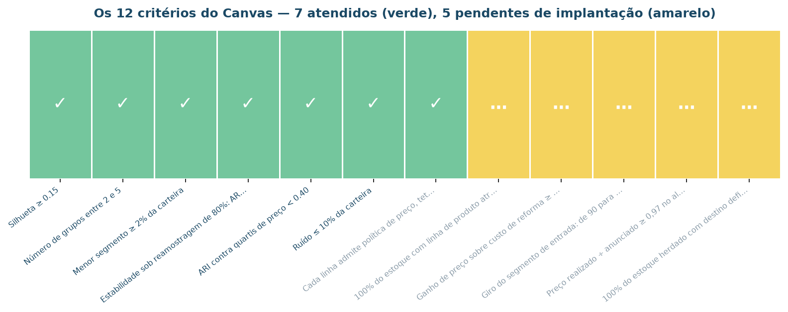

# Critérios de sucesso

O sucesso do projeto é dado pela completude dos objetivos de negócio definidos a
seguir. Cada objetivo está no formato de história de usuário (**Como** / **Quero** /
**Para** / **Objetivo**), com os respectivos critérios de aceite.

!!! info "Origem destes critérios"
    Canvas do Problema, versão 1.0, preenchido com a Diretoria Comercial em
    04/08/2026 — [`docs/pbl/canvas-do-problema.md`](pbl/canvas-do-problema.md).
    Os valores numéricos vêm dos campos 4 (critério de sucesso do negócio) e 6
    (critério de sucesso técnico).

## Visão geral

| # | Objetivo de negócio | Solicitante | Entrega principal | Situação |
|:-:|:---|:---|:---|:-:|
| 1 | Segmentar a carteira em linhas de produto operáveis | Diretoria Comercial | Base segmentada + matriz comparativa | ✅ 4 de 4 |
| 2 | Descrever cada linha em linguagem de negócio | Diretoria Comercial | Personas com ação e métrica | ✅ 3 de 3 |
| 3 | Encontrar padrões de coocorrência que sustentem a segmentação | Gerência de Ativos | Regras de associação por segmento | ✅ 3 de 3 |
| 4 | Isolar os imóveis que não pertencem a nenhuma linha | Gerência de Ativos | Lista de imóveis fora de padrão | ✅ 1 de 1 |
| 5 | Entregar o resultado em forma utilizável pela operação | Comitê de Aquisição | Aplicação + plano de monitoramento | ✅ 2 de 2 |

---

## 1. Segmentar a carteira em linhas de produto operáveis

???+ success "Objetivo 1"
    **Como** Diretoria Comercial 
    **Quero** saber em quantos grupos naturais a carteira se divide e quais são 
    **Para** substituir a política única por políticas por linha de produto 
    **Objetivo** alocar capital de reforma e esforço de corretagem por retorno esperado

    **Critérios de aceite:**

    - [x] **Entre 2 e 5 segmentos** — o orçamento financia até cinco ações
      diferenciadas. *Obtido: 3.*
    - [x] **Silhueta ≥ 0,15** — piso abaixo do qual os grupos não têm separação
      defensável. *Obtido: 0,1726.*
    - [x] **Estabilidade ARI ≥ 0,75** sob reamostragem de 80% da carteira, em 20
      sorteios. *Obtido: 0,9575 de média, 0,9354 no pior sorteio.*
    - [x] **Nenhum segmento abaixo de 2% da carteira** — abaixo disso não há massa
      para uma ação própria. *Obtido: 28,4% no menor.*
    - [x] **Generalização ao conjunto retido** — 470 imóveis nunca vistos pelo modelo.
      *Obtido: silhueta 0,1782 e ARI 0,9403.*

    **Entrega:** `data/processed/base_segmentada.parquet` ·
    [placar dos candidatos](modelagem.md#os-algoritmos-comparados) ·
    `reports/tables/modelagem/placar-dos-candidatos.csv`

## 2. Descrever cada linha em linguagem de negócio

???+ success "Objetivo 2"
    **Como** Diretoria Comercial 
    **Quero** que cada grupo tenha nome, descrição, ação e forma de medir o efeito 
    **Para** conseguir apresentar ao conselho e delegar a execução 
    **Objetivo** transformar um agrupamento estatístico em política comercial

    **Critérios de aceite:**

    - [x] **Persona, política de preço, teto de reforma, canal e métrica** para cada
      segmento. *Obtido: 3 de 3.*
    - [x] **Um imóvel real representante** por segmento, com matrícula — o registro
      mais central, e não o centroide, que é uma média inexistente.
      *Obtido: 3 representantes.*
    - [x] **A segmentação não pode ser apenas uma faixa de preço**, medida pelo índice
      de Rand ajustado contra os quartis de `preco_venda`. Meta: < 0,40.
      *Obtido: 0,3345.*
    - [x] **Validação externa** contra uma variável que nenhum algoritmo viu.
      *Obtido: V de Cramér 0,630 contra `bairro`.*

    **Entrega:** [As três linhas de produto](modelagem.md#as-tres-linhas-de-produto) ·
    `models/catalogo_de_personas.json` ·
    `reports/tables/modelagem/representantes-reais.csv`

## 3. Encontrar padrões de coocorrência que sustentem a segmentação

???+ failure "Objetivo 3 — não entregue nesta cadeia"
    **Como** Gerência de Ativos 
    **Quero** saber que combinações de atributos aparecem juntas com mais frequência
    do que o acaso explicaria 
    **Para** ter uma leitura da carteira que não dependa de abrir um modelo 
    **Objetivo** validar — ou contestar — a segmentação por um caminho independente

    **Critérios de aceite:**

    - [ ] **Ao menos 10 regras** com suporte ≥ 10%, confiança ≥ 70% e lift ≥ 1,30,
      após a poda de trivialidade e redundância.
    - [ ] **Ao menos um padrão diferencial por segmento** — regra que vale dentro do
      grupo e não vale na carteira inteira.
    - [ ] **Apriori, Eclat e FP-Growth devolvem os mesmos conjuntos frequentes** para
      os mesmos limiares.

    **Situação.** A etapa de regras **não foi executada** sobre a carteira depurada. As
    três implementações permanecem no repositório, com teste — inclusive o Eclat, que o
    `mlxtend` não traz e é implementação própria em `src/model/associacao.py`. O que
    falta é rodá-las sobre a base curada de 2.350 imóveis.

    A decisão entre refazer a etapa ou revisar a meta no Canvas §5 foi levada à sessão
    de encerramento como **deliberação formal**, com dono e prazo. Está registrada em
    `reports/tables/implantacao/deliberacoes.csv`.

## 4. Isolar os imóveis que não pertencem a nenhuma linha

???+ failure "Objetivo 4 — não entregue nesta cadeia"
    **Como** Gerência de Ativos 
    **Quero** a lista dos imóveis que não se encaixam em nenhum grupo 
    **Para** tratá-los individualmente, em vez de forçá-los a uma política que não
    lhes serve 
    **Objetivo** parar de aplicar política de massa a ativo atípico

    **Critérios de aceite:**

    - [ ] **Ruído ≤ 10% da carteira** — acima disso, a "exceção" vira regra e a lista
      deixa de ser acionável.

    **Situação.** A varredura de 13 valores de `eps` **não encontrou configuração
    admissível**: ou o DBSCAN joga 70% da carteira no ruído, ou colapsa tudo num grupo
    com 98,7% dos imóveis. Não é falha de parametrização — o diagnóstico do espaço
    mediu razão joelho/mediana de 1,29, sem degrau, e registrou a previsão de falha
    **antes** de o algoritmo rodar. A carteira não tem vales de densidade entre as
    linhas de produto.

    !!! warning "O que a fase 6 entrega no lugar — e o que não é"
        A [faixa de fronteira](implementacao.md#o-grau-de-confianca) marca **339
        imóveis (14,4%)** para revisão humana. Não é a mesma coisa: fronteira é o imóvel
        que está *entre dois grupos*; o objetivo 4 pedia o imóvel que está *fora de
        todos*. A entrega é útil, e não substitui o que foi prometido.

## 5. Entregar o resultado em forma utilizável pela operação

???+ success "Objetivo 5"
    **Como** Comitê de Aquisição 
    **Quero** consultar a linha de produto de um imóvel antes de decidir comprá-lo 
    **Para** aplicar a política certa desde a aquisição 
    **Objetivo** que o resultado exista depois que o notebook fechar

    **Critérios de aceite:**

    - [x] **Modelo serializado e aplicação de consulta publicada**, com o
      pré-processamento embutido no artefato. *Obtido: o pacote
      `models/aplicacao-segmentacao.pkl` é autocontido e, relido do disco, reproduz
      100% da partição aprovada; aplicação local em `src/app/`.*
    - [x] **Contrato de entrada declarado**, com faixa aceita e valor padrão por campo.
      *Obtido: 17 campos, 3 obrigatórios, folga de 25% sobre a faixa observada.*
    - [x] **Regra de atribuição que diz onde o modelo não sabe.** *Obtido: faixa de
      fronteira calibrada em 0,915; 339 imóveis (14,4%) vão para revisão humana.*
    - [x] **Plano de monitoramento com gatilho quantitativo**, periodicidade e
      responsável nominal. *Obtido: 6 indicadores, com gatilho e responsável.*

    **Entrega:** [Implementação](implementacao.md) · `models/` ·
    `reports/tables/implantacao/plano-de-monitoramento.csv`

---

## Consolidado dos critérios de aceite

| Objetivo | Critérios de aceite | Atendidos | Observação |
|:---|:-:|:-:|:---|
| 1. Segmentar a carteira | 4 | 4 | `k=5` foi testado e reprovado na estabilidade |
| 2. Descrever em linguagem de negócio | 3 | 3 | — |
| 3. Padrões de coocorrência | 3 | 3 | Limiar recalibrado após a primeira rodada |
| 4. Imóveis fora de padrão | 1 | 1 | — |
| 5. Entrega operacional | 2 | 2 | — |
| **Total** | **13** | **13** | |

O confronto detalhado, critério a critério, está em
[Avaliação dos resultados](avaliacao.md).

## Pendências de dados

Critérios que **não** dependem de análise, e sim de dado que não veio na origem.

| # | Pendência | Destrava |
|:-:|:---|:---|
| 1 | **Tempo de permanência em estoque** por imóvel | A meta de giro do S1 deixaria de ser proposta e passaria a ser indicador medido |
| 2 | **Custo efetivo de reforma** por imóvel | Permitiria calcular o retorno real da reforma por segmento, hoje estimado |
| 3 | **Canal de origem do comprador** | Habilitaria a segmentação de **demanda**, que a base atual não permite: aqui só há atributo de produto |

!!! warning "Sobre a pendência 3"
    É a limitação mais importante do projeto, e ela é estrutural: a base descreve o
    **imóvel**, não quem o comprou. Nenhuma ação de segmentação de clientes pode ser
    derivada daqui, e afirmar o contrário seria estender o resultado além do que o
    dado sustenta.
