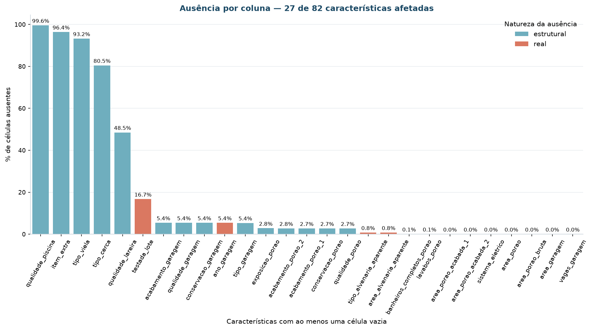
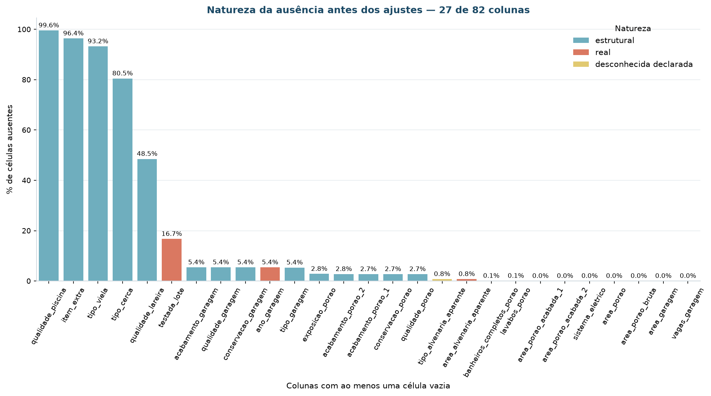

# Entendimento dos dados

Esta página responde a três perguntas sobre o conjunto: **o que existe**, **em que
qualidade** e **o que isso impede ou permite** dentro dos objetivos do projeto.

## Dados iniciais

Os dados vêm da carga única descrita em [Fonte de dados](fonte-dados.md). A apuração
desta página está no notebook
[`01-entendimento-e-descricao-dos-dados`](https://github.com/aislansf/projeto-exemplo-mercado-imobiliario/blob/main/notebooks/01-entendimento-e-descricao-dos-dados.ipynb)
e no módulo `src/data/qualidade.py`. As tabelas citadas estão em
`reports/tables/eda/`.

## Descrição dos dados

### Grão

Cada linha é **uma transação de um imóvel residencial** (`pid`).

| Conferência | Resultado |
|:---|---:|
| Linhas | 2.930 |
| Valores distintos de `PID` | 2.930 |
| Linhas duplicadas completas | 0 |
| A chave é única | **sim** |

A tabela é **achatada**: traz embutidas as dimensões de terreno, construção, garagem,
áreas externas e transação. Não há normalização a desfazer, o que elimina de saída o
erro mais comum de análise — somar coisas em grãos diferentes.

### Grupos de colunas

| Dimensão de negócio | Exemplos de colunas |
|:---|:---|
| Porte e configuração | `area_habitavel`, `area_porao`, `comodos`, `dormitorios`, `banheiros_total` |
| Padrão construtivo | `qualidade_geral`, `qualidade_externa`, `qualidade_cozinha`, `qualidade_porao` |
| Idade e conservação | `ano_construcao`, `ano_reforma`, `conservacao_geral` |
| Terreno | `area_terreno`, `testada_lote`, `formato_lote`, `zoneamento` |
| Garagem e áreas externas | `tipo_garagem`, `area_garagem`, `area_varandas`, `area_deck` |
| Localização | `bairro` — **reservada para validação externa** |
| Transação | `mes_venda`, `ano_venda`, `tipo_venda`, `condicao_venda` |
| Métrica | `preco_venda` — **rótulo reservado** |

### Cobertura frente aos critérios de sucesso

| Requisito vindo dos critérios | Situação |
|:---|:---|
| Atributos de **porte** para separar linhas de produto | **atendida** — 5 medidas de área e 4 de contagem |
| Atributos de **padrão construtivo** | **atendida** — 10 escalas ordinais de qualidade |
| Atributos de **idade e conservação** | **atendida** — ano de construção, de reforma e escala de conservação |
| Base para regras de associação **sem discretizar tudo** | **atendida** — 23 colunas nominais nativas |
| **Tempo de permanência em estoque** | **inviável** — não existe na origem; ver [pendências](criterios-sucesso.md#pendencias-de-dados) |
| **Custo de reforma** por imóvel | **inviável** — não existe na origem |
| Atributos de **quem comprou** | **inviável** — a base descreve o produto, não a demanda |

## Qualidade dos dados

### Valores sentinela

Muitos sistemas de origem não gravam nulo: a ausência de informação vira uma categoria
de texto ou um código. Sem tratamento, essas sentinelas aparecem nas distribuições
como se fossem valores reais — ou, pior, informação real desaparece como se fosse
ausência.

| Sentinela | Onde | Significado na origem |
|:---|:---|:---|
| `NA` | 14 colunas de porão, garagem, lareira, piscina, cerca e viela | **o item não existe no imóvel** |
| `None` | `Mas Vnr Type` (1.752 registros) | **categoria legítima** — sem revestimento em alvenaria aparente |
| *(vazio)* | `Mas Vnr Area`, `Mas Vnr Type` (23 registros) | ausência de fato |

!!! danger "O achado que muda a leitura da base"
    A leitura padrão do `pandas` converte **as duas primeiras** em nulo. O efeito
    sobre `Mas Vnr Type` é grosseiro: 1.752 imóveis **descritos** — aqueles sem
    revestimento em alvenaria aparente — passam a contar como imóveis
    **desconhecidos**, e a coluna aparenta **60,6% de ausência** quando a ausência
    real é de **0,8%** (23 registros).

    A correção é declarar as sentinelas na leitura:

    ```python
    pd.read_csv(caminho, sep="\t", keep_default_na=False, na_values=["NA", ""])
    ```

    Está implementada em `src.data.ingestao._ler_origem`, e a evidência que a
    justifica é a contagem literal de cada sentinela, coluna a coluna, em
    `reports/tables/eda/f5-inventario-sentinelas.csv`.

Depois do tratamento, as colunas de ausência estrutural recebem **rótulo próprio**
(`SemPorao`, `SemGaragem`, `SemLareira`) e as escalas ordinais recebem **0**, que na
escala significa "não tem". Imputar pela mediana criaria porões que nunca existiram.

### Mapa da ausência



| Coluna | Ausentes | % | Natureza |
|:---|---:|---:|:---|
| `Pool QC` | 2.917 | 99,6% | estrutural — sem piscina |
| `Misc Feature` | 2.824 | 96,4% | estrutural — sem item extra |
| `Alley` | 2.732 | 93,2% | estrutural — sem acesso por viela |
| `Fence` | 2.358 | 80,5% | estrutural — sem cerca |
| `Fireplace Qu` | 1.422 | 48,5% | estrutural — sem lareira |
| `Lot Frontage` | 490 | 16,7% | **faltante de fato** |
| `Garage *` (5 colunas) | 157–159 | 5,4% | estrutural — sem garagem |
| `Bsmt *` (5 colunas) | 79–83 | 2,8% | estrutural — sem porão |
| `Mas Vnr Type` / `Mas Vnr Area` | 23 | 0,8% | **faltante de fato** |
| `Electrical` | 1 | 0,03% | **faltante de fato** |

### A ausência é blocada, não aleatória



As cinco colunas de garagem faltam nos **mesmos** 157 a 159 imóveis; as cinco de porão,
nos mesmos 79 a 83. Quando duas colunas faltam sempre juntas, a ausência não é
aleatória: é a marca de um item que não existe. É essa figura que sustenta a decisão
de tratar `NA` como rótulo, e não como valor a imputar.

`Lot Frontage` é a única ausência numérica relevante que **não** é estrutural. Ela se
concentra em lotes de esquina e de fundo, onde a testada não é registrada da mesma
forma — ausência do tipo **MAR**, explicada pela geometria do lote. Por isso a
imputação usa a mediana do bairro, e não a mediana global: a global achataria a
variação entre bairros, que é exatamente a informação útil da coluna.

### Achados que mudam a análise

1. **A categoria `None` virava nulo.** Sem declarar `na_values`, `Mas Vnr Type`
   aparentava 60,6% de ausência contra 0,8% reais.
   → *Consequência:* a leitura da origem passou a declarar as sentinelas
   explicitamente, e a coluna deixou de ser candidata a descarte.

2. **Um imóvel tem garagem construída no ano 2207.** Erro de digitação evidente: o
   imóvel foi vendido em 2007 e construído em 2006.
   → *Consequência:* sem a correção, a idade da garagem fica negativa em 200 anos e
   domina qualquer padronização. Corrigido em `_corrigir_inconsistencias`.

3. **Três colunas são praticamente constantes.** `Street` (99,6% `Pave`), `Utilities`
   (99,9% `AllPub`) e `Pool Area` (99,6% zeros).
   → *Consequência:* variância desprezível não separa grupo nenhum e ainda gera
   divisão por zero na padronização. Nenhuma entra no espaço de atributos.

4. **Cinco imóveis acima de 4.000 pés² são vendas parciais atípicas.** O próprio autor
   da base recomenda removê-los (De Cock, 2011, §4).
   → *Consequência:* removidos na preparação. É a diferença entre uma decisão
   citável e um corte de conveniência.

5. **A área do terreno tem assimetria de 13,20.** Cauda longa legítima — são lotes
   grandes de verdade, não erro de digitação.
   → *Consequência:* discrepante legítimo não se remove. Remover o lote grande
   apagaria justamente o segmento de alto padrão que a diretoria quer enxergar. A
   resposta é `log1p`, não exclusão.

6. **17,7% das vendas não são "normais"** — são parciais, familiares, execuções ou
   realocações.
   → *Consequência:* mantidas. A condição da venda descreve a **transação**, não o
   **produto**: para segmentar o imóvel, uma venda entre familiares continua sendo um
   imóvel válido. A coluna fica reservada para análise de sensibilidade.

7. **`bairro` explica 56% da variância da qualidade geral e 78% da idade do imóvel**
   (razão de correlação η²) — de longe a nominal com maior poder explicativo.
   → *Consequência:* confirma que o bairro carrega informação de produto e, por
   tabela, de preço. Reforça a decisão de mantê-lo **fora** da modelagem e usá-lo como
   régua de validação externa. Incluí-lo faria o algoritmo redescobrir a localização
   por caminho indireto.

A coleção completa, com as 21 entradas e a consequência de cada uma, está em
[Análise exploratória](analise-exploratoria.md#colecao-de-insights).

## Dimensões-chave

### As escalas ordinais

Vinte colunas da base são **ordinais disfarçadas de texto**. `Ex > Gd > TA > Fa > Po`
tem ordem semântica: excelente, bom, típico, regular, ruim. Tratá-las como nominais e
aplicar *one-hot* destruiria a ordem e multiplicaria a dimensionalidade sem ganho.

| Valor | Descrição | Regra de derivação |
|:---|:---|:---|
| `Ex` | Excelente | → 5 |
| `Gd` | Bom | → 4 |
| `TA` | Típico / médio | → 3 |
| `Fa` | Regular | → 2 |
| `Po` | Ruim | → 1 |
| `NA` | O item não existe | → **0** |

O zero não é "pior que ruim": é uma categoria à parte, "não tem". Em `qualidade_porao`,
por exemplo, o 0 identifica exatamente os 80 imóveis que vão formar o segmento S1.

Escalas com outras ordens — `Bsmt Exposure`, `BsmtFin Type`, `Garage Finish`,
`Functional`, `Lot Shape`, `Land Slope`, `Paved Drive`, `Utilities`, `Fence` — estão
declaradas em `src/data/dicionario.py`, cada uma com a sua própria tabela.

### O rótulo reservado

`preco_venda` está na base e **não entra em nenhuma etapa de modelagem**. Ele reaparece
uma única vez, em `perfilagem.leitura_a_posteriori`, para responder a duas perguntas de
negócio depois que os segmentos já estão definidos:

- quanto vale cada segmento (participação em receita);
- se a segmentação é apenas uma faixa de preço disfarçada — medido por índice de Rand
  ajustado contra os quartis de preço.

| | Valor |
|:---|---:|
| Mediana | US$ 160.000 |
| Média | US$ 180.796 |
| Mínimo | US$ 12.789 |
| Máximo | US$ 755.000 |
| Assimetria | 1,74 |

## Limitações

| Limitação | Objetivo afetado | Consequência declarada |
|:---|:---|:---|
| **Não há tempo de permanência em estoque** | 1, 2 | As metas de giro das personas são propostas de meta, não medições. Precisam de instrumentação antes de virar indicador. |
| **Não há custo de reforma** | 2 | O retorno da reforma por segmento é estimado a partir do diferencial de preço, não medido. |
| **Não há atributo do comprador** | 2 | A segmentação descreve o **produto**. Nenhuma ação de segmentação de demanda pode ser derivada daqui. |
| **Período 2006–2010** | 5 | Inclui a crise imobiliária americana. A estrutura de segmentos é estável no período, mas os patamares de preço não devem ser lidos como preço corrente. |
| **Mercado único** | todos | Ames, Iowa, ~60 mil habitantes. A estrutura encontrada não se transfere automaticamente para outro mercado sem reciclagem. |

As três primeiras estão registradas também como
[pendências de dados](criterios-sucesso.md#pendencias-de-dados), para que a conversa
com a área provedora tenha uma lista objetiva.
