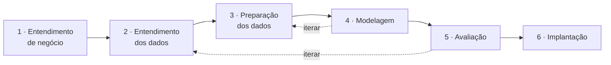

# Entendimento de negócio

**CRISP-DM fase 1.** Compreender os objetivos e requisitos do projeto sob a
perspectiva do negócio — antes de olhar uma linha de dado.

## A situação-problema

!!! quote "Memorando interno — Diretoria Comercial"
    Administramos hoje quase três mil imóveis residenciais e tratamos todos da mesma
    forma: mesma régua de preço, mesmo teto de reforma, mesmo anúncio.

    Sabemos que isso está errado, mas não sabemos **em quantas partes** a carteira se
    divide, nem **o que caracteriza** cada parte. Não temos essa classificação em
    lugar nenhum — nunca marcamos qual imóvel é de entrada e qual é de alto padrão.

    Precisamos saber como esses imóveis se organizam naturalmente e o que fazer de
    diferente com cada grupo. Uma restrição: **conseguimos financiar uma ação
    diferenciada por grupo, e no máximo cinco grupos.** Se vocês entregarem quinze
    segmentos, não agiremos sobre nenhum.

    Apresentem ao conselho em linguagem de negócio. Queremos entender **por que**
    confiar no que vocês encontraram.

### Por que este é um problema não supervisionado

Não existe variável-alvo. A classificação que se busca é exatamente o que **não**
existe na base. Isso muda três coisas de forma prática:

1. **Não há acurácia atrás da qual se esconder.** A defesa do resultado é a
   combinação de métricas internas, critérios de negócio declarados antes do resultado
   e leitura de negócio.
2. **O rótulo que existe precisa ser reservado.** `preco_venda` está na base, e usá-lo
   na modelagem descaracterizaria o problema — devolveria uma faixa de preço, não uma
   linha de produto.
3. **O monitoramento é diferente.** Sem gabarito não há erro de previsão para
   acompanhar; o que se monitora é o desvio de distribuição da entrada e a perda de
   coesão dos grupos. Ver [Implementação](implementacao.md).

## Marcos do projeto

???+ abstract "Fase 1: Preparação do ambiente"
    - [x] Criar repositório a partir do `project-template`
    - [x] Instalar ferramentas do projeto (`uv sync`)
    - [x] Fixar semente aleatória e versionar o `uv.lock`

???+ abstract "Fase 2: Entendimento de negócio"
    - [x] Preencher o Canvas do Problema ([docs/pbl/canvas-do-problema.md](pbl/canvas-do-problema.md))
    - [x] Definir critérios de sucesso de negócio e técnicos
    - [x] Formular as perguntas orientadas a dados (SMART)

???+ abstract "Fase 3: Entendimento dos dados"
    - [x] Materializar a camada bruta com manifesto de carga
    - [x] Gerar o dicionário de dados e as escalas ordinais (notebook 00)
    - [x] Executar as oito etapas da análise exploratória (notebook 01)
    - [x] Registrar os insights da exploração (12 registros)

???+ abstract "Fase 4: Preparação dos dados"
    - [x] Aplicar os ajustes de dados, com motivo registrado (notebook 02)
    - [x] Derivar os atributos consolidados
    - [x] Normalizar e codificar a base para os algoritmos (notebook 03)
    - [x] Alinhar as escalas ordinais do 00 aos rótulos da ingestão — ver [lacunas](avaliacao.md#lacunas-e-erros-identificados)

???+ abstract "Fase 5: Modelagem"
    - [x] Varrer onze algoritmos de agrupamento na mesma régua (notebook 04-0)
    - [x] Traçar o cotovelo e a silhueta de cada algoritmo (notebook 04-1)
    - [x] Reduzir dimensionalidade com PCA e UMAP (notebook 04-2)
    - [x] Minerar regras com Apriori, Eclat e FP-Growth (notebook 04-3)
    - [x] Perfilar os segmentos em unidades de negócio
    - [ ] Nomear personas e ações para os três segmentos

???+ abstract "Fase 6: Avaliação"
    - [x] Confrontar os critérios de sucesso (5 de 6 atendidos; todos os críticos)
    - [x] Estimar o impacto financeiro em três cenários
    - [x] Registrar lacunas, descobertas e limitações
    - [x] Decidir formalmente: **implantar**, com a ressalva da silhueta

???+ abstract "Fase 7: Implementação"
    - [x] Classificar imóveis novos com o modelo vencedor (notebook 06)
    - [x] Publicar a aplicação de consulta sobre os artefatos dos notebooks
    - [ ] Medir a linha de base do monitoramento
    - [ ] Entrar em produção — aguarda persona e ação por segmento e a linha de base

## 1.1 · Determinar os objetivos de negócio

### O que a organização quer realizar

Substituir a política única por **políticas por linha de produto**, de modo que o
capital de reforma vá para onde tem retorno e o esforço de corretagem vá para onde tem
margem. A segmentação é o meio; a decisão de alocação é o fim.

### Critérios de sucesso do negócio

| Critério | Métrica | Meta |
|:---|:---|:---|
| A carteira passa a ser tratada por linha de produto | % do estoque com linha atribuída | 100% em 30 dias |
| O capital de reforma é alocado por retorno esperado | ganho de preço sobre custo de reforma, por linha | ≥ 1,8× no segmento de maior retorno |
| O estoque de entrada gira mais rápido | tempo médio de giro do segmento de entrada | de 90 para 60 dias |
| O estoque de alto padrão não é vendido com desconto | preço realizado ÷ preço anunciado | ≥ 0,97 |
| O estoque herdado deixa de ser inerte | % do segmento com destino definido | 100% em 12 meses |

## 1.2 · Avaliar a situação

### Recursos

#### Equipe técnica

| Nome | Cargo / Função | E-mail |
|:---|:---|:---|
| Aislan Freitas | Cientista de dados — responsável pelo ciclo completo | aislansf@gmail.com |

Em um projeto real esta tabela teria analista de negócios, engenheiro de dados e
cientista de dados. Aqui o projeto é de demonstração, e a concentração em uma pessoa
é declarada como o que é: uma limitação de processo, não uma virtude.

#### Especialistas de negócio

| Papel | Contribuição esperada | Contato |
|:---|:---|:---|
| Diretoria Comercial | Define o teto de cinco linhas e valida as ações | comercial@meridiano.exemplo |
| Gerência de Ativos | Traduz o perfil técnico em viabilidade operacional | ativos@meridiano.exemplo |
| Comitê de Aquisição | Consome a classificação na decisão de compra | aquisicao@meridiano.exemplo |

#### Infraestrutura

Nenhuma além de um notebook. É uma característica do problema, não um atalho: 2.930
registros e 82 colunas cabem em memória com folga, e a matriz de distâncias entre todos
os pares de imóveis — o artefato mais pesado do projeto, usado pela silhueta e pelo
k-medoids — é a única estrutura de custo quadrático. Um projeto que precisasse de
cluster para 2.927 linhas teria um problema de engenharia, não de dados.

#### Recursos financeiros

O orçamento da diretoria comporta **cinco ações diferenciadas**. Essa é a única
restrição financeira que entra no projeto, e ela é técnica na prática: define o teto
de *k*.

### Requisitos do projeto

#### Necessidades de negócio

- Uma classificação **estável**: se a linha de produto de um imóvel mudar a cada
  reexecução, nenhuma política se sustenta.
- Uma classificação **explicável**: o corretor precisa entender por que aquele imóvel
  caiu naquela linha, sem abrir um modelo.
- Um **representante real** por linha: "me mostre um imóvel deste grupo" é a primeira
  pergunta de qualquer reunião.

#### Requisitos funcionais

| # | Requisito |
|:-:|:---|
| RF1 | Classificar todo imóvel da carteira em exatamente uma linha de produto |
| RF2 | Classificar um imóvel **novo**, ainda não adquirido, a partir de seus atributos |
| RF3 | Sinalizar imóveis de fronteira, em que a ação automática não deve ser disparada |
| RF4 | Listar os imóveis que não pertencem a nenhuma linha |
| RF5 | Permitir consulta filtrada da carteira e exportação do recorte |
| RF6 | Medir e exibir o desvio de distribuição desde a última reciclagem |

#### Requisitos técnicos

| Ferramenta | Uso no projeto |
|:---|:---|
| :simple-github: GitHub | Controle de versões e histórico do processo |
| :simple-uv: uv | Gerenciamento de dependências e do ambiente |
| :simple-python: Python 3.12 | Linguagem de todo o pipeline |
| :simple-jupyter: Jupyter | Os onze notebooks do percurso, de `00` a `07` |
| :material-bookshelf: Bibliotecas | `pandas`, `numpy`, `scipy`, `scikit-learn`, `umap-learn`, `mlxtend`, `matplotlib`, `seaborn`, `plotly` |
| :material-web: Streamlit | Aplicação de implantação |
| :material-file-document: MkDocs Material | Este site |

Alguns algoritmos da ementa **não** existem prontos nas bibliotecas e foram
implementados no projeto — o que é parte do material didático:

| Implementação própria | Onde | Por quê |
|:---|:---|:---|
| K-Means com distância Manhattan (centro = mediana) | notebooks `04-0` e `04-1` | O `scikit-learn` só oferece o K-Means euclidiano |
| K-Medoids | notebooks `04-0` e `04-1`; `src/model/particional.py` | Não é distribuído pelo `scikit-learn` |
| K-Means com Mahalanobis (por branqueamento) | notebooks `04-0` e `04-1` | Equivale a rodar o K-Means no espaço branqueado pelo PCA |
| Eclat (representação vertical) | notebook `04-3`; `src/model/associacao.py` | O `mlxtend` traz Apriori e FP-Growth, mas não o Eclat |
| Dissimilaridade de Gower | `src/model/distancias.py` | Não existe no `scikit-learn`; fica disponível, mas a cadeia atual não a usa |

#### Requisitos de dados

| Requisito | Situação |
|:---|:---|
| Ao menos 800 registros e 8 atributos, sendo 4 numéricos | **atendido** — 2.930 × 82 na origem, 2.927 × 90 após os ajustes |
| Atributos que descrevam o **produto**, não só a transação | **atendido** — porte, configuração, padrão e idade |
| Ausência de dado pessoal identificável | **atendido** — `PID` é matrícula do imóvel |
| Licença compatível com uso educacional | **atendido** — citação do artigo original é suficiente |
| Dado de tempo de permanência em estoque | **inviável** — não existe na origem; ver [limitações](avaliacao.md) |

### Riscos e contingências

| Risco | Probabilidade | Impacto | Contingência adotada |
|:---|:-:|:-:|:---|
| A base sair do ar durante o projeto | baixa | alto | A camada bruta é versionada com `sha256` no manifesto; o projeto reexecuta sem rede |
| Usar o rótulo reservado por descuido | média | **eliminatório** | `preco_venda` e `bairro` declarados fora da matriz de modelagem em `src/data/dicionario.py`; o rótulo só é lido depois que os segmentos estão definidos |
| A escala do pré-processamento definir os grupos | alta | alto | Registrado como lacuna na avaliação: o *one-hot* com MinMax pesa mais que as contínuas; testar FAMD ou ponderar os blocos |
| O agrupamento não se reproduzir | média | alto | Classificador supervisionado em validação cruzada (96,9% de acerto); a estabilidade por reamostragem ainda não foi medida |
| Entregar mais grupos do que o orçamento comporta | média | alto | Faixa de 2 a 5 segmentos verificada na avaliação como critério crítico |
| Regras de associação triviais apresentadas como descoberta | alta | médio | Itens presentes em mais de 90% dos imóveis descartados; limiares de confiança e lift; leitura declarada de que regras derivadas umas das outras são óbvias |

### Análise de custo-benefício

| Item | Estimativa |
|:---|:---|
| **Custo** — esforço técnico | ~40 h de análise, sem infraestrutura adicional |
| **Custo** — manutenção | 2 h/mês de monitoramento, 8 h/ano de reciclagem |
| **Benefício** — receita | Estimado na fase 5 sobre a comissão de 6%: de US$ 63,5 mil a US$ 317,5 mil por ano, conforme o ganho atribuído à segmentação (1% a 5%) — premissas hipotéticas, a validar |
| **Benefício** — alocação de reforma | Deixar de reformar o Segmento A (casa recente, padrão alto) e concentrar a decisão de reforma nos segmentos B e C, mais antigos |
| **Benefício** — estoque antigo | Os 698 imóveis do Segmento C (80 anos de idade mediana) ganham uma política própria em vez da régua única |
| **Risco de não fazer** | Continuar reformando imóvel que já está no padrão e anunciando imóvel de entrada por corretagem cara |

## 1.3 · Determinar as metas de mineração de dados

| Meta técnica | Critério |
|:---|:---|
| **Agrupamento** da carteira | entre 2 e 5 segmentos; menor segmento ≥ 10% da carteira; preço mediano do mais caro ≥ 1,3× o do mais barato; silhueta ≥ 0,25 (não crítico) |
| **Classificação de imóveis novos** | acurácia ≥ 85% em validação cruzada |
| **Detecção de anomalia** | ruído ≤ 20% da carteira, nenhum grupo com mais de 90% dos imóveis |
| **Regras de associação** | suporte ≥ 15%, confiança ≥ 60%, lift ≥ 1,20 |
| **Redução de dimensionalidade** | 90% da variância no PCA; relevância de cada variável nomeada no PCA e no UMAP |

!!! warning "O que **não** é meta de mineração"
    Prever o preço. A base permite, e é para isso que ela costuma ser usada — mas
    seria outro projeto, com outra pergunta e outro método de validação.

## 1.4 · Produzir o plano do projeto

| Fase | Entregável | Notebook | Módulo |
|:---|:---|:---|:---|
| 1 · Entendimento de negócio | Canvas, critérios de sucesso | — | — |
| 2 · Entendimento dos dados | Dicionário, escalas ordinais, 12 insights | `00`, `01` | `src.data.ingestao`, `src.data.dicionario` |
| 3 · Preparação | Base tratada e base pré-processada | `02`, `03` | — |
| 4 · Modelagem | Onze algoritmos comparados, cotovelos, PCA/UMAP, regras de associação | `04-0` a `04-3`, `07` | — |
| 5 · Avaliação | Critérios de sucesso, impacto financeiro, lacunas e próxima ação | `05` | — |
| 6 · Implantação | Classificação de imóveis novos e aplicação de consulta | `06` | `src.app` |

Cada fase corresponde a um notebook da cadeia; `uv run invoke notebooks` roda a
sequência inteira e **falha** se algum deles quebrar.
