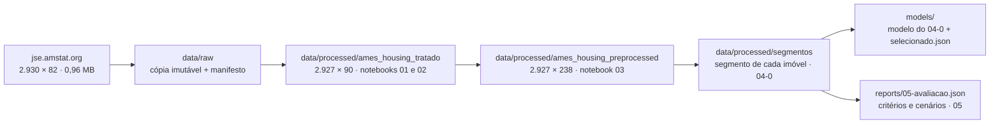

# Fonte de dados

Esta página descreve **de onde vêm os dados** do projeto: a origem, como ela está
organizada, qual é o grão de cada registro e como a carga é reproduzida.

## Origem

O conjunto **Ames Housing** foi montado por Dean De Cock, do Departamento de
Matemática e Estatística da Truman State University, a partir do cadastro do
*Ames City Assessor's Office* — o órgão municipal de avaliação de imóveis de Ames,
Iowa. Cobre **todas** as transações residenciais registradas na cidade entre 2006 e
2010.

O download é direto do endereço do artigo, sem cadastro:

```
https://jse.amstat.org/v19n3/decock/AmesHousing.txt
```

O caminho está declarado em `src/config.py` (`URL_AMES`) e é o único ponto do projeto
que fala com a rede.

!!! quote "Citação obrigatória"
    De Cock, D. (2011). *Ames, Iowa: Alternative to the Boston Housing Data as an End
    of Semester Regression Project.* **Journal of Statistics Education**, 19(3).
    <https://doi.org/10.1080/10691898.2011.11889627>

!!! warning "Licença e uso"
    A base é distribuída para **uso educacional e de pesquisa**, com citação do artigo
    original. Não há licença Creative Commons nomeada. Para uso comercial ou
    redistribuição do arquivo modificado, consulte o autor.

    Não há dado pessoal identificável: `PID` é o número da matrícula do imóvel
    (*Parcel Identification*), atribuído pelo cadastro municipal, e não identifica o
    proprietário. A base é, portanto, publicável sem anonimização adicional.

### Extração vigente

Extração única, correspondente ao arquivo publicado com o artigo em 2011. Não há
versões posteriores: o conjunto é fechado.

O manifesto da carga é gravado em `data/raw/manifesto_carga.json` a cada execução, com
`sha256` do arquivo, data do download e dimensões conferidas. É o que permite detectar
que a origem mudou — a carga **falha** se as dimensões não baterem com o declarado.

```json
{
  "origem": "https://jse.amstat.org/v19n3/decock/AmesHousing.txt",
  "linhas": 2930,
  "colunas": 82,
  "periodo_venda": "2006–2010",
  "sha256": "…"
}
```

### As 82 colunas, por dimensão de negócio

| Dimensão | Nº | Exemplos de colunas na origem |
|:---|:-:|:---|
| Identificação | 2 | `Order`, `PID` |
| Terreno e localização | 11 | `Lot Area`, `Lot Frontage`, `Lot Shape`, `Neighborhood`, `MS Zoning` |
| Porte e configuração | 12 | `Gr Liv Area`, `Total Bsmt SF`, `TotRms AbvGrd`, `Bedroom AbvGr`, `Full Bath` |
| Padrão construtivo | 14 | `Overall Qual`, `Exter Qual`, `Kitchen Qual`, `Bsmt Qual`, `Heating QC` |
| Idade e reforma | 3 | `Year Built`, `Year Remod/Add`, `Garage Yr Blt` |
| Estrutura e acabamento | 15 | `Foundation`, `Roof Style`, `Exterior 1st`, `Mas Vnr Type`, `Electrical` |
| Garagem | 6 | `Garage Type`, `Garage Cars`, `Garage Area`, `Garage Finish` |
| Áreas externas | 8 | `Wood Deck SF`, `Open Porch SF`, `Screen Porch`, `Pool Area`, `Fence` |
| Itens extras | 2 | `Misc Feature`, `Misc Val` |
| **Transação** | 4 | `Mo Sold`, `Yr Sold`, `Sale Type`, `Sale Condition` |
| **Rótulo reservado** | 1 | `SalePrice` |

O dicionário completo, coluna a coluna, com o nome curado e a escala de cada ordinal,
está em [`references/dicionario-de-dados.md`](https://github.com/aislansf/projeto-exemplo-mercado-imobiliario/blob/main/references/dicionario-de-dados.md).

## Organização da origem

Arquivo único, tabulado, codificado em ASCII. Sem particionamento — o volume não
justifica.

```
data/raw/
├── ames_housing.txt          # cópia imutável da origem (960 KB)
├── ames_housing.parquet      # as mesmas células, com nomes e categorias em PT-BR
└── manifesto_carga.json      # origem, data, sha256, dimensões conferidas
```

| Característica | Valor |
|:---|---:|
| Arquivos | 1 |
| Registros | 2.930 |
| Colunas | 82 |
| Volume na origem | 0,96 MB |
| Período | 2006 a 2010 |
| Vendas por ano | 625 · 694 · 622 · 648 · 341 |

!!! note "Decisão técnica: por que também um parquet"
    O `.txt` é a cópia imutável e é o que o manifesto assina. O `.parquet` existe
    porque a leitura passa de cerca de 1 s para 20 ms e, principalmente, porque o tipo
    de cada coluna deixa de ser reinferido a cada execução — o que, nesta base,
    importa: a inferência padrão do `pandas` converte a categoria `None` em nulo.
    Ver [Entendimento dos dados](entendimento-dados.md#valores-sentinela).

    O `.parquet` também já nasce em português: a ingestão renomeia as colunas para
    `snake_case` e troca os códigos das categorias pelos rótulos (`RL` →
    `Residencial de baixa densidade`, `Ex` → `Excelente`), sem alterar nenhum valor.
    O mapa está em `src/data/dicionario.py` e no
    [dicionário de dados](https://github.com/aislansf/projeto-exemplo-mercado-imobiliario/blob/main/references/dicionario-de-dados.md).

## Grão e conteúdo

Cada linha é **uma transação de um imóvel residencial** (`PID`).

As 2.930 linhas têm 2.930 valores distintos de `PID`, sem duplicidade completa. Nenhum imóvel aparece duas vezes — não há, portanto,
o problema clássico de somar o mesmo ativo mais de uma vez.

A tabela é **achatada**: traz embutidas as dimensões de terreno, construção, garagem,
áreas externas e transação em uma única linha. Não há normalização a desfazer.

As métricas aditivas são poucas, porque a base é predominantemente descritiva:

| Métrica | Descrição |
|:---|:---|
| `preco_venda` | Valor da transação, em dólares — **rótulo reservado** |
| `area_habitavel` | Área construída acima do solo, em pés quadrados |
| `area_terreno` | Área do lote, em pés quadrados |
| `area_porao` | Área total do porão, em pés quadrados |

## Fluxo de dados no projeto



A carga é implementada em `src/data/ingestao.py` e é **idempotente**: se o arquivo já
existe, o download não é refeito. A conferência de dimensões roda em toda execução, e
a carga falha em vez de seguir com dado diferente do declarado.

## Fontes complementares

Nenhuma. Todo o projeto se apoia em uma única origem — o que é incomum e simplifica a
rastreabilidade: qualquer número deste site é rastreável até uma das 82 colunas do
arquivo original.

## Reprodução

```bash
uv run invoke ingestao      # baixa e materializa data/raw
```

Ou, do zero aos artefatos finais:

```bash
uv run invoke notebooks
```

!!! tip "Se a origem sair do ar"
    O arquivo bruto é versionado no repositório (960 KB) e o manifesto traz o `sha256`
    para conferência. O pipeline reexecuta inteiro sem rede, a partir de
    `data/raw/ames_housing.parquet`.
