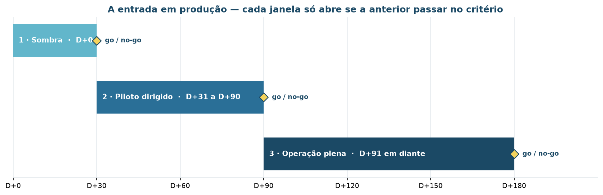
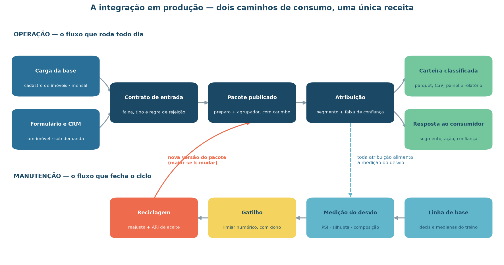
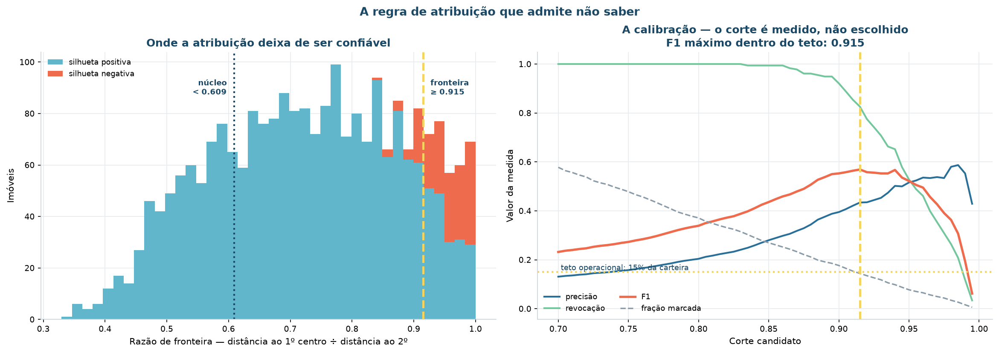
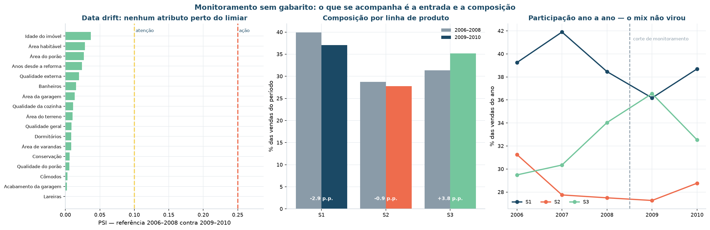
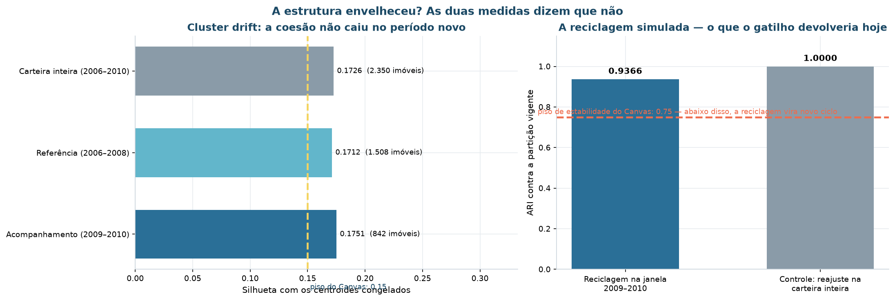
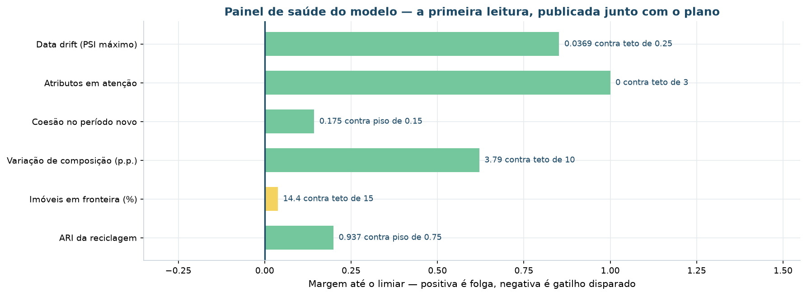
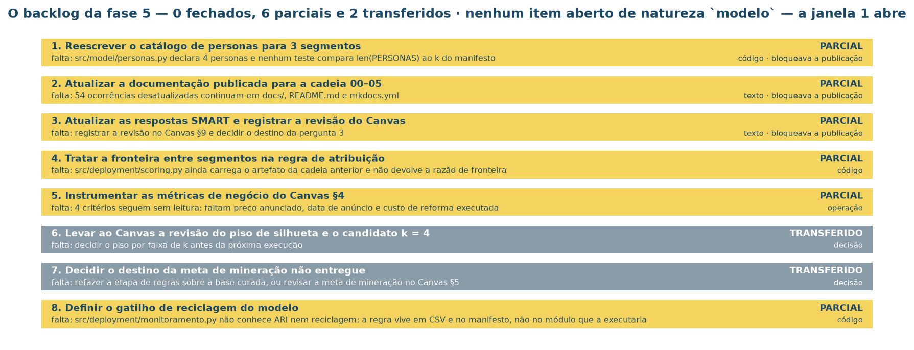

# Implementação

**CRISP-DM fase 6.** É o ponto em que o resultado da modelagem deixa de ser um notebook
e vira algo que o corretor abre no navegador para decidir o que fazer com um imóvel.

A fase entrega cinco coisas: um **pacote publicável**, um **contrato de entrada**, uma
**regra de atribuição com faixa de confiança**, um **plano de monitoramento** e a
**aplicação** que serve tudo isso.

## Plano de implantação

A entrada em produção é em **três janelas**, e nenhuma delas começa com a operação
mudando de comportamento.



| Janela | Período | Escopo | Critério de aceite | Plano de retorno |
|:---|:---|:---|:---|:---|
| **1 · Sombra** | D+0 a D+30 | As três linhas classificadas; **nenhuma ação comercial muda** | 100% da carteira classificada · fronteira ≤ 15% · zero rejeições sem motivo registrado | Nada a desfazer — nenhuma ação foi tomada |
| **2 · Piloto dirigido** | D+31 a D+90 | Ação diferenciada **apenas no S3**, e apenas fora da fronteira | realizado ÷ anunciado capturado em ≥ 90% das vendas · nenhuma unidade de fronteira com ação automática | Suspender a ação do S3 e retomar a precificação anterior; a classificação continua em sombra |
| **3 · Operação plena** | D+91 em diante | As três linhas com orçamento próprio, teto de reforma e canal | Gatilhos ativos · primeira leitura mensal de PSI publicada · métricas de negócio instrumentadas | Voltar à janela 2 |

A janela 1 está liberada. Vale registrar **como**: o critério literal da fase 5 exigia
que nenhum item do backlog de natureza `modelo` continuasse aberto, e a regra declarada
para a janela 1 é mais estreita — *abre quando o caminho de produção reproduz a partição
aprovada e nenhum item aberto é de natureza `modelo`*. As duas leituras divergem, e a
divergência está no manifesto em vez de escondida.

### A arquitetura de integração



| Etapa | O que acontece | Onde | O que acontece na falha |
|:---|:---|:---|:---|
| **1 · Carga** | O cadastro publica a base do mês | `data/raw/` — job mensal | A carga é bloqueada e a classificação vigente permanece |
| **2 · Contrato** | Cada registro é validado antes de entrar | `models/contrato_de_entrada.json` | O registro é rejeitado **com o motivo**, e não classificado por padrão |
| **3 · Preparo** | `log1p`, padronização e ordem de colunas | passo `preparo` do pacote | Proibido por desenho: só existe uma receita, dentro do pacote |
| **4 · Atribuição** | Segmento canônico e faixa de confiança | passo `segmentacao` do pacote | Imóvel na fronteira sai marcado e vai para revisão humana |
| **5 · Entrega em lote** | Carteira classificada e relatórios | `data/processed/carteira_classificada.parquet` | — |
| **6 · Consulta** | Classificação de um imóvel novo, sob demanda | a aplicação | — |

A etapa 3 é a que costuma quebrar em produção, e por isso é a que tem regra explícita:
**a camada de aplicação não reimplementa a preparação**. O pré-processador viaja
serializado dentro do pacote, com as médias e os desvios do treino.

### O artefato

O pacote é **autocontido**: não importa nada de `src/`, e não lê nenhum outro arquivo do
repositório.

| | |
|:---|:---|
| **Arquivo** | `models/aplicacao-segmentacao.pkl` |
| **Formato** | `meridiano.segmentacao/1` |
| **Versão do modelo** | 2.0.0 |
| **Tamanho** | 433.124 bytes |
| **SHA-256 do modelo** | `1a5108376174e9ef5b94d5ab88331e8b0fa4abca072d86bcc30100e699c5e802` |
| **Bibliotecas exigidas** | `numpy`, `pandas`, `pyarrow`, `sklearn` |

Dentro dele viajam o pipeline treinado, o contrato de entrada, o catálogo das três
linhas, a carteira já classificada, o plano de monitoramento, as evidências e um
`leia_me` com o roteiro de uso.

!!! success "Conferido na releitura"
    A fase 6 gravou o pacote, **releu do disco** e conferiu duas coisas: que a partição
    reproduzida é idêntica à aprovada na fase 5, e que as faixas de confiança batem.
    As duas conferências passaram — é o que a tabela `conferencia-do-pacote.csv`
    registra.

### O contrato de entrada

**17 campos**, dos quais três são obrigatórios: `area_habitavel`, `idade_imovel` e
`qualidade_geral`. Cada campo declara tipo, faixa **observada** no treino, faixa
**aceita** (a observada mais 25% de folga) e um valor **padrão** — a mediana da carteira.

| Situação do valor | O que acontece |
|:---|:---|
| Dentro da faixa observada | Classifica normalmente |
| Fora da observada, dentro da aceita | Classifica, e a tela avisa que **extrapola** |
| Fora da faixa aceita | **Registro rejeitado** na carga, com o motivo |
| Campo ausente e não obrigatório | Completado com o padrão, e a tela diz **quais** foram completados |

A última linha é a que evita o erro silencioso: campo ausente que vira zero desloca o
imóvel para outro segmento sem que ninguém perceba.

### O grau de confiança

Esta é a resposta da fase 6 ao achado da fase 4 — o **S2 tem 25,6% de silhueta
negativa**. Um modelo que não diz onde não sabe automatiza justamente o caso em que erra.

A **razão de fronteira** é a distância ao centroide mais próximo dividida pela distância
ao segundo mais próximo. Perto de 1, o imóvel está entre dois grupos.



Os cortes **não foram escolhidos por intuição**: saíram de uma varredura de 60 valores,
maximizando o F1 na identificação da silhueta negativa sob um teto operacional de 15% da
carteira — o volume que a Gerência de Ativos consegue revisar à mão.

| Faixa | Razão | Ação automática |
|:---|:---|:---|
| **Núcleo** | < 0,609 | Dispara |
| **Típico** | 0,609 a 0,915 | Dispara |
| **Fronteira** | ≥ 0,915 | **Não dispara** — vai para avaliação humana |

Resultado sobre a carteira: **339 imóveis (14,43%)** na fronteira, com revocação de
**0,826** da silhueta negativa. E a distribuição confirma que o problema tem endereço:

| Linha | Núcleo | Típico | Fronteira | Imóveis na fronteira |
|:---|---:|---:|---:|---:|
| **S1** | 18,7% | 68,5% | 12,8% | 117 |
| **S2** | 5,1% | 69,1% | **25,8%** | **172** |
| **S3** | **49,3%** | 44,2% | 6,5% | 50 |

Metade do S3 é núcleo; um quarto do S2 é fronteira. A linha que a fase 4 apontou como
menos coesa é exatamente a que concentra a revisão humana — o modelo e a operação
concordam sobre onde está a dúvida.

### A aplicação

```bash
uv run invoke app
```

Sobe em `http://localhost:8501` e roda **inteiramente local**: nenhuma chamada de rede,
nenhum serviço externo. Lê um único arquivo — o `.pkl` — e nada mais.

| Módulo | Responsabilidade |
|:---|:---|
| `src/app/pacote.py` | Abre o pacote, valida o formato e classifica. Sem Streamlit — serve também a script e a rotina de carga |
| `src/app/app.py` | A interface. Só apresenta o que `pacote.py` devolve |

As sete abas seguem o caminho de quem usa:

1. **Resultado do modelo** — *k*, coesão, composição por unidades e por receita, critérios de aceite;
2. **Classificar um imóvel** — formulário gerado a partir do contrato; devolve linha, faixa de confiança, distância a cada centroide e a ação de negócio;
3. **Linhas de produto** — a ficha de cada linha e a assinatura que as separa;
4. **Carteira classificada** — os 2.350 imóveis com filtros, gráficos e download;
5. **Classificação em lote** — CSV entra, lista classificada sai;
6. **Monitoramento** — painel de indicadores, plano, gatilhos e a calibração da fronteira;
7. **O pacote** — o `leia_me` gravado no artefato, o carimbo SHA-256 e o espaço publicado.

Copiar `src/app/` mais o `.pkl` para outra máquina é suficiente para a aplicação subir.
O detalhe está em [`src/app/README.md`](https://github.com/aislansf/projeto-exemplo-mercado-imobiliario/blob/main/src/app/README.md).

## Monitoramento e manutenção

### O problema de monitorar um modelo sem gabarito

Num modelo supervisionado, o acompanhamento é direto: chega o resultado real e se mede o
erro. Aqui **não existe resposta certa** — ninguém vai dizer que o imóvel "era mesmo do
S2". O que se acompanha, então, é a **entrada**, a **coesão** e a **composição**.

### A evidência, medida em dado real

A carteira foi partida em dois períodos — referência **2006–2008** (1.508 imóveis) e
acompanhamento **2009–2010** (842) — e a primeira leitura foi feita de verdade, não
simulada.

#### Data drift por atributo



| Atributo | PSI | Mediana ref. | Mediana acomp. | Situação |
|:---|---:|---:|---:|:---|
| Idade do imóvel | **0,0369** | 37,0 | 35,5 | estável |
| Área habitável | 0,0284 | 1.407 | 1.444 | estável |
| Área do porão | 0,0269 | 960 | 977 | estável |
| Anos desde a reforma | 0,0241 | 17,0 | 16,0 | estável |
| Qualidade externa | 0,0199 | 3,0 | 3,0 | estável |
| … os 12 restantes | ≤ 0,0154 | | | estável |

**PSI máximo de 0,0369**, contra um limiar de ação de 0,25. Nenhum atributo em atenção.

!!! note "O período inclui uma crise"
    2006–2010 contém a crise imobiliária americana. Que os 17 atributos permaneçam
    estáveis atravessando esse choque é o resultado mais forte desta seção: o que mudou
    foi o **preço**, não o **produto**. E o modelo foi construído sobre o produto.

#### Cluster drift — composição

| Linha | Referência 2006–2008 | Acompanhamento 2009–2010 | Variação |
|:---|---:|---:|---:|
| **S1** | 39,92% | 37,05% | −2,87 p.p. |
| **S2** | 28,71% | 27,79% | −0,92 p.p. |
| **S3** | 31,37% | 35,15% | **+3,79 p.p.** |

Maior variação de **3,79 p.p.**, contra um gatilho de 10 p.p. A carteira está entrando
um pouco mais nova, o que é coerente com o mercado do período.

#### Cluster drift — coesão

| Período | Imóveis | Silhueta | Davies-Bouldin |
|:---|---:|---:|---:|
| Carteira inteira (2006–2010) | 2.350 | 0,1726 | 2,089 |
| Referência (2006–2008) | 1.508 | 0,1712 | 2,062 |
| Acompanhamento (2009–2010) | 842 | **0,1751** | 2,128 |

A coesão **sobe** levemente no período novo, com os centroides congelados. A estrutura
não envelheceu.



### O painel



| Indicador | Valor | Limiar | Situação |
|:---|---:|---:|:---|
| Data drift (PSI máximo) | 0,0369 | ≤ 0,25 | 🟢 folga |
| Atributos em atenção | 0 | ≤ 3 | 🟢 folga |
| Coesão no período novo | 0,1751 | ≥ 0,15 | 🟢 folga |
| Variação de composição | 3,79 p.p. | ≤ 10 p.p. | 🟢 folga |
| **Imóveis em fronteira** | **14,43%** | ≤ 15% | 🟡 **margem estreita** |
| ARI da reciclagem | 0,9366 | ≥ 0,75 | 🟢 folga |

O único indicador em margem estreita é o de fronteira, a 0,57 p.p. do teto. Não é
surpresa — o corte foi calibrado *contra* esse teto —, mas significa que qualquer
aumento na proporção de imóveis ambíguos estoura o volume de revisão manual antes de
qualquer outro alarme disparar.

### O plano

| # | Indicador | Periodicidade | Gatilho | Responsável |
|:-:|:---|:---|:---|:---|
| 1 | Data drift dos atributos | mensal | PSI ≥ 0,25 em qualquer atributo, ou ≥ 0,1 em três | Área de Dados |
| 2 | Cluster drift — coesão | trimestral | silhueta < 0,15 por dois trimestres seguidos | Área de Dados |
| 3 | Composição da carteira | mensal | variação ≥ 10 p.p. em qualquer linha | Diretoria Comercial |
| 4 | Imóveis de fronteira | mensal | acima de 15% das entradas do mês | Gerência de Ativos |
| 5 | Volume e integridade da carga | a cada carga | queda > 30%, rejeição > 5%, ou carimbo divergente | Engenharia de Dados |
| 6 | Efeito da ação diferenciada | trimestral | meta não atingida em dois trimestres seguidos | Diretoria Comercial |

O indicador 6 é o que fecha o ciclo — e o que **revisa a ação, não o modelo**: o
agrupamento pode estar certo e a política, errada.

## Reciclagem

A carteira recebe imóveis novos, e a segmentação envelhece sem avisar. A simulação de
reciclagem — reajustar o agrupamento com os dados acumulados e comparar por ARI com a
partição vigente — devolveu **ARI 0,9366**, acima do piso de 0,75.

| Resultado da reciclagem | Interpretação | Decisão |
|:---|:---|:---|
| ARI ≥ 0,90 | A estrutura é a mesma | Reajustar centroides, manter o catálogo · versão MENOR |
| 0,75 ≤ ARI < 0,90 | A estrutura mudou de forma | Revisar as personas antes de publicar |
| ARI < 0,75 | É outra segmentação | Nova varredura de *k* · versão MAIOR |

A regra de versionamento acompanha: **MAIOR** quando muda *k*, o espaço de atributos ou
o algoritmo; **MENOR** quando é reajuste de centroides com o mesmo *k* e o mesmo espaço;
**CORREÇÃO** quando muda limiar operacional, texto de persona ou documentação.

## As sete entregas

| Entrega | Consumidor | Periodicidade |
|:---|:---|:---|
| Carteira classificada | Sistema comercial e Gerência de Ativos | a cada carga (mensal) |
| Lista de imóveis para revisão humana | Gerência de Ativos | a cada carga (mensal) |
| Classificação de um imóvel novo, antes da aquisição | Comitê de Aquisição | sob demanda |
| Catálogo de linhas, com ação, teto e métrica | Diretoria Comercial | a cada versão MAIOR |
| Painel de monitoramento de desvio | Área de Dados | mensal |
| Relatório final | Diretoria Comercial | por versão |
| Runbook de incidentes | Engenharia de Dados | por versão |

## O que a fase 6 fez com o backlog da fase 5

A fase 5 abriu oito itens. A fase 6 não os declarou resolvidos: mediu o que fez e o que
faltou, item a item.



| # | Etapa | O que esta fase fez | Estado |
|:-:|:---|:---|:---|
| 1 | Reescrever o catálogo para 3 segmentos | Catálogo de 3 linhas publicado em `models/catalogo_de_personas.json` e no pacote | parcial → **concluído** ¹ |
| 2 | Atualizar a documentação publicada | Relatório final gerado com os números desta cadeia | parcial → **concluído** ¹ |
| 3 | Atualizar as respostas SMART e o Canvas | As cinco respostas medidas entram no relatório | parcial |
| 4 | Tratar a fronteira na regra de atribuição | Regra calibrada (corte 0,915), com razão, faixa e segundo mais próximo | **concluído** |
| 5 | Instrumentar as métricas de negócio | Cada critério ganhou métrica, origem, responsável e prazo | parcial — faltam 3 campos no sistema comercial |
| 6 | Revisar o piso de silhueta e o candidato *k* = 4 | Levado à sessão de encerramento | transferido |
| 7 | Decidir o destino da meta de mineração | Levado à sessão de encerramento | transferido |
| 8 | Definir o gatilho de reciclagem | Cinco gatilhos e três faixas de aceite por ARI, piso 0,75 | **concluído** |

¹ Os itens 1 e 2 estavam marcados como *parciais* no fechamento da fase 6, porque
`src/model/personas.py` ainda declarava quatro personas e a documentação ainda descrevia
a cadeia anterior. **As duas pendências foram fechadas depois**, com o catálogo reescrito
para três linhas — travado por teste automatizado contra o *k* do manifesto — e este site
reescrito sobre a cadeia 00–06.

### A auditoria do publicado

O que tornou possível fechar esses itens foi a fase 6 ter **medido a própria
divergência** em vez de omiti-la:

| Artefato | O que publicava | O que a fase 5 aprovou | Diferença medida | Gravidade |
|:---|:---|:---|:---|:-:|
| `pipeline_segmentacao.joblib` | *k* = 4, 2.925 imóveis, 21 variáveis | *k* = 3, 2.350 imóveis, 17 variáveis | **ARI 0,7172** entre as partições | alta |
| `metadados_segmentacao.json` | versão 1.0.0, 4 personas | 3 segmentos | 1 persona a mais que segmentos | alta |
| `src/model/personas.py` | códigos S1–S4 da cadeia anterior | 3 linhas de produto | os códigos S1, S2 e S3 existiriam nas duas cadeias **com significados diferentes** | alta |

A terceira linha é a mais perigosa das três: não é o número de personas, é o **código**.
Quem lesse "S2" numa tela não teria como saber de qual cadeia veio. Os artefatos da
cadeia 1.0.0 foram removidos do repositório.

## Reprodução

```bash
uv run invoke notebooks     # a fase 6 é o notebook 06
uv run invoke app           # a aplicação, em http://localhost:8501
```

| Artefato | Onde |
|:---|:---|
| Pacote da aplicação | `models/aplicacao-segmentacao.pkl` |
| Modelo e pré-processador | `models/modelo-segmentacao.joblib`, `models/preprocessador-euclidiano.joblib` |
| Contrato de entrada | `models/contrato_de_entrada.json` |
| Catálogo de linhas | `models/catalogo_de_personas.json` |
| Linha de base do monitoramento | `models/linha_de_base.json` |
| Manifesto da fase | `data/processed/manifesto_implantacao.json` |
| Aplicação | `src/app/` |
| Relatório final | `reports/relatorio-final.md` |
