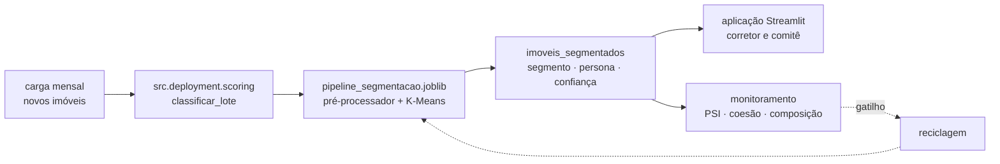
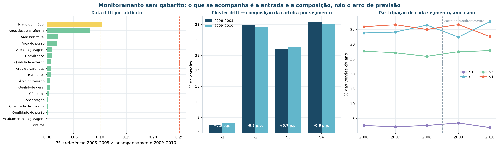

# Implementação

**CRISP-DM fase 6.** Um resultado só é útil quando quem decide consegue acessá-lo. Esta
página descreve **como a entrega chega ao usuário**, como é mantida em funcionamento e
como o projeto é encerrado.

!!! quote "O critério que orienta esta fase"
    Uma segmentação que só existe porque alguém rodou o notebook uma vez **não está
    implantada**.

## Plano de implantação

A entrega é uma **aplicação de consulta** em Streamlit, e não um relatório estático ou
uma API. A escolha vem do consumidor: doze corretores e um comitê de aquisição, que
precisam da resposta no momento da decisão, sem depender da área de dados.

| Entrega | Consumidor | Meio | Frequência |
|:---|:---|:---|:---|
| Classificação de cada imóvel da carteira | Corretores e Gerência de Ativos | Aplicação Streamlit | Sob demanda, atualizada a cada carga |
| Classificação de um imóvel **novo**, antes da aquisição | Comitê de Aquisição | Formulário da aplicação, com grau de confiança | Sob demanda |
| Lista de imóveis fora de padrão | Gerência de Ativos | CSV e filtro dedicado na aplicação | Mensal |
| Painel de monitoramento de *drift* | Área de Dados | Aba de monitoramento da aplicação | Mensal |
| Relatório executivo com personas e ações | Diretoria | Este site (MkDocs) | A cada reciclagem |



O que dispara a atualização: a **carga mensal** de novos imóveis. O artefato é
publicado em `models/` e versionado junto com o código.

### O artefato

`models/pipeline_segmentacao.joblib` carrega o **pré-processador e o K-Means juntos**,
em um único objeto `Pipeline`. A aplicação nunca reimplementa a preparação.

!!! danger "Por que isso importa"
    Reimplementar a padronização na camada de aplicação é a forma mais comum de um
    modelo funcionar no notebook e falhar em produção. As médias e os desvios do
    `StandardScaler` são os **do treino** — recalculá-los sobre o lote novo produz
    classificações silenciosamente erradas, sem nenhum erro visível.

A conferência de que o artefato reproduz o treino roda a cada execução da fase 6:

| Verificação | Resultado | Situação |
|:---|:---|:-:|
| O pipeline serializado reproduz a classificação da base de treino | **100,00% de concordância** | ✅ |
| Linha de base gravada para o monitoramento | `models/linha_de_base.json` | ✅ |
| Atributos com *data drift* em nível de ação | 0 de 17 | ✅ |
| Queda de coesão no período de acompanhamento | silhueta 0,1797 → 0,1737 | ✅ |

### Os arquivos publicados

| Arquivo | Conteúdo |
|:---|:---|
| `models/pipeline_segmentacao.joblib` | Pré-processador + K-Means, prontos para `predict` |
| `models/metadados_segmentacao.json` | *k*, espaço de atributos, semente, escalador, métricas, período de treino e a tradução de rótulo bruto para canônico |
| `models/linha_de_base.json` | Decis de cada atributo numérico e proporções de cada nominal — a referência do monitoramento |

!!! note "Por que a linha de base é gravada"
    Sem ela, o monitoramento depende de alguém ter guardado a base de treino — o que,
    na prática, significa não haver monitoramento. Os decis gravados permitem calcular
    PSI contra a referência sem acesso ao dado original.

### A aplicação

`src/deployment/app.py` — sete abas, uma por pergunta da diretoria:

| Aba | Responde a | Evidência que exibe |
|:---|:---|:---|
| **Visão executiva** | "Quantos grupos, e por quê?" | Confronto com os 13 critérios, receita por segmento |
| **Personas e ações** | "O que caracteriza cada grupo, e o que fazer?" | Perfil, medoide real, ação, métrica, canal |
| **Explorar a carteira** | — | Filtros, dispersão configurável, exportação em CSV |
| **Classificar um imóvel** | — | Formulário → segmento, política aplicável, grau de confiança |
| **Padrões de coocorrência** | "Que padrões existem nos dados?" | Funil de poda, regras, diferenciais por segmento |
| **Monitoramento** | — | PSI ao vivo, coesão por período, planos de ação |
| **Como chegamos aqui** | — | Rastreabilidade das seis fases, com o arquivo de cada decisão |

Cada aba traz, no rodapé, o **caminho do arquivo** de onde cada número veio — o mesmo
CSV que este site cita.

```bash
uv run invoke app
```

### O grau de confiança

A aplicação não devolve só o segmento: devolve **quanto confiar nele**. A medida é a
razão entre a distância ao centroide mais próximo e ao segundo mais próximo.

| Faixa | Razão | Leitura operacional |
|:---|:---|:---|
| **Núcleo** | < 0,60 | A política padrão se aplica sem ressalva |
| **Típico** | 0,60 a 0,90 | Classificação típica, com alguma proximidade do vizinho |
| **Fronteira** | ≥ 0,90 | O modelo não decidiu. A ação automática **não** deve ser disparada sem revisão humana |

Os cortes foram **calibrados na distribuição da carteira**, e não escolhidos por
intuição: sobre os 2.925 imóveis de treino, a razão tem quartil inferior 0,60, mediana
0,715 e nono decil 0,93. A leitura operacional: cerca de um quarto da carteira é
núcleo, dois terços são típicos e um décimo fica na fronteira — proporção que a
Gerência de Ativos consegue revisar manualmente.

## Monitoramento e manutenção

### O problema de monitorar um modelo sem gabarito

Não existe erro de previsão para acompanhar. Não há a quem perguntar se a
classificação de um imóvel estava "certa" — a classificação **é** a resposta, e não
existe verdade de referência contra a qual compará-la.

O que se acompanha, então, é indireto:

1. a **entrada** mudar de distribuição — *data drift*;
2. os **grupos** perderem coesão — *cluster drift*;
3. a **composição** da carteira se deslocar entre segmentos.

### A evidência, medida em dado real

O teste usa o próprio calendário da base: **2006–2008 como referência** (1.936
imóveis) e **2009–2010 como acompanhamento** (989). É um teste honesto, feito com dado
real, e não uma perturbação simulada.



#### Data drift por atributo

| Atributo | PSI | Mediana referência | Mediana atual | Situação |
|:---|---:|---:|---:|:-:|
| Idade do imóvel | 0,1046 | 34,0 | 35,0 | ⚠️ atenção |
| Anos desde a reforma | 0,0817 | 14,0 | 16,0 | ✅ estável |
| Área habitável | 0,0199 | 1.436 | 1.456 | ✅ estável |
| Área do porão | 0,0176 | 988 | 991 | ✅ estável |
| Área da garagem | 0,0081 | 477,5 | 480,0 | ✅ estável |
| *(demais 12 atributos)* | < 0,008 | — | — | ✅ estável |

Faixas de leitura, convenção usual em modelos de crédito: **< 0,10** estável,
**0,10 a 0,25** atenção, **> 0,25** desvio relevante.

Um único atributo em atenção — `idade_imovel`, com PSI 0,1046 —, e o motivo é
mecânico: o tempo passou. Entre uma janela e outra, todo imóvel que não foi construído
no intervalo envelheceu dois anos. Não é sinal de mudança de mercado; é o relógio.

#### Cluster drift — composição

| Segmento | Referência 2006–2008 | Acompanhamento 2009–2010 | Variação |
|:---|---:|---:|---:|
| S1 | 2,58% | 3,03% | +0,45 p.p. |
| S2 | 34,71% | 34,18% | −0,53 p.p. |
| S3 | 26,91% | 27,60% | +0,69 p.p. |
| S4 | 35,80% | 35,19% | −0,61 p.p. |

Nenhum segmento varia mais de 0,7 ponto percentual. A composição da carteira é
estável, inclusive atravessando a crise imobiliária de 2008.

#### Cluster drift — coesão

| Período | Imóveis | Silhueta | Davies-Bouldin |
|:---|---:|---:|---:|
| Carteira inteira (2006–2010) | 2.925 | 0,1775 | 1,800 |
| Referência (2006–2008) | 1.936 | 0,1797 | 1,782 |
| Acompanhamento (2009–2010) | 989 | **0,1737** | 1,818 |

A silhueta cai 0,006 no período novo — dentro da faixa aceitável, e bem acima do piso
de 0,15.

!!! success "Veredicto: estável"
    Nenhum atributo em nível de ação, um em atenção por efeito do calendário,
    composição praticamente idêntica e coesão preservada. **A segmentação não precisa
    de reciclagem no horizonte da base.**

### O plano

| O que monitorar | Como | Periodicidade | Gatilho | Ação se desviar | Responsável |
|:---|:---|:---|:---|:---|:---|
| **Data drift** dos atributos de entrada | PSI dos 17 atributos numéricos e ordinais contra `models/linha_de_base.json` | mensal | Qualquer atributo com PSI ≥ 0,25, ou três simultaneamente acima de 0,10 | Reciclar o agrupamento e comparar por ARI com a partição vigente | Área de Dados |
| **Cluster drift** — coesão | Silhueta sobre as vendas dos últimos 12 meses, com centroides congelados | trimestral | Silhueta abaixo de 0,15 por dois trimestres consecutivos | Reciclagem obrigatória, com nova varredura de *k* | Área de Dados |
| **Composição** da carteira | Participação percentual de cada segmento nas entradas | mensal | Variação acima de 10 p.p. em qualquer segmento | Revisar o orçamento de cada ação — o mix mudou e a alocação deixou de fazer sentido | Diretoria Comercial |
| **Imóveis de fronteira** | Percentual de entradas classificadas como fronteira | mensal | Acima de 15% das entradas do mês | Suspender a ação automática e escalar para avaliação humana | Gerência de Ativos |
| **Volume e integridade** da carga | Contagem de registros e nulos por coluna contra o manifesto | a cada carga | Queda de volume acima de 30%, ou nulo em coluna que não tinha | Bloquear a publicação e acionar a origem — sem dado novo válido, a classificação anterior permanece vigente | Engenharia de Dados |
| **Efeito das ações** | As métricas declaradas em cada persona | trimestral | Meta não atingida em dois trimestres consecutivos | Revisar a **ação**, não o modelo: o agrupamento pode estar certo e a ação, errada | Diretoria Comercial |

!!! tip "O último indicador é o mais importante"
    Um modelo pode estar tecnicamente perfeito e a ação derivada dele, errada. Separar
    "o agrupamento envelheceu" de "a política não funciona" evita o reflexo de
    reciclar o modelo quando o problema está em outro lugar.

### O que acontece quando falha

Se a carga não roda ou vem inconsistente, **a classificação anterior permanece
vigente** e a Engenharia de Dados é acionada. A aplicação continua servindo a última
classificação válida, com a data da carga visível — degradação silenciosa é pior que
indisponibilidade declarada.

## Reciclagem

| Gatilho | Condição | Procedimento |
|:---|:---|:---|
| **Calendário** | a cada 12 meses | Reexecutar `uv run invoke pipeline` sobre a base acumulada e comparar a nova partição com a vigente por ARI |
| **Data drift** | PSI ≥ 0,25 em qualquer atributo | Reciclagem imediata, com registro do atributo que disparou |
| **Cluster drift** | Silhueta < 0,15 por dois trimestres | Reciclagem com nova varredura de *k*, incluindo teste de estabilidade |
| **Mudança de escopo** | Entrada de novo tipo de ativo (comercial, terreno) | Revisão do espaço de atributos **antes** de qualquer reciclagem — o dicionário de dados muda primeiro |

### Critério de aceite da nova partição

Reciclar não é aceitar automaticamente o resultado novo. A partição reciclada é
comparada com a vigente por ARI, e a decisão segue a tabela:

| Resultado | Interpretação | Decisão |
|:---|:---|:---|
| **ARI ≥ 0,80** | Mesma estrutura | Atualizar centroides, manter personas |
| **0,50 ≤ ARI < 0,80** | Estrutura deslocada | Revisar as personas afetadas com a Diretoria Comercial |
| **ARI < 0,50** | Estrutura diferente | Novo ciclo de CRISP-DM, a partir do entendimento de negócio |

Sem esse critério, cada reciclagem seria uma renegociação implícita das personas — e a
área comercial descobriria pela mudança de resultado.

## Relatório final

| Artefato | Local |
|:---|:---|
| Relatório completo (este site) | `docs/`, publicado com `uv run invoke docs` |
| Versão para impressão, em página única | Botão de impressão no canto superior direito |
| Notebooks executados, com saída | `reports/notebooks/` |
| Figuras | `reports/figures/` — 46 arquivos |
| Tabelas-fonte | `reports/tables/` — 98 arquivos |
| Aplicação | `src/deployment/app.py` |

## Revisão do projeto

### O que deu certo

- **Reservar o rótulo antes de começar.** As duas validações mais fortes do projeto só
  existem porque `preco_venda` e `bairro` foram protegidos na fase 3.
- **Testar estabilidade, e não só coesão.** Foi o que impediu a entrega de cinco
  segmentos com métrica melhor e resultado pior.
- **Persistir figura e tabela juntas.** Rastreabilidade total, sem número digitado à
  mão.
- **Embutir o pré-processamento no artefato.** Elimina de saída a classe de erro mais
  comum em implantação.

### O que poderia ter sido melhor

- O **inventário de sentinelas literais** deveria ter sido a primeira coisa feita
  sobre o arquivo, antes de qualquer perfil de nulos. Teria poupado uma iteração.
- A **poda de tautologia semântica** deveria estar no desenho inicial do funil, e não
  ter sido acrescentada depois de ver o resultado.
- A **comparação de métricas entre espaços métricos diferentes** passou despercebida na
  primeira versão da matriz comparativa.

### O que fazer diferente

1. Inventariar sentinelas literais como **primeiro** passo da fase 2, sempre.
2. Escrever a lista de pares definicionais do domínio **antes** de minerar regras.
3. Marcar explicitamente, na estrutura da tabela comparativa, em que espaço cada
   métrica foi calculada — antes de preencher a primeira linha.

### Responsabilidades após o encerramento

| Item | Responsável |
|:---|:---|
| Execução mensal da carga e da classificação | Engenharia de Dados |
| Monitoramento de *drift* e decisão de reciclagem | Área de Dados |
| Manutenção da aplicação | Área de Dados |
| Acompanhamento do efeito das ações por persona | Diretoria Comercial |
| Ponto de contato | aislansf@gmail.com |

## Reprodução

```bash
uv run invoke implantacao   # artefatos, drift e planos
uv run invoke app           # a aplicação
```
