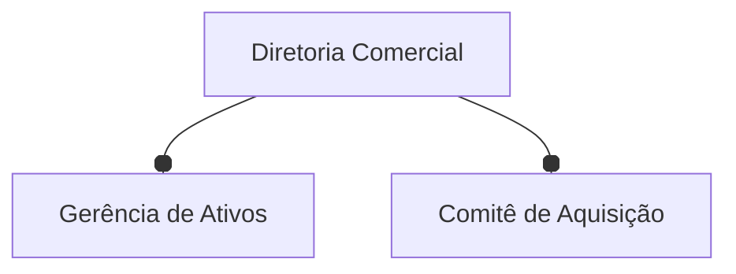

# Segmentação da carteira residencial — Meridiano Imobiliária

## Introdução

A Meridiano Imobiliária administra uma carteira de **2.925 imóveis residenciais**
transacionados em Ames, Iowa, entre 2006 e 2010. Compra, requalifica e revende parte
desse estoque; intermedeia o restante. Hoje todos os imóveis recebem a **mesma**
política de preço, o mesmo teto de reforma e o mesmo canal de anúncio.

O pedido que chegou à área de dados foi curto: *como esses imóveis se organizam
naturalmente, e o que devemos fazer de diferente com cada grupo?* Com uma restrição
que muda tudo — **há orçamento para no máximo cinco linhas de produto**.

Não existe rótulo. Ninguém nunca marcou qual imóvel é "de entrada" e qual é "de alto
padrão": essa é justamente a pergunta. O preço de venda existe na base, mas é
**rótulo reservado** — usá-lo na modelagem transformaria a tarefa em regressão e
devolveria uma tabela de preço, que a diretoria já tem.

!!! success "O resultado"
    Quatro linhas de produto, cada uma com persona, política de reforma, canal de
    venda e métrica de acompanhamento próprios. Silhueta de **0,1775**, estabilidade
    de **0,943** sob reamostragem e **13 de 13** critérios de aceite atendidos.
    A entrega operacional é a [aplicação de consulta](implementacao.md) que o corretor
    abre no navegador.

## Dados do projeto

A base é o **Ames Housing**, publicado por De Cock (2011) no *Journal of Statistics
Education*. São 2.930 imóveis descritos por 82 colunas — 23 nominais, 23 ordinais, 14
discretas e 20 contínuas. É, provavelmente, o conjunto de dados residencial público
mais rico em atributos de **produto**, e é isso que o torna adequado a uma pergunta
de segmentação.

!!! tip "Por que esta base, e não outra"
    O Ames Housing é conhecido como um problema de **regressão de preço** — foi
    publicado com essa finalidade. Este projeto faz o oposto: joga o preço fora e
    pergunta o que sobra. A mesma base, sem a variável-alvo, responde a uma pergunta
    completamente diferente.

### Levantamento inicial

!!! info "Tipo do projeto"
    - [ ] Análise exploratória
    - [ ] Modelo preditivo
    - [ ] Modelo de classificação
    - [x] **Modelo de agrupamento**
    - [x] **Detecção de anomalias** *(secundário: os imóveis fora de padrão)*
    - [x] **Mineração de regras de associação**

### Nível de acesso

!!! warning "Confidencialidade"
    - [x] **Público** — a base de origem é publicada com licença de uso educacional
      e de pesquisa, mediante citação. Não há dado pessoal identificável: o `PID` é o
      número da matrícula do imóvel, não do proprietário.
    - [ ] Interno (toda a organização)
    - [ ] Restrito (apenas a área requisitante)

### Objetivos de negócio

!!! quote ""
    **1.** Segmentar a carteira em, no máximo, cinco linhas de produto operáveis.

    **2.** Descrever cada linha em linguagem de negócio, com persona, ação
    diferenciada e métrica de acompanhamento.

    **3.** Encontrar padrões de coocorrência entre atributos construtivos que
    sustentem — ou contestem — a segmentação.

    **4.** Isolar os imóveis que não pertencem a nenhuma linha e exigem avaliação
    individual.

    **5.** Entregar o resultado em forma utilizável pela operação, com plano de
    monitoramento.

Os critérios de aceite de cada objetivo estão em
[Critérios de sucesso](criterios-sucesso.md), e o confronto entre o prometido e o
entregue está em [Avaliação dos resultados](avaliacao.md).

## Os quatro segmentos encontrados

| Código | Persona | Imóveis | % da carteira | % da receita | Ação diferenciada |
|:--|:--|--:|--:|--:|:--|
| **S1** | Requalificação sem porão | 80 | 2,7% | 1,6% | Decisão binária por unidade: renda ou desinvestimento |
| **S2** | Compacto de entrada | 1.010 | 34,5% | 23,3% | Precificação por giro e reforma leve padronizada |
| **S3** | Familiar consolidado | 794 | 27,1% | 25,5% | Reforma de valorização em cozinha e banheiro |
| **S4** | Novo de alto padrão | 1.041 | 35,6% | 49,5% | Sem reforma; corretagem dedicada e vitrine premium |


## Como reproduzir

```bash
uv sync                    # cria o ambiente a partir do uv.lock
uv run invoke pipeline     # as seis fases do CRISP-DM, do download aos artefatos
uv run invoke app          # a aplicação de implantação
uv run invoke docs         # este site, em http://127.0.0.1:8000
```

O ciclo inteiro roda em cerca de dez minutos em um notebook comum. Nada precisa ser
baixado à mão, e nada depende de credencial.

## Sobre o projeto

### Histórico do documento

| Data       | Versão | Descrição                                                    | Autor          |
| :--------- | :----- | :----------------------------------------------------------- | :------------- |
| 04/08/2026 | 1.0    | Ciclo CRISP-DM completo, com aplicação de implantação publicada | Aislan Freitas |

### Dados do solicitante



| Nome                      | Cargo / Função                | E-mail            |
| :------------------------ | :---------------------------- | :---------------- |
| Diretoria Comercial       | Patrocinadora do projeto      | comercial@meridiano.exemplo |
| Gerência de Ativos        | Dona da operação de estoque   | ativos@meridiano.exemplo |
| Comitê de Aquisição       | Consumidor da classificação   | aquisicao@meridiano.exemplo |

### Dados da equipe técnica

| Nome               | Cargo / Função        | E-mail            |
| :----------------- | :-------------------- | :---------------- |
| Aislan Freitas     | Cientista de dados    | aislansf@gmail.com |

!!! note "Sobre este repositório"
    Este é um **projeto de demonstração** da disciplina *Método de Aprendizado Não
    Supervisionado*, construído a partir do
    [`project-template`](https://github.com/aislansf/project-template). A Meridiano
    Imobiliária é uma organização fictícia; os dados são reais e públicos. O objetivo
    é mostrar o ciclo CRISP-DM percorrido inteiro, com todas as evidências
    materializadas em disco.
