# Modelagem dos dados

**CRISP-DM fase 4.** Esta página descreve o **desenho do experimento**: qual problema o
modelo resolve, sobre que unidade de análise opera, quais variáveis entram, quais
técnicas foram testadas e como o resultado é avaliado tecnicamente.

## Problema

> Descobrir em quantos grupos naturais a carteira residencial se divide e o que
> caracteriza cada um, **sem usar o preço**.

Corresponde aos objetivos **1** e **2** dos
[critérios de sucesso](criterios-sucesso.md).

| Onde está implementado | Arquivo |
|:---|:---|
| Clusterização, escolha de *k*, comparativo | `notebooks/04-modelagem.ipynb` |
| Distâncias, incluindo Gower | `src/model/distancias.py` |
| K-Means, K-Medoids, métricas de escolha de *k* | `src/model/particional.py` |
| Hierárquica | `src/model/hierarquica.py` |
| DBSCAN e Mean Shift | `src/model/densidade.py` |
| GMM | `src/model/mistura.py` |
| PCA, Kernel PCA e LDA | `src/model/reducao.py` |
| Perfilagem e catálogo de linhas | `src/model/perfilagem.py`, `src/model/personas.py` |

## Unidade de análise

Um registro por **imóvel residencial transacionado** (`pid`).

A pergunta de negócio é sobre o **produto**: que tipo de imóvel a carteira tem. Se a
unidade fosse a transação por bairro, os bairros grandes dominariam o resultado; se
fosse o bairro, a variação **dentro** do bairro — que é onde estão as linhas de
produto — desapareceria na média.

## O desenho do experimento

A fase 4 não é "rodar um K-Means e olhar". É uma grade declarada antes de qualquer
execução, com o critério de aprovação escrito primeiro.

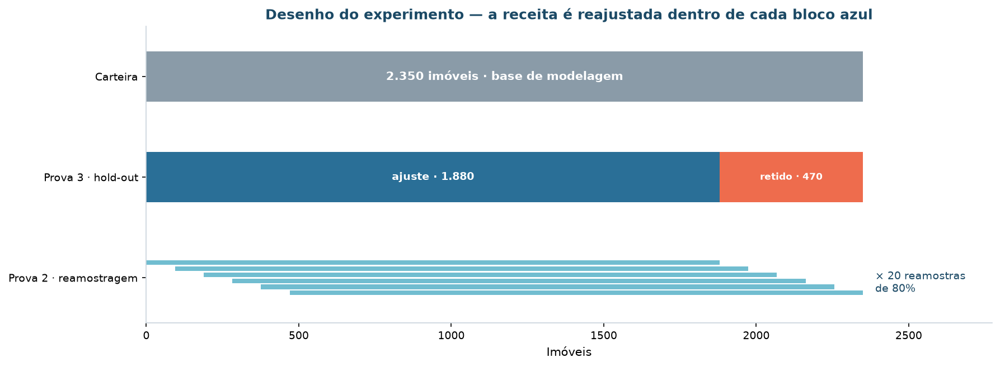

| Bloco | Imóveis | Papel |
|:---|---:|:---|
| Carteira | 2.350 | Base de modelagem |
| Ajuste | 1.880 | Prova 3 — onde a receita é ajustada |
| **Retido** | **470** | Prova 3 — **nunca visto pelo modelo** |
| Reamostra | 1.880 | Prova 2 — 20 sorteios sem reposição |

### As três provas

| Prova | O que mede | Como |
|:---|:---|:---|
| **1 · Varredura** | O modelo separa? | Silhueta, tamanho do menor grupo e ruído sobre a grade inteira |
| **2 · Reamostragem** | O modelo se reproduz? | 20 sorteios de 80%, reagrupando do zero, ARI contra a partição de referência |
| **3 · Hold-out** | O modelo generaliza? | Ajuste em 1.880, atribuição dos 470 retidos, silhueta e ARI no retido |

Um modelo só é aprovado se passa nas **três**. A tabela de critérios foi lida do
manifesto da fase 1 — nunca redigitada:

| Critério | Valor | Origem |
|:---|:---|:---|
| Número de grupos | entre 2 e 5 | Canvas · o orçamento financia até 5 ações diferenciadas |
| Silhueta | ≥ 0,15 | Canvas · piso abaixo do qual não há separação defensável |
| Menor segmento | ≥ 2% da carteira | Canvas · abaixo disso não há massa para ação própria |
| Ruído (métodos de densidade) | ≤ 10% da carteira | Canvas · imóvel sem grupo é entrega, mas não pode ser a regra |
| Estabilidade sob reamostragem | ARI ≥ 0,75 | Canvas · revisão 2 do quadro de critérios |
| Generalização ao retido | ARI ≥ 0,75 e silhueta ≥ 0,15 | Desenho deste notebook · exigência da fase 6 |
| Independência do rótulo reservado | ARI contra quartis de preço < 0,40 | Canvas · revisão 3 — **medido na fase 5**, com o rótulo aberto |

> Evidência: `reports/tables/modelagem/criterios-de-aceitacao.csv` ·
> `reports/tables/modelagem/desenho-do-experimento.csv`

### A grade

**47 execuções**, distribuídas em cinco famílias de técnica:

| Família | Configuração | Espaço | Parâmetro varrido | Execuções |
|:---|:---|:---|:---|---:|
| Particional | K-Means | euclidiano | *k* = 2…10 | 9 |
| Particional | K-Medoids | Gower | no *k* decidido | 1 |
| Hierárquica | Aglomerativa | euclidiano | 4 ligações | 4 |
| Densidade | DBSCAN | euclidiano | 13 valores de `eps`, minPts = 2*d* | 13 |
| Densidade | Mean Shift | euclidiano | 4 quantis de largura de banda | 4 |
| Probabilística | GMM | euclidiano | 4 covariâncias × *k* = 2…5 | 16 |
| | | | **TOTAL** | **47** |

## Variáveis e espaços de atributos

O espaço publicado tem **17 variáveis**. A escolha da distância não é detalhe de
implementação: ela define quem é vizinho de quem.

| Critério pede | Variáveis usadas |
|:---|:---|
| Porte do imóvel | `area_habitavel`, `area_porao`, `area_terreno`, `area_garagem`, `area_varandas` |
| Configuração | `comodos`, `dormitorios`, `banheiros_total`, `lareiras` |
| Padrão construtivo | `qualidade_geral`, `qualidade_externa`, `qualidade_cozinha`, `qualidade_porao`, `acabamento_garagem` |
| Idade e conservação | `idade_imovel`, `anos_desde_reforma`, `conservacao_geral` |

| Espaço | Variáveis | Distância | O que se ganha, o que se perde |
|:---|:-:|:---|:---|
| **Euclidiano** | 17 | euclidiana sobre variáveis padronizadas | As nominais ficam de fora; nenhuma delas domina a geometria |
| **Misto (Gower)** | 22 | dissimilaridade de Gower, peso igual por variável | Trata nominais nativamente — mas cada nominal pesa tanto quanto cada numérica |

O pré-processamento está descrito em [Preparação dos dados](preparacao.md).

!!! info "Sobre a dissimilaridade de Gower"
    Não existe no `scikit-learn`. A implementação é própria (`src/model/distancias.py`)
    e a fórmula cabe em quinze linhas: para cada par de registros, é a média das
    contribuições de cada variável — diferença normalizada pela amplitude, no caso das
    numéricas; 0 ou 1, no caso das nominais. O custo é quadrático: acima de ~10.000
    registros, amostre.

### O diagnóstico do espaço, antes de agrupar

Medir a geometria antes de escolher a técnica evita descobrir na saída o que a entrada
já dizia.

| Medida | Valor | Lê-se |
|:---|---:|:---|
| Registros por dimensão | 138,2 | Folgado — não há maldição da dimensionalidade aqui |
| Contraste p99/p01 | 4,28 | Há contraste de distância: técnicas de centroide fazem sentido |
| Coef. de variação das distâncias | 0,298 | — |
| Dissimilaridade de Gower mediana | 0,237 | — |
| **Razão joelho / mediana da k-distância** | **1,29** | **Sem degrau: previsão de falha para densidade** |
| Duplicatas exatas no espaço | 6 | Irrelevante para o agrupamento |

O último número é o que importa: a curva de k-distância **não tem joelho**. Isso foi
registrado como *previsão de falha* para DBSCAN e Mean Shift **antes** de os dois
rodarem — e a varredura confirmou.

> Evidência: `reports/tables/modelagem/diagnostico-do-espaco.csv` ·
> `reports/tables/modelagem/familias-de-tecnicas.csv`

## A escolha de *k*

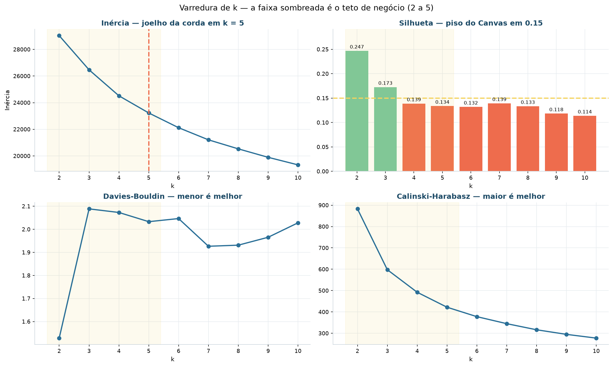

A regra foi declarada antes do resultado: **o maior *k* que ainda passa em todos os
critérios**. Ela *não* é "o *k* de maior silhueta", e o motivo é de negócio — a
silhueta cresce quando *k* diminui, e levada ao limite devolve dois grupos, "caro" e
"barato", que a diretoria já tem.

| *k* | Silhueta | Menor grupo | ARI médio | ARI mínimo | Passa em tudo |
|:-:|---:|---:|---:|---:|:-:|
| 2 | **0,2468** | 41,3% | **0,9942** | 0,9746 | ✅ |
| **3** | **0,1726** | 28,4% | 0,9575 | 0,9354 | ✅ |
| 4 | 0,1388 | 16,7% | 0,9323 | 0,8645 | ❌ silhueta |
| 5 | 0,1337 | 14,6% | 0,9411 | 0,8738 | ❌ silhueta |
| 6 | 0,1320 | 9,1% | 0,9464 | 0,8902 | ❌ silhueta, *k* fora da faixa |
| 7 | 0,1392 | 2,7% | 0,9109 | 0,5843 | ❌ silhueta, *k*, ARI mínimo |
| 8 | 0,1333 | 2,7% | 0,7298 | 0,6408 | ❌ silhueta, *k*, ARI |
| 9 | 0,1183 | 2,6% | 0,7658 | 0,6540 | ❌ silhueta, *k*, ARI mínimo |
| 10 | 0,1138 | 2,6% | 0,7822 | 0,4946 | ❌ silhueta, *k*, ARI mínimo |

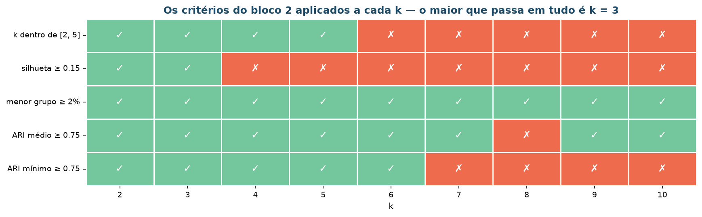

Só **dois** valores passam em tudo: *k* = 2 e *k* = 3. Pela regra, vence o maior —
**k = 3**. E *k* = 4 não é uma escolha que se possa fazer: reprova por **0,0112** de
silhueta (0,1388 contra o piso de 0,15).

!!! warning "A margem é estreita — e está registrada"
    Reprovar *k* = 4 por pouco mais de um centésimo de silhueta é frágil o suficiente
    para merecer registro. O piso único de 0,15 favorece *k* pequeno **por construção**:
    a silhueta cai à medida que *k* cresce, então um piso fixo vira, na prática, um teto
    de granularidade.

    Isso foi levado à sessão de encerramento como deliberação formal — *declarar o piso
    de silhueta por faixa de k, antes da próxima execução da cadeia*. É revisão do
    critério, não do resultado: enquanto o critério vigente for este, o resultado é
    *k* = 3.

### A estabilidade, faixa a faixa

Reamostrando 80% da carteira 20 vezes e reagrupando do zero:

| *k* | ARI médio | ARI mínimo | Desvio | Repetições abaixo do piso |
|:-:|---:|---:|---:|---:|
| 2 | 0,9942 | 0,9746 | 0,0055 | 0 |
| **3** | **0,9575** | **0,9354** | 0,0123 | **0** |
| 4 | 0,9323 | 0,8645 | 0,0375 | 0 |
| 5 | 0,9411 | 0,8738 | 0,0305 | 0 |
| 6 | 0,9464 | 0,8902 | 0,0214 | 0 |
| 7 | 0,9109 | 0,5843 | 0,0995 | **2** |
| 8 | 0,7298 | 0,6408 | 0,0902 | **17** |
| 9 | 0,7658 | 0,6540 | 0,0930 | **9** |
| 10 | 0,7822 | 0,4946 | 0,1049 | **6** |

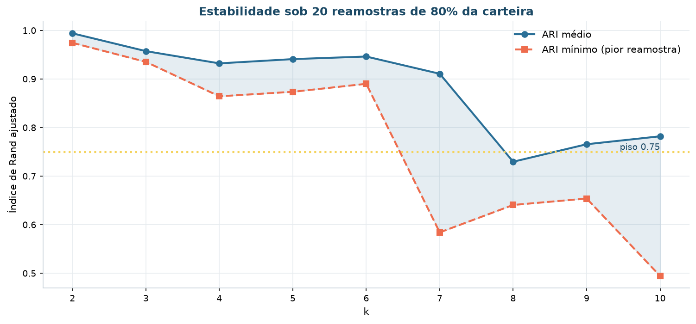

A leitura importante está na coluna do ARI **mínimo**, não na média: a partir de *k* = 7
a média ainda parece aceitável enquanto o pior sorteio despenca. Média de estabilidade
esconde instabilidade.

### A silhueta que a média esconde

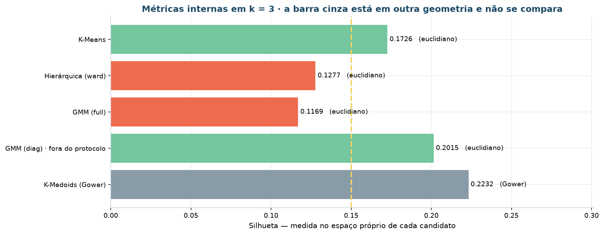

| Segmento | Registros | Silhueta média | Mediana | Mínimo | % negativa |
|:---|---:|---:|---:|---:|---:|
| **S1** · Compacto herdado | 914 | 0,1786 | 0,1823 | −0,0359 | 0,8% |
| **S2** · Amplo para requalificar | 667 | **0,0555** | 0,0509 | −0,0647 | **25,6%** |
| **S3** · Recente de alto padrão | 769 | **0,2669** | 0,2881 | 0,0330 | 0,0% |

A média global de 0,1726 esconde uma variação de quase **5×** entre o grupo mais coeso
(S3) e o menos coeso (S2). **S2 é o segmento de fronteira**: fica entre S1 e S3 no
espaço de atributos, e **um quarto** dos seus imóveis tem silhueta negativa — estariam
melhor alocados em outro grupo.

Isso não invalida o S2; é informação operacional, e é ela que sustenta a
[regra de fronteira](implementacao.md) da fase 6. É o segmento assistido: onde a
classificação automática deve ser revisada por gente.

> Evidência: `reports/tables/modelagem/silhueta-por-segmento.csv` ·
> `reports/tables/modelagem/varredura-de-k.csv` ·
> `reports/tables/modelagem/estabilidade-por-k.csv`

## Os algoritmos comparados

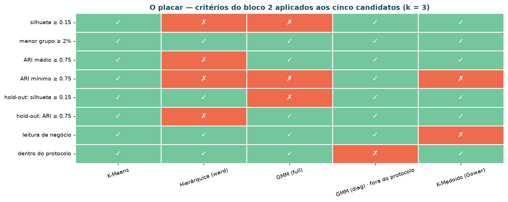

Todas as métricas medidas no **mesmo espaço de referência** — o euclidiano padronizado
—, independentemente do espaço em que cada algoritmo foi ajustado. É a única forma de
comparar.

| Modelo | Grupos | Silhueta | Davies-Bouldin | Menor grupo | ARI médio | Silhueta no retido | Critérios reprovados |
|:---|:-:|---:|---:|---:|---:|---:|:-:|
| **K-Means** | 3 | 0,1726 | 2,089 | 28,4% | **0,9575** | 0,1782 | **0** ✅ |
| Hierárquica (ward) | 3 | 0,1277 | 2,195 | 20,4% | 0,4345 | 0,1807 | 4 |
| GMM (full) | 3 | 0,1169 | 3,519 | 7,2% | 0,9109 | 0,1204 | 3 |
| GMM (diag) · *fora do protocolo* | 3 | **0,2015** | 3,133 | 8,5% | **0,9907** | 0,2014 | 1 |
| K-Medoids (Gower) | 3 | **0,2232** ¹ | — | 19,8% | 0,8505 | 0,2202 | 2 |

¹ Medida na própria dissimilaridade de Gower. **Não é comparável** às demais: silhueta
calculada em espaços métricos diferentes não é uma escala comum.

!!! danger "O candidato que ganharia — e por que não conta"
    O **GMM com covariância diagonal** tem a melhor combinação da tabela: silhueta
    0,2015 contra 0,1726 do K-Means, ARI de reamostragem 0,9907 contra 0,9575, e passa
    no retido. Pela métrica, ganharia.

    Ele está marcado como **fora do protocolo** porque a covariância `diag` não constava
    da grade declarada antes da execução — apareceu na varredura das quatro covariâncias
    e teria sido escolhida *depois* de ver o resultado. Aceitá-la seria mover a trave: o
    protocolo existe justamente para que o melhor número não redefina a regra.

    Fica registrado como candidato para a próxima execução, com a covariância declarada
    **antes**. É a diferença entre um achado e um resultado.

### Concordância entre as partições

ARI de cada par de candidatos:

| | K-Means | Ward | GMM (full) | GMM (diag) | K-Medoids |
|:---|---:|---:|---:|---:|---:|
| **K-Means** | 1,000 | 0,406 | 0,283 | 0,478 | 0,368 |
| **Ward** | 0,406 | 1,000 | 0,225 | 0,491 | 0,339 |
| **GMM (full)** | 0,283 | 0,225 | 1,000 | 0,531 | 0,237 |
| **GMM (diag)** | 0,478 | 0,491 | 0,531 | 1,000 | 0,396 |
| **K-Medoids** | 0,368 | 0,339 | 0,237 | 0,396 | 1,000 |

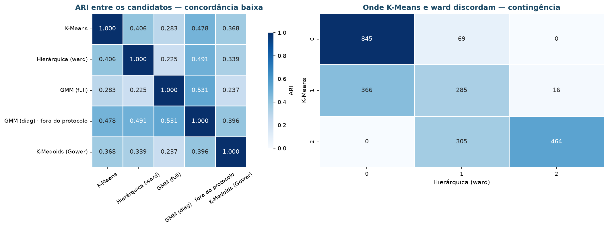

Nenhum par passa de 0,53. Os algoritmos **não** estão encontrando a mesma estrutura por
caminhos diferentes — cada um lê o espaço com uma premissa própria, e a premissa muda o
resultado. É mais uma razão para o critério de aprovação valer mais que a métrica
isolada.

### Hierárquica: quatro critérios de ligação

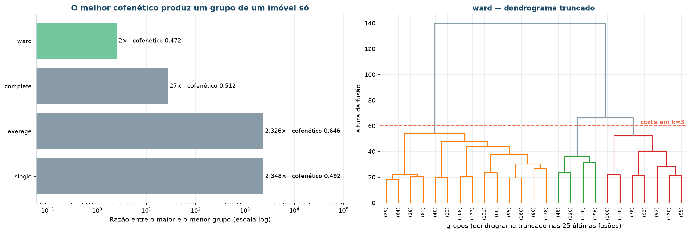

| Ligação | Cofenético | Menor grupo | Maior grupo | Razão | Salto da última fusão |
|:---|---:|---:|---:|---:|---:|
| `ward` | 0,4720 | 480 | 1.211 | **2,5×** | 2,109 |
| `complete` | 0,5121 | 65 | 1.755 | 27× | 1,262 |
| `average` | **0,6464** | **1** | 2.326 | 2.326× | 1,013 |
| `single` | 0,4922 | **1** | 2.348 | 2.348× | 1,078 |

!!! warning "Quando a melhor métrica é o pior resultado"
    O coeficiente cofenético favorece `average` (0,6464), que é a métrica canônica para
    escolher critério de ligação. E `average` produz um grupo com **2.326 imóveis** e
    outro com **um**.

    É o efeito de encadeamento: ligações baseadas em distância mínima ou média vão
    agregando os pontos um a um ao mesmo aglomerado. O dendrograma representa bem as
    distâncias originais — e não serve para nada, porque nenhum orçamento se reparte
    2.326 para 1.

    `ward` é a escolha, e a justificativa é a viabilidade, não a métrica. Ainda assim
    reprova em 4 critérios: ARI de reamostragem 0,4345, com **as 20 reamostras abaixo do
    piso**.

### Por que o Gower foi descartado

O K-Medoids sobre Gower tem a maior silhueta da tabela — e particiona a carteira por
**estilo construtivo**, não por linha de produto:

| Segmento | 1Story | 2Story | 1.5Fin | SLvl | outras |
|:-:|---:|---:|---:|---:|---:|
| 0 | **78,3%** | 5,9% | 4,4% | 6,2% | 5,2% |
| 1 | 13,9% | 31,3% | **43,3%** | 1,7% | 9,8% |
| 2 | 37,7% | **53,6%** | 2,1% | 4,9% | 1,7% |

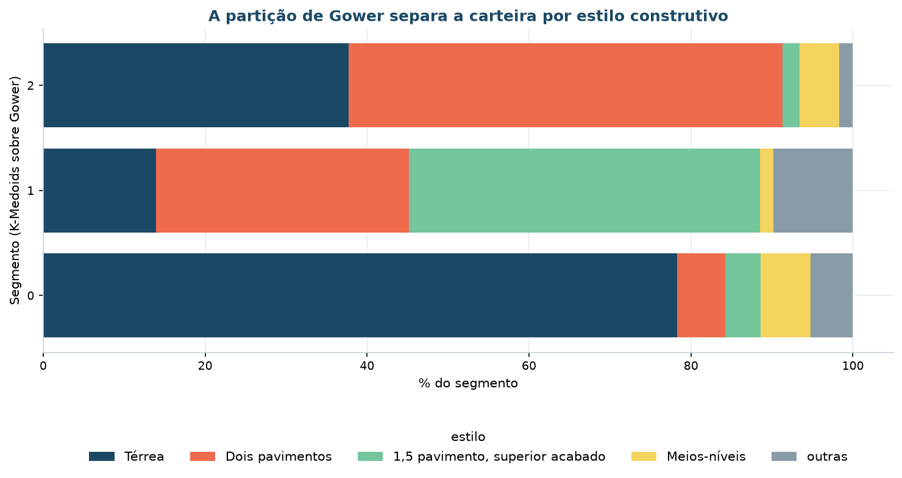

Com peso igual por variável, as cinco nominais respondem por 5/22 da dissimilaridade — e
`estilo` sozinho reorganiza o resultado. A partição é coesa e é sobre outra pergunta: *de
que estilo é o imóvel*, e não *que linha de produto ele é*. A leitura de negócio
reprovou.

### Por que DBSCAN e Mean Shift falharam

O diagnóstico já previa: razão joelho/mediana de **1,29**, sem degrau. A varredura de 13
valores de `eps` confirmou.

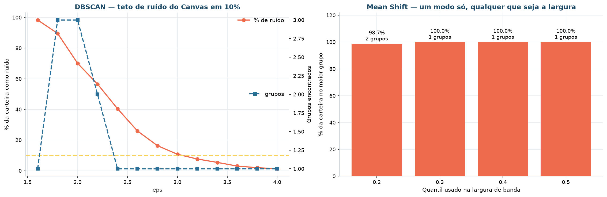

| `eps` | Grupos | % ruído | Maior grupo |
|---:|:-:|---:|---:|
| 1,8 | 3 | **89,6%** | 3,8% |
| 2,0 | 3 | **70,1%** | 16,7% |
| 2,2 | 2 | **56,6%** | 21,8% |
| 2,4 | 1 | 40,5% | 59,5% |
| 3,0 | 1 | 10,8% | 89,2% |
| 4,0 | 1 | 1,3% | **98,7%** |

Não existe `eps` que entregue simultaneamente **ruído ≤ 10%** e **de 2 a 5 grupos**. Ou
o algoritmo joga a maioria da carteira no ruído, ou colapsa tudo num grupo só. Não é
defeito de parametrização: a carteira **não tem vales de densidade** entre as linhas de
produto — os grupos são regiões contíguas de um contínuo, e é por isso que técnicas de
centroide funcionam aqui e técnicas de densidade não.

!!! note "Consequência para o objetivo 4"
    O objetivo 4 do Canvas — *isolar os imóveis fora de padrão* — dependia de uma
    configuração de densidade admissível, e não há. Ele **não foi entregue** nesta
    cadeia. O que a fase 6 entrega no lugar não é a mesma coisa, e não se apresenta como
    tal: a [faixa de fronteira](implementacao.md) marca o imóvel que está *entre dois
    grupos*, não o imóvel que está *fora de todos*.

### GMM: a varredura das covariâncias

| Covariância | *k* | BIC | Silhueta | % na fronteira |
|:---|:-:|---:|---:|---:|
| `full` | 3 | 57.419,9 | 0,1169 | 0,3% |
| `tied` | 3 | 89.886,4 | 0,1264 | 0,3% |
| `diag` | 3 | 72.324,0 | **0,2015** | 0,6% |
| `spherical` | 3 | 101.485,1 | 0,1561 | 1,7% |
| `full` | 5 | **37.842,8** | 0,0448 | 0,0% |

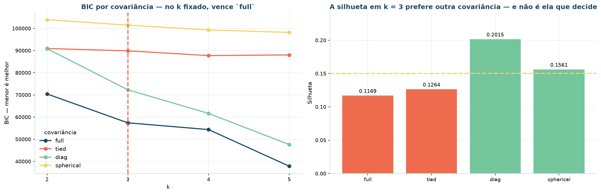

O BIC **não tem mínimo** na faixa: cai monotonicamente com *k* e com a flexibilidade da
covariância, e o menor valor de toda a varredura é o do modelo com a pior silhueta
(`full`, *k* = 5: BIC 37.842,8 e silhueta 0,0448). Selecionar por BIC aqui devolveria o
modelo menos útil da tabela.

## O modelo escolhido

**K-Means, *k* = 3, espaço euclidiano de 17 variáveis, semente 42.** Único candidato com
zero critérios reprovados.

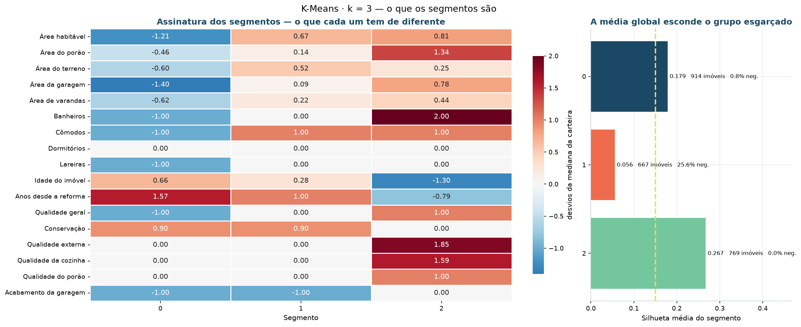

| Segmento | Imóveis | Part. | Área hab. | Porão | Terreno | Banh. | Cômodos | Lareiras | Idade | Desde reforma | Qual. geral |
|:-:|---:|---:|---:|---:|---:|---:|---:|---:|---:|---:|---:|
| **S1** | 914 | 39% | 1.048 | 864 | 8.094 | 1,5 | 5 | 0 | 52 | 39 | 5 |
| **S2** | 667 | 28% | 1.628 | 995 | 10.304 | 2,0 | 7 | 1 | 43 | 31 | 6 |
| **S3** | 769 | 33% | 1.673 | 1.254 | 9.765 | 3,0 | 7 | 1 | **6** | **6** | 7 |

Valores medianos, em unidades originais (pé² e anos).

### A assinatura: por que os grupos são diferentes

A leitura em uma frase por linha:

- **S1** está abaixo da mediana em toda medida de porte e acima em idade e tempo desde a
  reforma. É o estoque herdado;
- **S2** tem porte de S3 e padrão construtivo de S1 — 55% mais área que o S1, com
  qualidade de cozinha e banheiro meio nível abaixo do S3. É onde a reforma tem alavanca;
- **S3** se separa por **idade**, não por tamanho: 6 anos contra 43 do S2, com área
  habitável quase igual.

O que distingue S2 de S3 **não é metragem, é estado**. Essa é a leitura que uma tabela
de preço não dá.

### Os representantes reais

Cada linha tem um imóvel de verdade no centro, com matrícula — não um centroide médio
que não existe na carteira:

| Segmento | `pid` | Área hab. | Qual. geral | Idade | Banheiros | Cômodos | Estilo |
|:-:|---:|---:|:-:|---:|---:|:-:|:---|
| **S1** | 532376180 | 909 | 5 | 38 | 1,0 | 5 | 1Story |
| **S2** | 905103040 | 1.683 | 6 | 31 | 2,5 | 7 | 2Story |
| **S3** | 907187040 | 1.873 | 7 | 8 | 2,5 | 7 | 2Story |

> Evidência: `reports/tables/modelagem/placar-dos-candidatos.csv` ·
> `reports/tables/modelagem/perfil-do-modelo-escolhido.csv` ·
> `reports/tables/modelagem/representantes-reais.csv` ·
> `reports/tables/modelagem/assinatura-dos-segmentos.csv`

### Reprodutibilidade dos rótulos

O rótulo que o K-Means atribui é arbitrário: reexecutar com outra semente troca o número
dos grupos. `src/model/personas.py` reordena os segmentos por qualidade geral e área, de
modo que o **segmento 0 seja sempre o de padrão mais baixo**, e o pacote publicado leva o
`mapa_canonico` correspondente. Sem isso, qualquer texto que se refira a "S2" fica errado
na próxima rodada.

## As três linhas de produto

O agrupamento vira produto quando cada grupo tem **um nome**, **uma ação** e **uma forma
de saber se a ação funcionou**.

=== "S1 · Compacto herdado"

    **914 imóveis · 38,9% da carteira · 27,3% da receita**

    1.048 pé² habitáveis, 52 anos de idade e 39 anos desde a última reforma; qualidade
    geral 5, 1,5 banheiros e sem lareira. 30% em zoneamento de média densidade.

    | | |
    |:---|:---|
    | **Política de preço** | Percentil 40 do bairro — precificação por giro, não por margem |
    | **Teto de reforma** | 6% do valor de avaliação |
    | **Ação** | Decisão unidade a unidade em 12 meses: reforma leve padronizada (pintura, piso e louças) e venda, ou conversão em ativo de renda, ou desinvestimento. Acima do teto de 6%, o retorno não se paga neste padrão |
    | **Canal** | Digital, com foco em primeira aquisição e crédito facilitado |
    | **Métrica** | Percentual do grupo com destino definido em 12 meses e tempo médio de giro |
    | **Meta** | 100% com destino definido · giro de 90 para 60 dias |

=== "S2 · Amplo para requalificar"

    **667 imóveis · 28,4% da carteira · 27,9% da receita**

    1.628 pé² habitáveis — 55% mais espaço que o S1 — com 7 cômodos, 2,0 banheiros e
    lareira, aos 43 anos. É o **menor preço por pé² da carteira**: US$ 105,42 contra
    US$ 133,90 do S3.

    | | |
    |:---|:---|
    | **Política de preço** | Comparação direta de bairro, com reavaliação após a reforma |
    | **Teto de reforma** | 12% do valor de avaliação |
    | **Ação** | Pacote de valorização concentrado em cozinha e banheiro — os dois atributos em que o grupo fica meio nível abaixo do S3 — executado antes do anúncio |
    | **Canal** | Corretagem tradicional, com foco em família em segunda aquisição |
    | **Métrica** | Ganho de preço realizado sobre o custo da reforma e percentual reformado antes do anúncio |
    | **Meta** | ganho ≥ 1,8× o investido · ≥ 70% reformados antes do anúncio |

    !!! warning "É a linha assistida"
        25,6% dos imóveis do S2 têm silhueta negativa e 25,8% caem na faixa de fronteira.
        É a linha em que a classificação automática **não** dispara sozinha.

=== "S3 · Recente de alto padrão"

    **769 imóveis · 32,7% da carteira · 44,8% da receita**

    6 anos de idade mediana, qualidade geral 7, 3,0 banheiros e porão de 1.254 pé². É um
    terço da carteira em unidades e quase metade da receita transacionada.

    | | |
    |:---|:---|
    | **Política de preço** | Comparação com lançamentos do período; desconto só acima de 90 dias em estoque |
    | **Teto de reforma** | sem reforma — o imóvel já está no padrão |
    | **Ação** | Corretor dedicado, material de venda com fotografia profissional e vitrine premium. Nenhum orçamento de requalificação: gastar aqui é destruir margem no grupo que sustenta a receita |
    | **Canal** | Corretagem dedicada e vitrine premium |
    | **Métrica** | Razão entre preço realizado e preço anunciado e percentual de vendas sem desconto |
    | **Meta** | realizado ÷ anunciado ≥ 0,97 · ≥ 60% sem desconto |

## O que esta fase não entregou

| Prometido no Canvas | Situação |
|:---|:---|
| **Objetivo 3** — regras de coocorrência entre atributos construtivos | Não executado sobre a carteira depurada. A implementação de Apriori, Eclat e FP-Growth permanece em `src/model/associacao.py`, com teste, mas a etapa não foi refeita |
| **Objetivo 4** — isolar os imóveis fora de padrão | A varredura não encontrou configuração de densidade admissível (ver acima). Sem entrega |

As duas foram levadas à sessão de encerramento como **deliberações formais**, com dono e
prazo — não como resultados parciais. O registro está em
`reports/tables/implantacao/deliberacoes.csv`.

## Saídas

| Arquivo | Conteúdo |
|:---|:---|
| `data/processed/base_segmentada.parquet` | Base de modelagem + segmento canônico |
| `models/modelo-segmentacao.joblib` | Pré-processador + K-Means em um único objeto |
| `data/processed/manifesto_modelagem.json` | *k*, espaço, semente, métricas, modelos reprovados e as 30 decisões |
| `docs/imagens/modelagem/*.png` | 15 figuras |
| `reports/tables/modelagem/*.csv` | Tabelas-fonte de cada figura |

## Reprodução

```bash
uv run invoke notebooks     # executa a cadeia 00–06; a fase 4 é o notebook 04
```
