# Modelagem dos dados

**CRISP-DM fase 4.** Esta página descreve o **desenho do experimento**: qual problema o
modelo resolve, sobre que unidade de análise opera, quais variáveis entram, quais
técnicas foram testadas e como o resultado é avaliado tecnicamente.

## Problema

> Descobrir em quantos grupos naturais a carteira residencial se divide e o que
> caracteriza cada um, **sem usar o preço**.

Corresponde aos objetivos **1**, **2**, **3** e **4** dos
[critérios de sucesso](criterios-sucesso.md).

| Onde está implementado | Arquivo |
|:---|:---|
| Clusterização, escolha de *k*, comparativo | `src/pipeline/modelagem.py` |
| Regras de associação | `src/pipeline/regras.py` |
| Distâncias, incluindo Gower | `src/model/distancias.py` |
| K-Means, K-Medoids, métricas de escolha de *k* | `src/model/particional.py` |
| Hierárquica | `src/model/hierarquica.py` |
| DBSCAN e Mean Shift | `src/model/densidade.py` |
| GMM | `src/model/mistura.py` |
| PCA, Kernel PCA e LDA | `src/model/reducao.py` |
| Notebooks | `03`, `04`, `05` |

## Unidade de análise

Um registro por **imóvel residencial transacionado** (`pid`).

A pergunta de negócio é sobre o **produto**: que tipo de imóvel a carteira tem. Se a
unidade fosse a transação por bairro, os bairros grandes dominariam o resultado; se
fosse o bairro, a variação **dentro** do bairro — que é onde estão as linhas de
produto — desapareceria na média.

## Variáveis

| Critério pede | Variáveis usadas | Observação |
|:---|:---|:---|
| Porte do imóvel | `area_habitavel`, `area_porao`, `area_terreno`, `area_garagem`, `area_varandas` | Cinco medidas de área, três com `log1p` |
| Configuração | `comodos`, `dormitorios`, `banheiros_total`, `lareiras` | O que distingue produtos de mesma metragem |
| Padrão construtivo | `qualidade_geral`, `qualidade_externa`, `qualidade_cozinha`, `qualidade_porao`, `acabamento_garagem` | Escalas ordinais mapeadas para inteiro |
| Idade e conservação | `idade_imovel`, `anos_desde_reforma`, `conservacao_geral` | Distingue o antigo reformado do antigo intocado |
| Tipologia | `zoneamento`, `tipo_construcao`, `estilo`, `tipo_garagem`, `ar_central` | Nominais — entram por Gower ou *one-hot* |
| — | `tem_porao`, `tem_garagem`, `tem_lareira`, `tem_segundo_pavimento` | Acrescentadas: preservam a informação que o zero da área esconde |

O pré-processamento está descrito em [Preparação dos dados](preparacao.md).

## As três leituras do espaço de atributos

A escolha da distância não é detalhe de implementação: ela define quem é vizinho de
quem. Três leituras foram construídas e comparadas.

| Espaço | Variáveis | Distância | O que se ganha, o que se perde |
|:---|:-:|:---|:---|
| **Euclidiano enxuto** | 21 | euclidiana sobre variáveis padronizadas | As nominais ficam de fora; nenhuma delas domina a geometria |
| **Euclidiano com one-hot** | 49 | euclidiana sobre variáveis padronizadas | 28 colunas binárias não padronizadas competem com 21 contínuas |
| **Misto (Gower)** | 22 | dissimilaridade de Gower, peso igual por variável | Trata nominais nativamente — mas cada nominal pesa tanto quanto cada numérica |

!!! info "Sobre a dissimilaridade de Gower"
    Não existe no `scikit-learn`. A implementação é própria (`src/model/distancias.py`)
    e a fórmula cabe em quinze linhas: para cada par de registros, é a média das
    contribuições de cada variável — diferença normalizada pela amplitude, no caso das
    numéricas; 0 ou 1, no caso das nominais.

    Com 2.925 imóveis a matriz ocupa **34 MB** em `float32` e leva cerca de 1 s para
    ser calculada. O custo é quadrático: acima de ~10.000 registros, amostre.

## A escolha de *k*

Quatro métricas internas, mais estabilidade por reamostragem, mais o teto operacional
de cinco grupos.

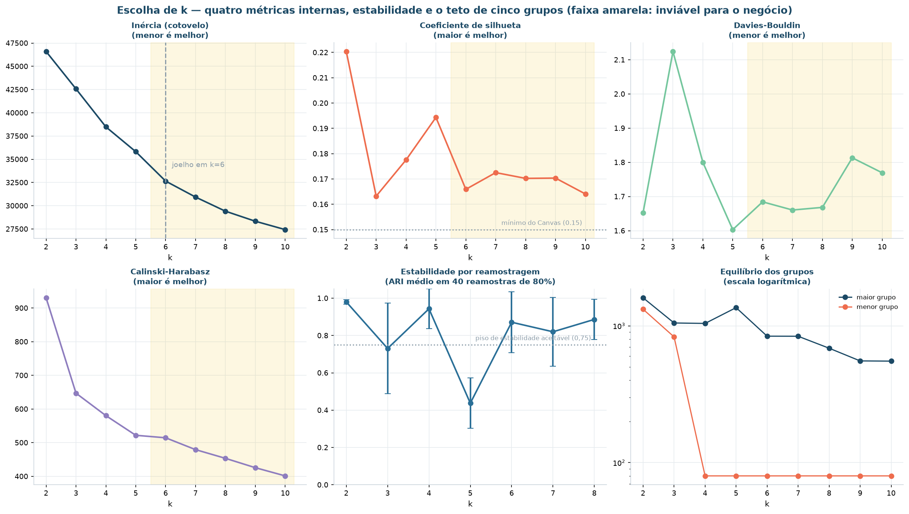

| k | Inércia | Silhueta | Davies-Bouldin | Calinski-Harabasz | Menor grupo | Estabilidade (ARI) |
|:-:|---:|---:|---:|---:|---:|---:|
| 2 | 46.593 | **0,2204** | 1,652 | **930,5** | 1.322 | **0,980** |
| 3 | 42.571 | 0,1632 | 2,124 | 647,0 | 830 | 0,731 |
| **4** | **38.485** | **0,1775** | 1,800 | 580,4 | 80 | **0,943** |
| 5 | 35.816 | 0,1943 | **1,603** | 521,9 | 80 | 0,437 |
| 6 | 32.650 | 0,1659 | 1,684 | 514,5 | 80 | 0,871 |
| 7 | 30.934 | 0,1725 | 1,661 | 479,4 | 80 | 0,820 |
| 8 | 29.415 | 0,1702 | 1,668 | 453,5 | 80 | 0,886 |

### A decisão, critério a critério

| Critério | Aponta para | Leitura |
|:---|:-:|:---|
| Cotovelo da inércia | 6 | Sugere mais grupos do que o negócio consegue operar |
| Maior silhueta global | 2 | 0,2204 — mas com apenas duas linhas de produto |
| Maior silhueta dentro do teto de 5 | 2 | 0,2204 |
| Menor Davies-Bouldin dentro do teto | 5 | 1,6032 |
| Estabilidade por reamostragem (ARI ≥ 0,75) | 2 e 4 | Os demais não se reproduzem |
| Restrição operacional do Canvas | 2 a 5 | Orçamento para cinco ações diferenciadas |
| **DECISÃO** | **4** | Maior *k* simultaneamente estável, acima da silhueta mínima e viável |

!!! success "O que o teste de estabilidade derrubou"
    As métricas de coesão preferiam **k = 5**: melhor Davies-Bouldin de toda a faixa
    (1,603) e silhueta superior à de k = 4 (0,1943 contra 0,1775).

    O teste de estabilidade derrubou. Reamostrando 80% da carteira 40 vezes e
    reagrupando do zero, o índice de Rand ajustado médio contra a partição de
    referência cai de **0,943** (k = 4) para **0,437** (k = 5). A quinta linha de
    produto não se reproduz: ela existe nesta amostra, não no mercado.

    Sem esse teste, o projeto teria entregue cinco segmentos — com métrica melhor e
    resultado pior.

E **k = 2**, que tem a melhor métrica e a melhor estabilidade? Foi descartado por
critério de negócio, não técnico: dois grupos são "caro" e "barato", e a diretoria já
sabe disso. O pedido era por linhas de produto operáveis, e duas não justificam o
projeto.

### A silhueta que a média esconde

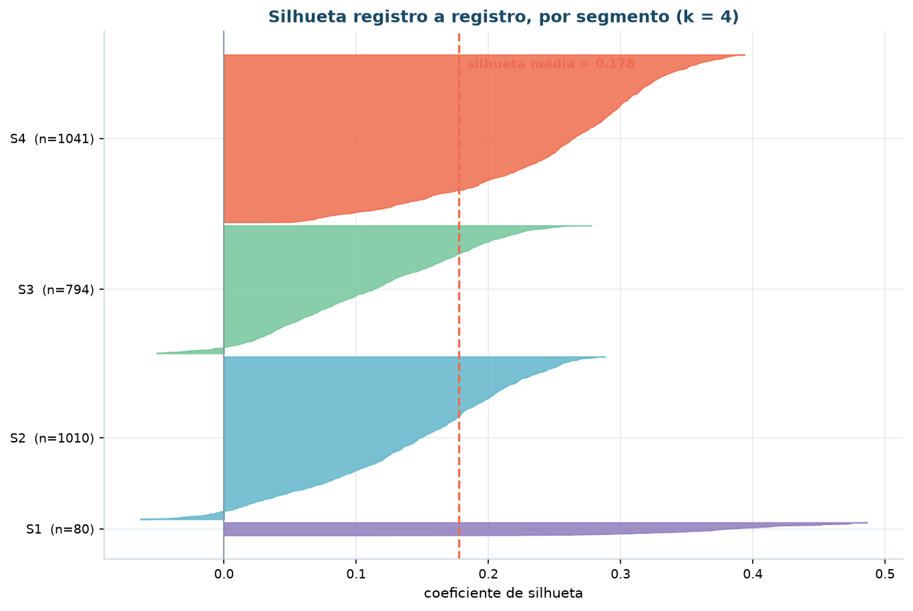

| Segmento | Registros | Silhueta média | Mediana | Mínimo | % negativa |
|:---|---:|---:|---:|---:|---:|
| S1 · Requalificação sem porão | 80 | **0,3757** | 0,3787 | 0,1170 | 0,0% |
| S2 · Compacto de entrada | 1.010 | 0,1391 | 0,1477 | −0,0634 | 5,2% |
| S3 · Familiar consolidado | 794 | **0,1118** | 0,1126 | −0,0510 | 4,9% |
| S4 · Novo de alto padrão | 1.041 | 0,2497 | 0,2640 | 0,0239 | 0,0% |

A média global de 0,1775 esconde uma variação de 3,4× entre o grupo mais coeso (S1) e o
menos coeso (S3). **S3 é o segmento de fronteira**: fica entre S2 e S4 no espaço de
atributos, e 4,9% dos seus imóveis têm silhueta negativa — estariam melhor alocados em
outro grupo.

Isso não invalida S3; é informação operacional. É o segmento em que a classificação
automática deve ser revisada com mais frequência, e a aplicação sinaliza esses casos.

## Os algoritmos comparados

### Hierárquica: quatro critérios de ligação

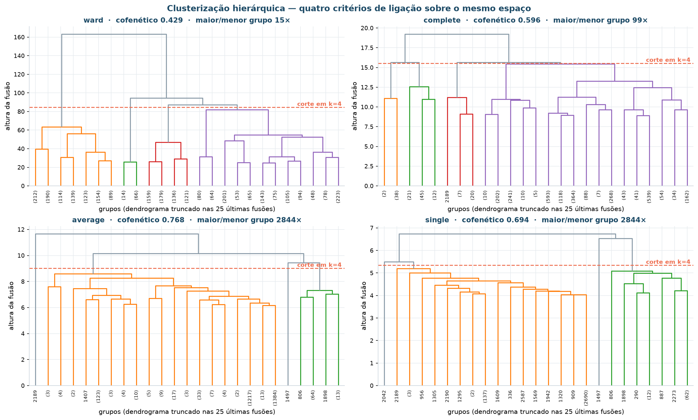

| Ligação | Cofenético | Menor grupo | Maior grupo | Razão | Leitura |
|:---|---:|---:|---:|---:|:---|
| `ward` | 0,429 | 80 | 1.229 | 15× | Pior cofenético, **melhor equilíbrio** |
| `complete` | 0,596 | 28 | 2.779 | 99× | Um grupo com 95% da carteira |
| `average` | **0,768** | **1** | 2.844 | 2.844× | Encadeamento: um grupo de um elemento |
| `single` | 0,694 | **1** | 2.844 | 2.844× | Encadeamento clássico |

!!! warning "Quando a melhor métrica é o pior resultado — de novo"
    O coeficiente cofenético favorece `average` (0,768), que é a métrica canônica para
    escolher critério de ligação. E `average` produz um grupo com **2.844 imóveis** e
    outro com **um**.

    É o efeito de encadeamento: ligações baseadas em distância mínima ou média entre
    grupos vão agregando os pontos um a um ao mesmo aglomerado. O dendrograma
    representa bem as distâncias originais — e não serve para nada, porque nenhum
    orçamento se reparte 2.844 para 1.

    `ward` é a escolha, e a justificativa é a viabilidade, não a métrica.

### A matriz comparativa

Todas as métricas medidas no **mesmo espaço de referência** — o euclidiano padronizado
—, independentemente do espaço em que cada algoritmo foi ajustado. É a única forma de
comparar.

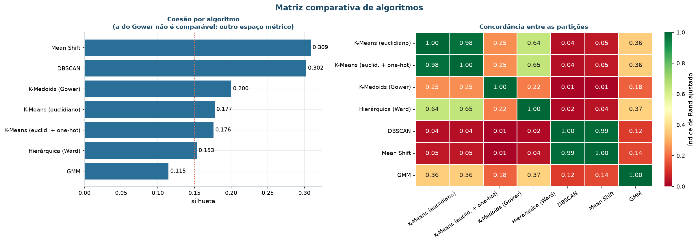

| Algoritmo | Grupos | Silhueta | Davies-Bouldin | Ruído | Maior grupo | Leitura de negócio |
|:---|:-:|---:|---:|---:|---:|:---|
| **K-Means (euclidiano)** | 4 | 0,1775 | 1,800 | 0% | 35,6% | **Escolhido:** estável, interpretável e dentro do teto |
| K-Means (euclid. + one-hot) | 4 | 0,1760 | 1,806 | 0% | 35,7% | 28 binárias diluem a distância; silhueta cai sem mudar a partição |
| K-Medoids (Gower) | 4 | 0,2001 ¹ | 3,011 | 0% | 30,4% | Particiona por estilo construtivo: as nominais dominam o peso |
| Hierárquica (Ward) | 4 | 0,1532 | 1,850 | 0% | 42,0% | Concorda em 64% com o K-Means; útil como validação, não como produto |
| DBSCAN | 3 | 0,3024 | 1,142 | 1,81% | **92,1%** | Degenerado. Entrega o ruído, não a segmentação |
| Mean Shift | 3 | 0,3087 | 1,241 | 0% | **92,2%** | Degenerado pelo mesmo motivo |
| GMM | 4 | 0,1145 | 2,536 | 0% | 40,8% | Grupos menos coesos; contribui com o grau de pertencimento |

¹ Medida na própria dissimilaridade de Gower. **Não é comparável** às demais: silhueta
calculada em espaços métricos diferentes não é uma escala comum.

### Concordância entre as partições

| | K-Means | one-hot | Gower | Ward | GMM |
|:---|---:|---:|---:|---:|---:|
| **K-Means** | 1,00 | 0,98 | 0,25 | 0,64 | 0,36 |
| **one-hot** | 0,98 | 1,00 | 0,25 | 0,65 | 0,36 |
| **Gower** | 0,25 | 0,25 | 1,00 | 0,22 | 0,20 |
| **Ward** | 0,64 | 0,65 | 0,22 | 1,00 | 0,32 |
| **GMM** | 0,36 | 0,36 | 0,20 | 0,32 | 1,00 |

Três leituras do resultado:

1. **Acrescentar as nominais em *one-hot* não muda nada** (ARI 0,98) e ainda reduz a
   silhueta. As 28 colunas binárias acrescentam ruído, não informação — caminho
   abandonado, e registrado como tal.
2. **Gower produz outra coisa** (ARI 0,25). Ver abaixo.
3. **Ward concorda em 64% com o K-Means.** Concordância parcial é o esperado entre um
   método aglomerativo e um particional; serve como validação cruzada da estrutura.

### Por que o Gower foi descartado

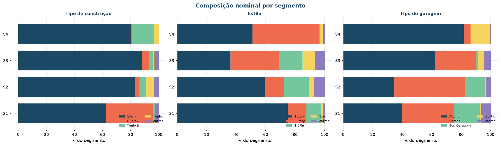

Com peso igual por variável, as cinco nominais respondem por 5 das 22 contribuições —
e `estilo`, sozinha, separa a carteira. O K-Medoids sobre Gower devolve um grupo com
**93% de casas térreas** e outro com **90% de sobrados**.

Isso é um fato construtivo, não uma linha de produto: a Meridiano não tem política
diferente para casa de um ou de dois pavimentos. **Hipótese derrubada**, e registrada
em [Avaliação](avaliacao.md#limitacoes-e-hipoteses-derrubadas).

O que o K-Medoids entregou de valor foi outra coisa: o **medoide**, o imóvel real mais
central de cada segmento.

### Por que DBSCAN e Mean Shift falharam

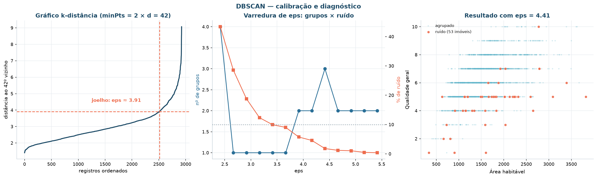

O `eps` foi calibrado pelo método correto — joelho do gráfico k-distância, com
`minPts = 2 × d = 42`. Em **toda** a faixa testada o resultado é o mesmo: um grupo com
mais de 90% da carteira, mais ruído.

O motivo é geométrico. Em 21 dimensões padronizadas os pontos se distribuem de forma
aproximadamente uniforme em densidade: não existem regiões densas separadas por regiões
vazias, que é a estrutura que o DBSCAN procura. O Mean Shift falha pela mesma razão —
sem modos de densidade separados, a busca converge quase toda para o mesmo modo.

Repare que a silhueta **sobe** conforme o resultado degenera (0,30 e 0,31, as maiores
da tabela). Um agrupamento com 92% em um grupo é trivialmente "bem separado".

!!! success "O ruído como produto"
    O DBSCAN não serviu para segmentar — e entregou a resposta ao **objetivo 4**: os
    **53 imóveis** (1,81%) que não pertencem a nenhuma linha de produto e precisam de
    avaliação individual.

    O perfil deles é sistematicamente diferente do típico, e a lista com identificador
    está em `reports/tables/modelagem/m7-imoveis-fora-de-padrao.csv`.

### GMM: quando o BIC não tem mínimo

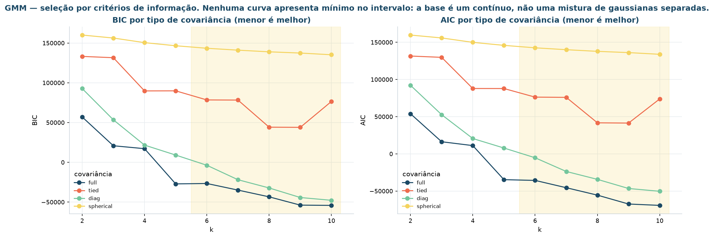

Nenhuma das quatro curvas de BIC apresenta mínimo entre *k* = 2 e 10. Isso **não** é
erro de execução: é o que acontece quando os dados não são uma mistura de gaussianas
bem separadas. Cada componente a mais sempre melhora a verossimilhança o suficiente
para vencer a penalização de complexidade.

O que se faz então: usar o **joelho da curva** (que aponta k = 4 para covariância
`diag`) e o teto operacional, e **declarar a limitação** em vez de fingir que o BIC
decidiu.

O GMM entrou na matriz comparativa e perdeu em coesão. O que ele contribui é o **grau
de pertencimento**: a distinção entre um imóvel no núcleo do segmento e um na fronteira
entre dois. Essa informação vai para a base segmentada, na coluna `confianca_gmm`, e é
usada na aplicação para suspender a ação automática nos casos duvidosos.

## Redução de dimensionalidade

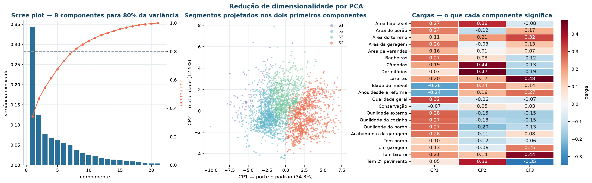

São necessários **8 componentes** para reter 80% da variância de 21 variáveis. O CP1
sozinho retém 34,3%, e o CP2 mais 12,5%.

### As cargas — o que dá nome de negócio aos eixos

| Variável | CP1 | CP2 |
|:---|---:|---:|
| Qualidade geral | **+0,318** | −0,061 |
| Qualidade externa | +0,284 | −0,155 |
| Qualidade do porão | +0,274 | −0,197 |
| Área habitável | +0,273 | **+0,357** |
| Banheiros | +0,269 | +0,078 |
| Idade do imóvel | **−0,260** | +0,244 |
| Anos desde a reforma | −0,243 | +0,156 |
| Dormitórios | +0,066 | **+0,471** |
| Cômodos | +0,192 | **+0,442** |
| Tem 2º pavimento | +0,052 | **+0,381** |

**CP1 = porte e padrão.** Carrega positivamente qualidade e tamanho, negativamente
idade. É o eixo "imóvel novo e bom" contra "imóvel velho e simples".

**CP2 = configuração familiar.** Carrega dormitórios, cômodos, segundo pavimento e área
habitável — e é **ortogonal** ao padrão. Separa a casa grande com muitos quartos da
casa compacta de acabamento superior.

Sem esta leitura, "CP1" e "CP2" são rótulos vazios e a projeção 2D não é defensável.

### Kernel PCA

| Kernel | Silhueta na projeção 2D |
|:---|---:|
| `linear` | 0,2985 |
| `cosine` | 0,2087 |
| `rbf` | 0,1223 |

A tabela mede **legibilidade do gráfico**, não qualidade do agrupamento. Confundir as
duas coisas é o erro que esta nota existe para evitar: uma projeção mais separada não
torna os grupos mais reais.

O Kernel PCA captura estrutura não linear, e o preço é a interpretabilidade — **não
existem cargas**, porque a projeção acontece em um espaço de dimensão implícita. Serve
para visualizar, não para explicar.

!!! danger "LDA não aparece nesta fase, e a razão é conceitual"
    `LinearDiscriminantAnalysis` é **supervisionado**: procura as direções que separam
    classes conhecidas. Usá-lo antes de clusterizar seria contrabandear o rótulo
    reservado para dentro do modelo.

    O LDA aparece uma única vez neste projeto, em [Avaliação](avaliacao.md#pca-lda),
    sobre a faixa de preço derivada de `preco_venda`, **depois** que os segmentos já
    estão definidos. É avaliação, não modelagem.

## As quatro personas

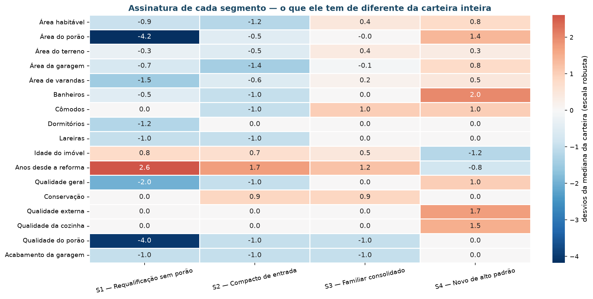

| | S1 · Requalificação sem porão | S2 · Compacto de entrada | S3 · Familiar consolidado | S4 · Novo de alto padrão |
|:---|---:|---:|---:|---:|
| **Imóveis** | 80 (2,7%) | 1.010 (34,5%) | 794 (27,1%) | 1.041 (35,6%) |
| Área habitável | 1.152 pés² | 1.068 pés² | 1.577 pés² | 1.689 pés² |
| Área do porão | **0** | 871 pés² | 988 pés² | 1.317 pés² |
| Área do terreno | 8.777 pés² | 8.327 pés² | 10.158 pés² | 10.120 pés² |
| Área da garagem | 397 pés² | 308 pés² | 469 pés² | 576 pés² |
| Cômodos | 6 | 5 | 7 | 7 |
| Dormitórios | 2 | 3 | 3 | 3 |
| Banheiros | 1,75 | 1,5 | 2,0 | 3,0 |
| Lareiras | 0 | 0 | 1 | 1 |
| **Idade** | 54 anos | 51 anos | 46 anos | **4 anos** |
| Anos desde a reforma | 51,5 | 39 | 32 | 4 |
| Qualidade geral | 4 | 5 | 6 | 7 |
| Conservação | 5 | 6 | 6 | 5 |
| Tipo predominante | 34% duplex | 83% unifamiliar | 88% unifamiliar | 80% unifamiliar, 16% *townhouse* |
| Estilo predominante | 75% térrea | 60% térrea | 36% térrea, 33% sobrado | 51% térrea, 45% sobrado |

### Ação diferenciada e métrica de acompanhamento

=== "S1 · Requalificação sem porão"
    **Perfil.** Imóvel antigo, sem porão, de padrão construtivo mais baixo e com um
    terço do grupo em formato duplex. É o estoque que a carteira herdou e nunca tratou.

    **Ação.** Avaliação individual por unidade, com decisão binária: converter em ativo
    de renda (locação, aproveitando o formato duplex) ou desinvestir. Teto de
    requalificação limitado a 8% do valor de avaliação — acima disso, o retorno não se
    paga neste padrão.

    **Métrica.** Percentual do grupo com destino definido em 12 meses (meta: 100%) e
    retorno sobre o capital requalificado (meta: ≥ 12% a.a.).

    **Canal.** Carteira de investidores e gestores de locação.

    **Representante real.** PID `905402070` · Edwards · 1.383 pés² · qualidade 4 ·
    55 anos.

=== "S2 · Compacto de entrada"
    **Perfil.** Casa pequena, meio século de idade, sem reforma recente, com garagem
    apertada e um banheiro e meio. É o imóvel de primeira aquisição — e o maior grupo
    da carteira em unidades.

    **Ação.** Precificação por giro, não por margem: preço alinhado ao percentil 40 do
    bairro e pacote de reforma leve padronizado (pintura, piso e louças), com teto de
    6% do valor. Financiamento facilitado como argumento de venda.

    **Métrica.** Tempo médio de giro do estoque (meta: reduzir de 90 para 60 dias) e
    taxa de conversão do canal digital (meta: ≥ 3%).

    **Canal.** Digital, com foco em primeira moradia e crédito facilitado.

    **Representante real.** PID `527455250` · NAmes · 988 pés² · qualidade 5 · 41 anos.

=== "S3 · Familiar consolidado"
    **Perfil.** Imóvel amplo, de meia-idade, com sete cômodos, dois banheiros e
    lareira. Padrão médio bem conservado, em bairros estabelecidos. É onde a reforma
    tem o melhor retorno da carteira.

    **Ação.** Pacote de reforma de valorização concentrado em cozinha e banheiro — os
    dois atributos em que este grupo fica meio nível abaixo do segmento superior, com
    teto de 12% do valor de avaliação. Precificação por comparação de bairro.

    **Métrica.** Ganho de preço realizado sobre o custo da reforma (meta: ≥ 1,8× o
    investido) e percentual de unidades reformadas antes do anúncio (meta: ≥ 70%).

    **Canal.** Corretagem tradicional, com foco em família em segunda aquisição.

    **Representante real.** PID `534252240` · NWAmes · 1.342 pés² · qualidade 6 ·
    42 anos.

=== "S4 · Novo de alto padrão"
    **Perfil.** Construção recente, grande, com três banheiros, porão amplo e
    acabamento superior. Um terço da carteira em unidades, **metade da receita**.

    **Ação.** Nenhuma reforma: o imóvel já está no padrão. Corretor dedicado, material
    de venda com fotografia profissional e precificação por comparação direta com os
    lançamentos do período. Descontos autorizados apenas acima de 90 dias.

    **Métrica.** Razão entre preço realizado e preço anunciado (meta: ≥ 0,97) e
    percentual de vendas fechadas sem desconto (meta: ≥ 60%).

    **Canal.** Corretagem dedicada e vitrine premium.

    **Representante real.** PID `528439080` · Somerst · 1.506 pés² · qualidade 7 ·
    2 anos.

!!! tip "Por que o medoide, e não o centroide"
    O centroide do K-Means é um imóvel médio que **não existe** — pode ter 2,7
    dormitórios. O medoide é um imóvel **real da carteira**, com matrícula, que pode
    ser visitado. Em uma reunião de diretoria, a segunda coisa é muito mais fácil de
    defender.

    Os medoides desta tabela foram calculados sobre a matriz de Gower, que é a
    dissimilaridade que considera todas as 22 variáveis, inclusive as nominais.

### Reprodutibilidade dos rótulos

Os rótulos do K-Means não têm ordem: rodar de novo com outra semente troca o número dos
grupos, e qualquer texto que se refira a "segmento 0" fica errado na execução seguinte.

`personas.ordenar_canonicamente` resolve isso reordenando os segmentos por qualidade
geral e área habitável, de modo que **o segmento 0 seja sempre o de padrão mais baixo**.
É o que permite amarrar persona a segmento sem depender da sorte da inicialização.

## Regras de associação

A entidade da transação é o **imóvel**. Cada um vira uma cesta de itens, e 62 itens
compõem o universo.

| Origem | Itens | Discretização |
|:---|:-:|:---|
| Nominais | 27 | **nenhuma** — a categoria já é o item |
| Ordinais em faixas de mercado | 9 | cortes em 4 e 7 na escala 1–10 |
| Numéricas em quartis | 16 | quartis da própria carteira |
| Binárias construtivas | 4 | **nenhuma** — presença do item |
| Segmento | 4 | resultado da clusterização, para o cruzamento |

!!! note "Por que quartis, e não faixas absolutas"
    Quartil é relativo ao estoque: "área no quartil superior **desta carteira**". Uma
    faixa absoluta em pés quadrados envelheceria a cada ano e exigiria recalibração
    manual. O custo da escolha é que os itens mudam de significado a cada reciclagem —
    e isso está registrado no plano de reciclagem.

### Calibração do limiar

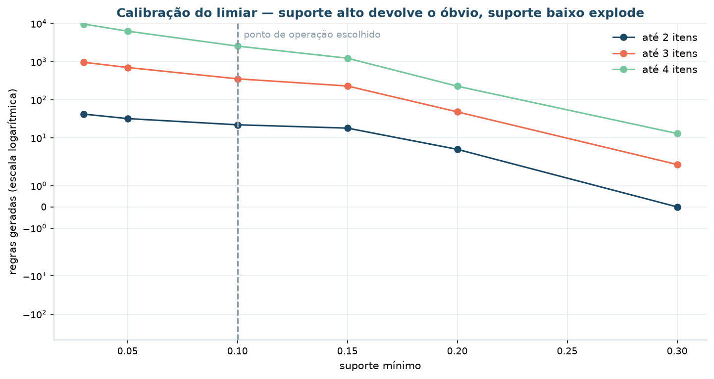

| Suporte | Imóveis | Até 2 itens | Até 3 itens | Até 4 itens |
|---:|---:|---:|---:|---:|
| 3% | 88 | 42 regras | 960 | 9.640 |
| 5% | 146 | 32 | 699 | 6.274 |
| **10%** | **292** | 22 | **353** | 2.541 |
| 15% | 439 | 18 | 229 | 1.227 |
| 20% | 585 | 5 | 48 | 226 |
| 30% | 878 | 0 | 2 | 13 |

Ponto de operação: **suporte ≥ 10%, até 3 itens, confiança ≥ 70%, lift ≥ 1,30**.

A primeira rodada usou 5% e 4 itens, e produziu 6.274 regras — volume que nenhuma área
comercial lê, e que não traz padrão novo, apenas variações redundantes das mesmas
combinações. A recalibração está registrada na
[revisão do processo](avaliacao.md#revisao-do-processo).

### Os três algoritmos

| Algoritmo | Conjuntos frequentes | Tempo | Idêntico ao Apriori |
|:---|---:|---:|:-:|
| Apriori | 1.597 | 0,030 s | — |
| FP-Growth | 1.597 | 0,195 s | ✅ |
| **Eclat** (implementação própria) | 1.597 | 0,154 s | ✅ |

Os três chegam ao **mesmo** resultado por caminhos diferentes. O Eclat aqui é
implementação própria — o `mlxtend` não o traz — e usa a representação que dá nome ao
algoritmo: em vez da lista de itens de cada transação, guarda para cada item a lista de
transações em que ele aparece (o *tidset*). O suporte de um conjunto vira o tamanho da
interseção dos tidsets: uma operação de conjunto, sem varrer a base de novo.

### O funil de poda

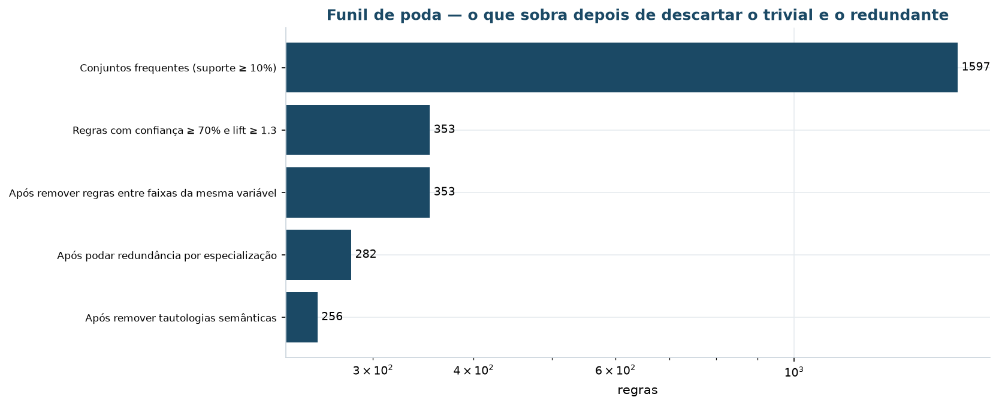

| Etapa | Restam | Critério |
|:---|---:|:---|
| Conjuntos frequentes (suporte ≥ 10%) | 1.597 | Antimonotonicidade: todo subconjunto de um frequente é frequente |
| Confiança ≥ 70% e lift ≥ 1,30 | 353 | Lift ≤ 1 significa que a regra é pior que o acaso |
| Sem faixas da mesma variável | 353 | Faixas de uma variável não coocorrem — nenhuma sobreviveria mesmo |
| Sem redundância por especialização | 282 | `{A,B}→C` some quando `{A}→C` já tem confiança igual ou maior |
| **Sem tautologia semântica** | **256** | Relação definicional, não de mercado |

!!! danger "A tautologia que nenhuma métrica pega"
    Uma casa de estilo `2Story` tem segundo pavimento porque é isso que `2Story`
    significa. A regra `tem 2º pavimento → estilo:2Story` tem suporte 11%, confiança
    90% e **lift 3,03** — passaria por todos os filtros estatísticos.

    Suporte, confiança e lift são altos **justamente** porque a relação é perfeita.
    Nenhuma métrica detecta isso: só o conhecimento do domínio separa a tautologia da
    descoberta.

    Por isso a lista de pares definicionais é **explícita** em
    `src/model/associacao.py`, e as 26 regras removidas são publicadas em
    `r2-tautologias-descartadas.csv` — mostrar o que foi removido, e por quê, é o que
    impede a suspeita de que o resultado foi escolhido a dedo.

### As regras que sobreviveram

| Se o imóvel tem | Então também tem | Suporte | Confiança | Lift |
|:---|:---|---:|---:|---:|
| 2º pavimento + garagem destacada | idade no quartil mais alto | 0,107 | 0,763 | **3,05** |
| conservação média + qualidade alta | idade no quartil mais baixo | 0,114 | 0,727 | 2,91 |
| qualidade alta | cozinha superior + lareira | 0,142 | 0,859 | 2,86 |
| cozinha superior + qualidade alta | idade no quartil mais baixo | 0,114 | 0,707 | 2,83 |
| idade no quartil mais baixo | conservação média + cozinha superior | 0,239 | 0,956 | 2,51 |
| qualidade alta + idade baixa | cozinha superior | 0,114 | **0,997** | 2,14 |

A leitura de negócio: **qualidade construtiva vem em pacote**. Cozinha superior,
lareira e garagem interna aparecem juntas com muito mais frequência do que o acaso
explicaria — o que confirma que "padrão" é atributo do imóvel inteiro, e não de uma
peça isolada.

### O cruzamento com a segmentação

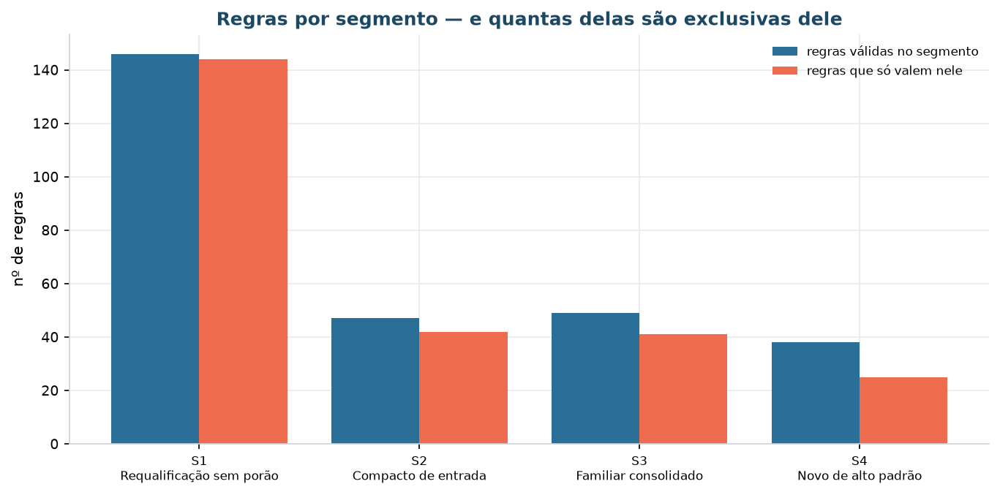

| Segmento | Regras válidas nele | Das quais, exclusivas |
|:---|---:|---:|
| S1 · Requalificação sem porão | 146 | 144 |
| S2 · Compacto de entrada | 47 | 42 |
| S3 · Familiar consolidado | 49 | 41 |
| S4 · Novo de alto padrão | 38 | 25 |

Os padrões diferenciais confirmam as personas por um caminho **independente** da
clusterização:

- **S1** — `Duplex` aparece junto de dois banheiros e conservação média com lift acima
  de 2,4, e essa combinação **não existe** na base inteira. É a assinatura do estoque
  de renda.
- **S2** — zoneamento `RM` (média densidade) leva a terreno no primeiro quartil. Lote
  pequeno em zona adensada é o produto de entrada.
- **S3** — garagem destacada leva a imóvel no quartil mais velho com segundo pavimento:
  o casario consolidado dos bairros antigos.
- **S4** — sobrado com lareira leva a área no quartil superior.

Se as regras de cada grupo fossem as mesmas da base inteira, o agrupamento não teria
achado nada que a frequência global já não dissesse. Não é o caso.

## Saídas

| Arquivo | Conteúdo |
|:---|:---|
| `data/processed/imoveis_segmentados.parquet` | Base curada + segmento, persona, confiança do GMM e sinalizador de fora de padrão |
| `data/processed/transacoes.parquet` | Matriz booleana 2.925 × 62 itens |
| `models/pipeline_segmentacao.joblib` | Pré-processador + K-Means em um único objeto |
| `models/metadados_segmentacao.json` | *k*, espaço de atributos, semente, métricas, tradução de rótulos |
| `models/linha_de_base.json` | Distribuições de referência para o monitoramento |
| `reports/figures/modelagem/*.png` | 15 figuras |
| `reports/figures/associacao/*.png` | 6 figuras |
| `reports/tables/modelagem/*.csv` | 21 tabelas |
| `reports/tables/associacao/*.csv` | 14 tabelas |

## Reprodução

```bash
uv run invoke modelagem     # clusterização, comparativo, personas
uv run invoke regras        # Apriori, Eclat e FP-Growth
```
