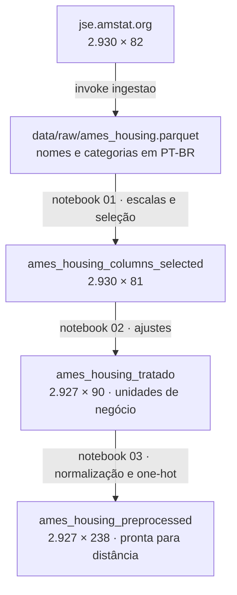

# Preparação dos dados

**CRISP-DM fase 3.** Transformar a base bruta em duas coisas diferentes: uma **base
tratada**, legível em unidades de negócio, e uma **base pré-processada**, pronta para
algoritmos baseados em distância. Os problemas foram levantados no
[entendimento dos dados](entendimento-dados.md); aqui ficam as decisões tomadas a
respeito deles.

## Arquitetura em camadas



| Camada | Arquivo | Papel |
|:---|:---|:---|
| Bruta | `data/raw/ames_housing.parquet` | cópia da origem com nomes e categorias em português, assinada no manifesto |
| Selecionada | `data/processed/ames_housing_columns_selected.csv` | escalas ordinais aplicadas e `ordem` descartada (notebook 01) |
| Tratada | `data/processed/ames_housing_tratado.csv` | ajustes, ausências tratadas e atributos derivados, em unidades originais (notebook 02) |
| Pré-processada | `data/processed/ames_housing_preprocessed.csv` | contínuas e ordinais em 0–1, nominais em *one-hot* (notebook 03) |

A camada bruta é tratada como **imutável**: nenhuma outra parte do projeto escreve em
`data/raw`. Reprocessar sempre parte dela, nunca de um arquivo editado à mão.

## A curadoria, regra a regra

O notebook 02 aplica os ajustes em sequência. A regra do notebook é que **nenhum dado
é alterado em silêncio**: cada ajuste declara o motivo.

| # | Ajuste | Imóveis tocados | Motivo |
|:-:|:---|---:|:---|
| 1 | `ano_garagem = 2207` vira 2007 | 1 | Erro de digitação evidente: o imóvel foi vendido em 2007 |
| 2 | `ano_reforma` anterior a `ano_construcao` passa a ser o ano de construção | 1 | Reforma antes da construção é impossível |
| 3 | Porão sem exposição registrada recebe a moda | — | O porão existe; falta só a característica |
| 4 | `acabamento_porao_2` alinhado à área acabada tipo 2 | — | Área sem acabamento ou acabamento sem área são contradições |
| 5 | Garagem separada sem característica recebe a moda das separadas; sem nenhuma informação vira "sem garagem" | — | Separa o dado faltante do item inexistente |
| 6 | Alvenaria aparente ausente vira "Sem alvenaria aparente", e tipo e área são alinhados | 23 | Ausência que significa "não tem" |
| 7 | Ausência estrutural recebe rótulo próprio: `Sem porão`, `Sem garagem`, `Sem lareira`, `Sem piscina`, `Sem cerca`, `Sem viela`, `Nenhum` | — | `NA` nessas colunas significa que o item não existe; imputar criaria porões que nunca existiram |
| 8 | Áreas, vagas e banheiros de porão e garagem ausentes viram 0 | — | Área de garagem em imóvel sem garagem é zero, não desconhecida |
| 9 | `ano_garagem` ausente recebe o ano de construção | — | Imóvel sem garagem; o ano só precisa não ser vazio |
| 10 | `testada_lote` ausente recebe a mediana do **bairro** | 490 | A ausência se explica pela geometria do lote; a mediana global achataria a variação entre bairros |
| 11 | `sistema_eletrico` ausente recebe a moda | 1 | Uma célula vazia na origem |
| 12 | Remover as vendas **parciais** acima de 4.000 pés² habitáveis | 3 | Recomendação do autor da base (De Cock, 2011): vendas atípicas, com preço incompatível |
| 13 | Remover colunas com mais de 5% de ausentes | 0 colunas | Depois das regras anteriores, nenhuma coluna tem ausente |
| 14 | Remover registros com mais de 5% de ausentes | 0 | Nenhum registro passou do limite |
| 15 | Imputar os ausentes restantes pela mediana ou moda | 0 | Nada a imputar |

O resultado é a base tratada: **2.927 imóveis × 90 colunas, sem nenhuma célula vazia**.

!!! note "As regras 13 e 15 já removeram seis colunas"
    Numa versão anterior da cadeia, a escala ordinal do notebook 00 não reconhecia
    níveis como "Típico", e o 01 os transformava em ausentes. A regra 13 removia então
    `qualidade_externa`, `qualidade_cozinha`, `conservacao_externa`,
    `qualidade_aquecimento`, `funcionalidade` e `acesso_pavimentado`, e a regra 7
    marcava 2.100 imóveis como "Sem garagem". Com a escala alinhada à ingestão, as duas
    regras não encontram mais nada a fazer — ver
    [Entendimento dos dados](entendimento-dados.md#as-escalas-ordinais).

### Os atributos derivados

| Atributo | Como é calculado | Por quê |
|:---|:---|:---|
| `idade_imovel` | ano da venda − ano de construção, com piso em 0 | Venda na planta daria idade negativa |
| `anos_desde_reforma` | ano da venda − ano da reforma, com piso em 0 | O ano em si não diz nada; o tempo desde a reforma, sim |
| `foi_reformada` | 1 quando a reforma é posterior à construção **e** a 1950 | 1950 é o piso do cadastro: casa antiga com "reforma em 1950" não conta |
| `area_varandas` | soma das quatro áreas de varanda | Separadas, cada uma é quase toda zero; somadas, têm variância útil |
| `banheiros_total` | banheiros completos + metade dos lavabos, no térreo e no porão | Lavabo conta como meio banheiro |
| `tem_porao`, `tem_garagem`, `tem_lareira`, `tem_segundo_pavimento` | 1 quando a área ou a contagem correspondente é maior que zero | Presença do item, independente do tamanho |

## O pré-processamento

O notebook 03 prepara a base tratada para algoritmos baseados em distância. As colunas
são separadas pelo tipo declarado no dicionário do notebook 00:

| Bloco | Colunas | Transformação |
|:---|---:|:---|
| Contínuas e discretas, mais as derivadas | 39 | `MinMaxScaler` — cada coluna em 0 a 1 (inclui `preco_venda` e `subclasse`) |
| Ordinais | 22 | Cada nível vira a sua posição na escala (rótulo de ausência = 0), depois `MinMaxScaler` |
| Nominais | 23 | `OneHotEncoder` — uma coluna 0/1 por categoria, 177 no total |
| Temporais | 5 | Descartadas (`remainder='drop'`): a idade e o tempo desde a reforma já as representam |

São **238 colunas**. Os notebooks de modelagem retiram `preco_venda` (o rótulo
reservado) e `subclasse` (um código, não uma medida) e trabalham com **236**.

!!! note "Por que MinMax, e não padronização"
    O `MinMaxScaler` preserva a ordem e iguala a amplitude de todas as colunas, e mantém
    as binárias do *one-hot* em 0 e 1. O 05 registra o efeito colateral como lacuna:
    uma coluna binária dividida meio a meio tem variância 0,25, e uma contínua
    concentrada perto de zero — como `area_terreno`, de cauda longa — tem bem menos. Com
    177 colunas *one-hot* contra 37 contínuas, **as categorias dominam a distância**. O
    04-2 confirma: as variáveis de maior peso no PCA são nominais (`bairro`,
    `revestimento_1`, `revestimento_2`, `estilo`, `fundacao`).

## O que esta fase deixou em aberto

| Lacuna | Efeito | Correção proposta |
|:---|:---|:---|
| `preco_venda` e `subclasse` continuam na base pré-processada | Cada notebook de modelagem precisa lembrar de retirá-los | Retirá-los já no 03 |
| O *one-hot* com MinMax pesa mais que as contínuas | As categorias definem a distância | Testar FAMD ou ponderar os blocos de variáveis |
| `area_terreno` e outras áreas de cauda longa sem transformação | Quase todos os imóveis ficam perto de zero na escala 0–1 | Avaliar `log1p` antes do MinMax |

As três estão também na [avaliação](avaliacao.md#lacunas-e-erros-identificados), junto
com a lacuna das escalas ordinais, já corrigida.

## Reprodução

```bash
uv run invoke ingestao      # data/raw
uv run invoke notebooks     # os ajustes são o notebook 02; o pré-processamento, o 03
```
