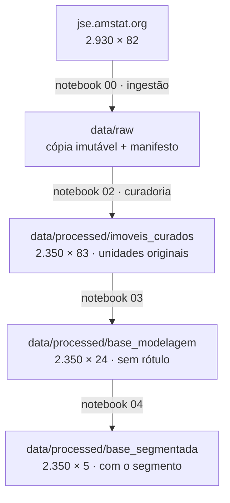
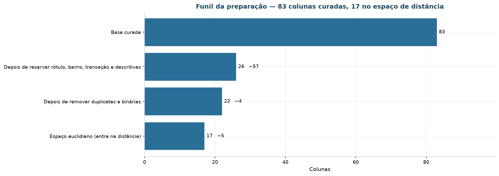
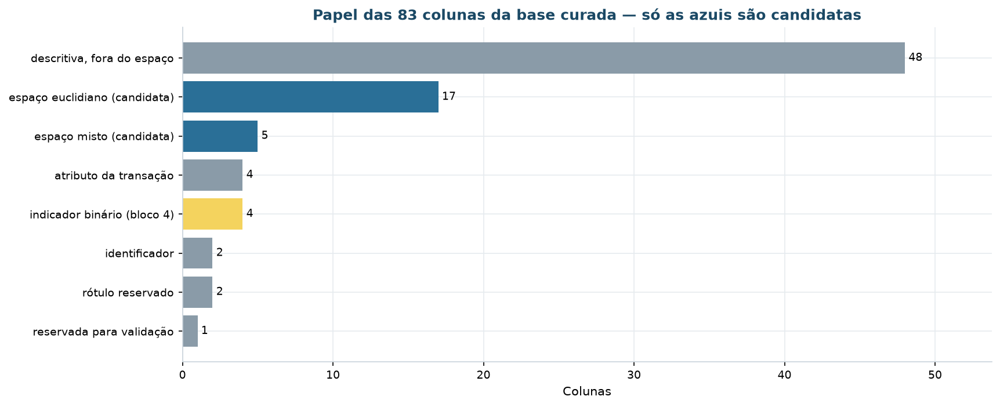
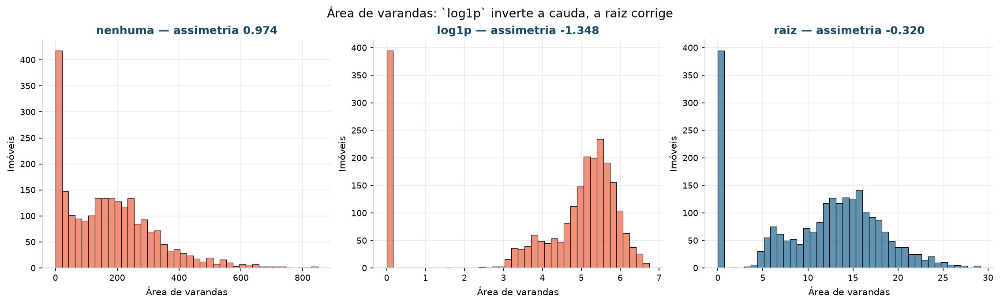
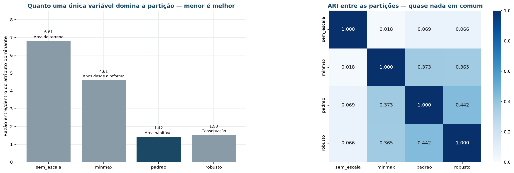
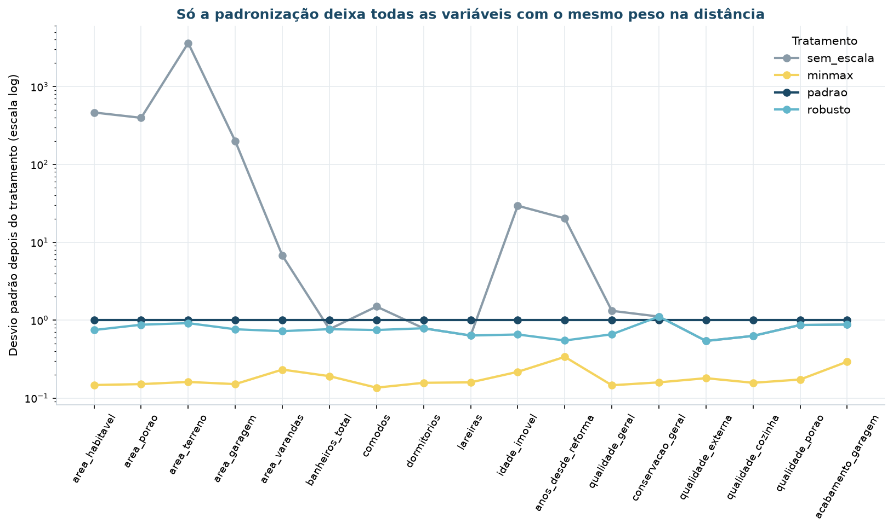
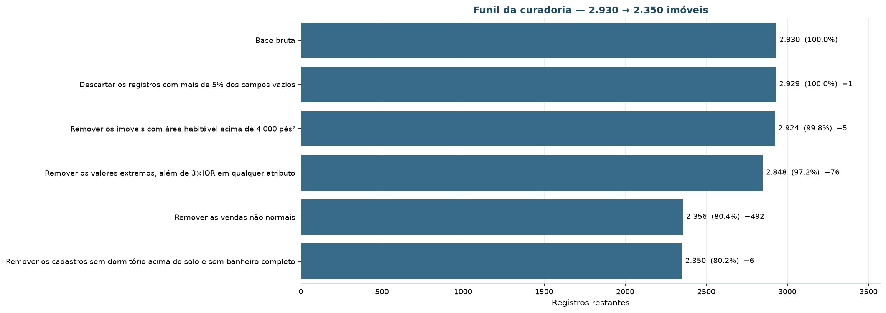

# Preparação dos dados

**CRISP-DM fase 3.** Esta página descreve **o que foi feito com os dados** entre a
origem e a análise: como são materializados, que regras de limpeza foram aplicadas e
como a transformação é conferida.

Ela é o par de [Entendimento dos dados](entendimento-dados.md): lá ficam os achados de
qualidade, aqui ficam as decisões tomadas a respeito deles.

## Arquitetura em camadas



| Camada | Diretório | Papel |
|:---|:---|:---|
| Bruta | `data/raw` | cópia imutável da origem, assinada por `sha256` |
| Curada | `data/processed/imoveis_curados.parquet` | colunas renomeadas, tipadas, limpas e derivadas, em unidades originais |
| Modelagem | `data/processed/base_modelagem.parquet` | recorte com o espaço de atributos, **sem as reservadas no arquivo** |
| Segmentada | `data/processed/base_segmentada.parquet` | chave, segmento canônico e faixa de confiança |
| Publicada | `data/processed/carteira_classificada.parquet` | a carteira que a operação consome |

A camada bruta é tratada como **imutável**: nenhuma outra parte do projeto escreve em
`data/raw`. Reprocessar sempre parte dela, nunca de um arquivo editado à mão.

## Materialização da camada bruta

O arquivo tabulado é copiado como veio e, em seguida, convertido para `parquet`. Os
dois convivem: o `.txt` é o que o manifesto assina, o `.parquet` é o que o pipeline lê.

```
data/raw/ames_housing.txt        # 960 KB, cópia da origem
data/raw/ames_housing.parquet    # a mesma coisa, com tipos preservados
data/raw/manifesto_carga.json    # origem, data, sha256, dimensões conferidas
```

A operação é **idempotente**: se o arquivo já existe, o download não é refeito. E é
**verificada**: a carga compara as dimensões contra o que a fonte declara e **falha**
se não baterem, em vez de seguir com dado diferente.

```python
if dados.shape != (LINHAS_ESPERADAS, COLUNAS_ESPERADAS):
    raise ValueError("A fonte mudou — registre o fato antes de prosseguir.")
```

!!! note "Decisão técnica: por que também um parquet"
    A leitura passa de cerca de 1 s para 20 ms, e — o que importa mais — o tipo de
    cada coluna deixa de ser reinferido a cada execução. Nesta base isso não é
    detalhe: a inferência padrão do `pandas` converte a categoria `None` em nulo. Ver
    [valores sentinela](entendimento-dados.md#valores-sentinela).

## Regras de limpeza

Implementadas em `src/data/preparacao.py`, em uma única passada, e publicadas em
`REGRAS_LIMPEZA` — a mesma lista que alimenta esta tabela e o notebook `02b`.

| # | Regra | Motivo |
|:-:|:---|:---|
| 1 | Renomear as 82 colunas para `snake_case` em português | Os nomes originais têm espaço no meio (`Gr Liv Area`), o que obriga a usar colchetes em toda referência. O resultado é lido por gente de negócio. |
| 2 | Ler o arquivo com `na_values=['NA', '']`, em vez do padrão do `pandas` | A palavra `None` em `Mas Vnr Type` é categoria legítima. A leitura padrão a converte em nulo e transforma 1.752 imóveis descritos em desconhecidos, inflando a ausência de 0,8% para 60,6%. |
| 3 | Converter `NA` em rótulo de ausência estrutural em 14 colunas | Nessas colunas `NA` significa "o item não existe" — sem porão, sem garagem, sem lareira. Imputar pela mediana inventaria porões que nunca existiram. |
| 4 | Mapear 20 colunas ordinais para inteiro, com **0** para ausência | `Ex > Gd > TA > Fa > Po` tem ordem semântica. *One-hot* destruiria a ordem e multiplicaria a dimensionalidade sem ganho. |
| 5 | Corrigir `ano_garagem = 2207` para o ano de construção do imóvel | Erro de digitação evidente: o imóvel foi vendido em 2007. Sem a correção, a idade da garagem fica negativa em 200 anos e domina qualquer padronização. |
| 6 | Imputar `testada_lote` pela mediana do **bairro** | 16,7% de ausência concentrada em lotes de esquina e de fundo — ausência MAR, explicada pela geometria. A mediana global achataria a variação entre bairros. |
| 7 | Preencher com 0 as áreas e contagens de itens inexistentes | Área de garagem ausente em imóvel sem garagem é zero, não desconhecida. |
| 8 | Remover os 5 imóveis com área habitável acima de 4.000 pés² | Recomendação explícita do autor da base (De Cock, 2011, §4): são vendas parciais de imóveis atípicos. Decisão citável, não arbitrária. |
| 9 | Derivar 8 atributos: áreas somadas, banheiros equivalentes, idades e flags | Cinco colunas de varanda medem a mesma coisa; separadas, cada uma é quase toda zero e nenhuma tem poder de separação. Somadas, viram um atributo com variância útil. |
| 10 | **Manter** as vendas não normais (17,7% dos registros) | A condição da venda descreve a transação, não o produto. Para segmentar o imóvel, uma venda entre familiares continua sendo um imóvel válido. |

### Os atributos derivados

| Atributo | Fórmula | O que ele separa que o original não separava |
|:---|:---|:---|
| `area_varandas` | soma de deck, varanda aberta, fechada, de tela e de três estações | Cada parcela é quase toda zero; a soma tem variância útil |
| `banheiros_total` | completos + ½ lavabos, incluindo os do porão | Quatro colunas viram uma medida comparável entre imóveis |
| `idade_imovel` | `ano_venda − ano_construcao` | Idade na data da transação, e não o ano absoluto |
| `anos_desde_reforma` | `ano_venda − ano_reforma` | Distingue o imóvel antigo reformado do antigo intocado |
| `tem_porao`, `tem_garagem`, `tem_lareira`, `tem_segundo_pavimento` | presença do item | O zero da área é categoria, não medida — a flag preserva essa distinção |

!!! note "Por que a idade é truncada em zero"
    Alguns imóveis foram vendidos na planta, com a venda parcial registrada no ano
    anterior à conclusão — o que produziria idade negativa. O piso em zero mantém o
    registro sem inventar uma idade impossível, e a condição da venda continua
    disponível para quem quiser isolar esses casos.

## O espaço de atributos

O funil vai de 83 colunas curadas a **17** no espaço que entra na distância:

| Etapa | Colunas | Saíram |
|:---|---:|---:|
| Base curada | 83 | — |
| Depois de reservar rótulo, bairro, transação e descritivas | 26 | **57** |
| Depois de remover duplicatas e binárias | 22 | 4 |
| **Espaço euclidiano** (entra na distância) | **17** | 5 |



| Natureza | Nº | Variáveis |
|:---|:-:|:---|
| Numéricas | 11 | `area_habitavel`, `area_porao`, `area_terreno`, `area_garagem`, `area_varandas`, `banheiros_total`, `comodos`, `dormitorios`, `lareiras`, `idade_imovel`, `anos_desde_reforma` |
| Ordinais | 6 | `qualidade_geral`, `conservacao_geral`, `qualidade_externa`, `qualidade_cozinha`, `qualidade_porao`, `acabamento_garagem` |
| Nominais (só no espaço Gower) | 5 | `zoneamento`, `tipo_construcao`, `estilo`, `tipo_garagem`, `ar_central` |
| **Reservadas** | 3 | `preco_venda` (rótulo), `preco_por_pe2` (derivada do rótulo), `bairro` (validação externa) |

!!! success "A reserva é física, não disciplinar"
    As três reservadas **não estão no arquivo** `base_modelagem.parquet`. Não é uma
    convenção que se cumpre por atenção: é impossível usá-las por engano, porque não
    foram materializadas. A fase 5 auditou os cinco artefatos que alimentam algoritmo e
    confirmou.

    O motivo de `bairro` estar entre elas está medido: η² de **0,574** sobre o preço —
    é a variável mais explicativa de preço da base inteira, com 28 categorias. Usá-la
    seria contrabandear o rótulo.



### O que ficou de fora, e por quê

| Variável | Decisão | Motivo |
|:---|:---|:---|
| `preco_venda` | **reservada** | Rótulo. Uso exclusivo na avaliação a posteriori — critério eliminatório |
| `bairro` | **reservada** | Proxy de preço (explica 56% da qualidade geral) e 28 categorias |
| `infraestrutura`, `tipo_via`, `area_piscina` | descartadas | Concentração acima de 99,5% em um único valor |
| `area_terreo`, `area_pavimento_superior` | descartadas | A soma das duas **é** a área habitável — redundância exata |
| `qualidade_aquecimento`, `conservacao_externa`, `funcionalidade` | descartadas | Correlacionadas com qualidade geral e sem leitura de negócio própria |
| `mes_venda`, `ano_venda`, `tipo_venda`, `condicao_venda` | reservadas | Descrevem a transação, não o produto. Usadas na análise temporal e no *drift* |
| `comodos` | **mantida**, apesar de ρ = 0,81 com a área | Mede configuração, não tamanho: dois imóveis de mesma área com 5 e 9 cômodos são produtos diferentes |
| `conservacao_geral` | mantida sob observação | Baixo poder de separação (56% no nível 5), mas é a única variável de estado de conservação |

## Formatação e escala

### Uma transformação só, e escolhida por ensaio

O limiar é **0,75** de assimetria absoluta — convenção usual. Abaixo dele, o ganho não
compensa a perda de legibilidade da unidade original.

Depois da curadoria, **uma única variável** passa do limiar entre as contínuas:

| Variável | Assimetria | Decisão |
|:---|---:|:---|
| `area_varandas` | **0,974** | transformar |
| `area_habitavel` | 0,747 | — (logo abaixo do limiar) |
| `area_terreno` | 0,417 | — |
| `area_porao` | 0,296 | — |

!!! info "A lista encolheu porque a base mudou"
    Na base bruta, `area_terreno` marcava **13,20** de assimetria. Depois de a curadoria
    remover os lotes extremos, caiu para **0,417**. O que parecia forma da distribuição
    era um punhado de valores extremos — transformá-la agora seria hábito, não decisão.

    E `area_habitavel` ficou em **0,747**, logo abaixo do limiar de 0,75. Fica de fora
    pelo critério declarado: mudar o limiar para acomodar a variável inverteria a ordem
    entre regra e resultado.

A transformação não foi escolhida por convenção, e sim por ensaio das três opções:

| Transformação | Assimetria resultante | Dentro do limiar | *z* máximo |
|:---|---:|:-:|---:|
| nenhuma | 0,974 | ❌ | 4,50 |
| `log1p` | **−1,348** | ❌ | 1,22 |
| **raiz quadrada** | **−0,320** | ✅ | 2,62 |



O `log1p` **corrige demais**: joga a assimetria de +0,97 para −1,35, trocando uma cauda
à direita por uma à esquerda. A raiz quadrada é a que entra no pipeline publicado — e é
por isso que o pacote tem um passo chamado `raiz_area_varandas`.

As ordinais `qualidade_externa` (0,81) e `qualidade_porao` (−1,38) também passam do
limiar e **não** são transformadas: `log1p` sobre nota de 0 a 5 destrói o passo constante
que dá sentido à escala.

### O experimento de sensibilidade à escala

Quatro escalonadores, o **mesmo** K-Means, o **mesmo** *k*. Se as partições
resultantes discordarem, quem definiu os segmentos foi o pré-processamento.



| Escalador | Silhueta | Menor grupo | Maior grupo | Atributo que de fato particionou | Razão entre/dentro |
|:---|---:|---:|---:|:---|---:|
| `sem_escala` | **0,4698** | 162 | 1.064 | Área do terreno | **6,81** |
| `minmax` | 0,1975 | 418 | 850 | Anos desde a reforma | 4,61 |
| **`padrao`** | 0,1388 | 392 | 808 | Área habitável | **1,42** |
| `robusto` | 0,1350 | 456 | 864 | Conservação | 1,53 |

A última coluna mede a razão entre a variância **entre** grupos e a variância
**dentro** dos grupos, para o atributo em que ela é máxima. Quanto maior, mais o
resultado depende de uma variável só.

!!! danger "A armadilha: a maior silhueta é a pior segmentação"
    `sem_escala` tem a **melhor** métrica de todas — silhueta 0,4698, mais que o triplo
    da padronizada — e é o pior resultado.

    Sem padronização, a variável de maior amplitude numérica domina a distância
    euclidiana. Aqui é `area_terreno`, que se mede em milhares contra os 9 níveis da
    qualidade geral. O K-Means acaba particionando quase pelo tamanho do lote sozinho —
    razão entre/dentro de **6,81** — e a silhueta fica alta porque um agrupamento
    praticamente **unidimensional** é, de fato, bem separado.

    A escala padrão é a que tem a razão mais equilibrada (**1,42**): nenhuma variável
    isolada define a partição. É essa a razão de ela ser a escolhida — não a métrica.

    Só que "imóveis com porão grande" não é uma linha de produto: é uma coluna que já
    existia na base, e para descobri-la não era preciso algoritmo nenhum.

    O `minmax` troca o problema de lugar em vez de resolvê-lo: leva tudo para [0, 1],
    mas variáveis com poucos valores distintos — `lareiras` tem 5 — passam a ter saltos
    enormes entre níveis adjacentes, e é ela que assume o comando.

    **A conclusão que o experimento entrega:** silhueta mais alta não significa
    segmentação melhor. A métrica mede separação geométrica; ela não sabe se o que
    separou faz sentido de negócio.

O `StandardScaler` é o escolhido — não por ter a melhor métrica, mas por ser aquele em
que a razão entre/dentro do atributo dominante é a mais equilibrada entre os que
produzem grupos interpretáveis: **nenhuma variável isolada define a partição**.

### Concordância entre as partições

| | `sem_escala` | `minmax` | `padrao` | `robusto` |
|:---|---:|---:|---:|---:|
| **`sem_escala`** | 1,000 | 0,018 | **0,069** | 0,066 |
| **`minmax`** | 0,018 | 1,000 | 0,373 | 0,365 |
| **`padrao`** | 0,069 | 0,373 | 1,000 | **0,442** |
| **`robusto`** | 0,066 | 0,365 | 0,442 | 1,000 |



Nenhum par passa de **0,442** de índice de Rand ajustado, e `sem_escala` contra `padrao`
fica em **0,069** — praticamente nenhuma concordância. Trocar o escalonador não ajusta a
segmentação: **produz outra**. É a demonstração mais direta de que, em algoritmos
baseados em distância, o pré-processamento não é uma etapa preparatória — é parte da
modelagem.

## Conferências

Validações executadas antes de seguir para a análise:

| Conferência | O que é comparado | Resultado |
|:---|:---|---:|
| Contagem de linhas na carga | arquivo lido × dimensões declaradas pela fonte | 2.930 = 2.930 |
| Unicidade da chave | `PID` distintos × linhas | 2.930 = 2.930 |
| Registros removidos pela curadoria | funil declarado, regra a regra | 580 |
| Nulos remanescentes na base de modelagem | soma de nulos nas 17 colunas do espaço | **0** |
| Reservadas na base de modelagem | `preco_venda`, `preco_por_pe2`, `bairro` | **nenhuma** |
| Faixa da dissimilaridade de Gower | mínimo e máximo | [0,000; 1,000] |
| Reprodução pelo pacote serializado | classificação relida do `.pkl` × partição aprovada | **100,00%** |

## A curadoria, regra a regra

O funil de 2.930 a 2.350 é declarado, e cada degrau tem motivo:

| Etapa | Registros | Removidos | % do total |
|:---|---:|---:|---:|
| Base bruta | 2.930 | — | 100,0% |
| Descartar registros com mais de 5% dos campos vazios | 2.929 | 1 | 100,0% |
| Remover imóveis com área habitável acima de 4.000 pé² | 2.924 | 5 | 99,8% |
| Remover valores extremos, além de 3×IQR em qualquer atributo | 2.848 | 76 | 97,2% |
| **Remover as vendas não normais** | 2.356 | **492** | 80,4% |
| Remover cadastros sem dormitório acima do solo e sem banheiro | **2.350** | 6 | **80,2%** |



!!! info "O corte grande é o das vendas não normais"
    492 dos 580 registros removidos saem numa única regra. São vendas entre familiares,
    execuções hipotecárias, permutas e transferências — transações cujo preço e cujas
    condições não descrevem o mercado.

    Removê-las é o que permite ler o resultado como *carteira comercializável*. É também
    a decisão que mais mudou o modelo em relação à cadeia anterior, que operava sobre as
    2.925 unidades sem esse filtro.

## Tratamento de outliers

Os valores extremos desta base são, em boa parte, **legítimos**: lotes grandes de
verdade, casas antigas de verdade, imóveis de alto padrão de verdade. A régua escolhida
reflete isso.

| Situação | Decisão | Motivo |
|:---|:---|:---|
| Limiar do valor extremo | **3×IQR**, não 1,5×IQR | O 1,5 de Tukey marca cerca de um quinto da carteira, incluindo o alto padrão que a segmentação precisa isolar. O 3 alcança só a anomalia |
| 5 imóveis acima de 4.000 pé² | **removidos** | Recomendação explícita do autor da base: são vendas parciais atípicas |
| Lotes acima de 200.000 pé² | **removidos** como extremos | Depois deles, a assimetria de `area_terreno` cai de 13,20 para 0,417 — eram eles a "forma" da distribuição |
| `ano_garagem = 2207` | **corrigido** | Erro de digitação, não valor extremo |

Onde o extremo distorce a leitura, o projeto usa **mediana** em vez de média (toda a
perfilagem) e **escala logarítmica** nos gráficos das variáveis de cauda longa.

## Reprodução

```bash
uv run invoke ingestao      # data/raw
uv run invoke notebooks     # a preparação é o notebook 03; a curadoria, o 02
```
