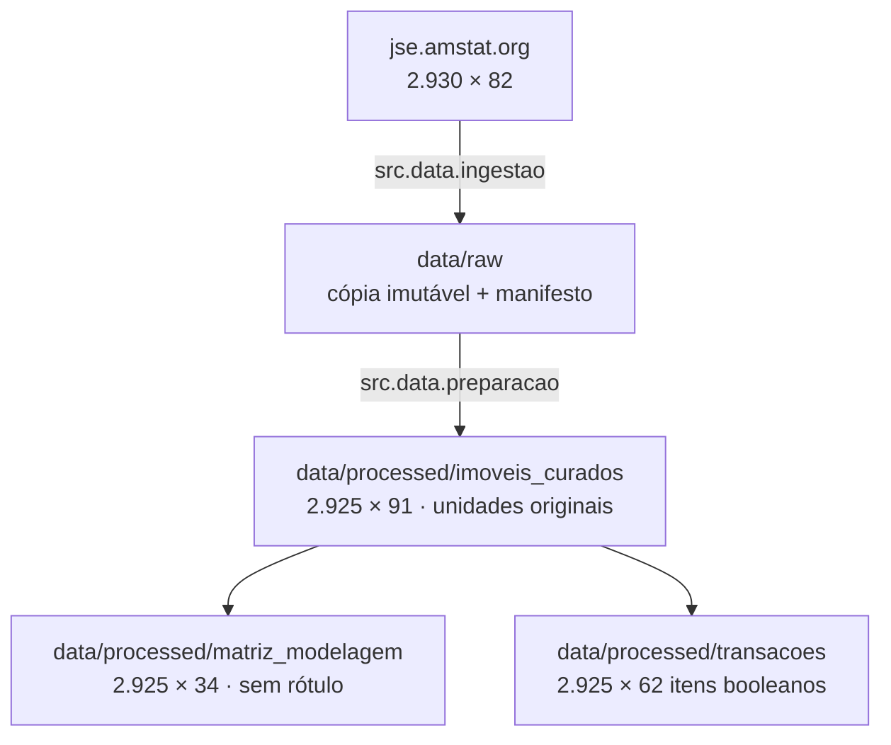
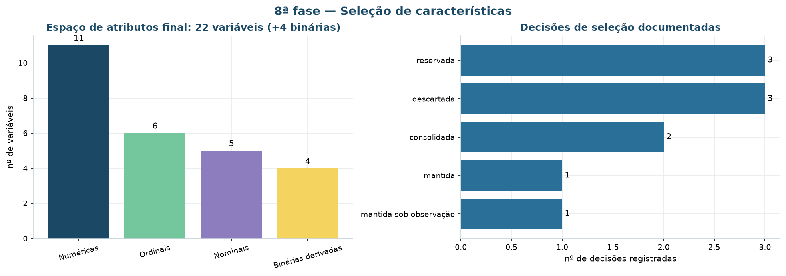
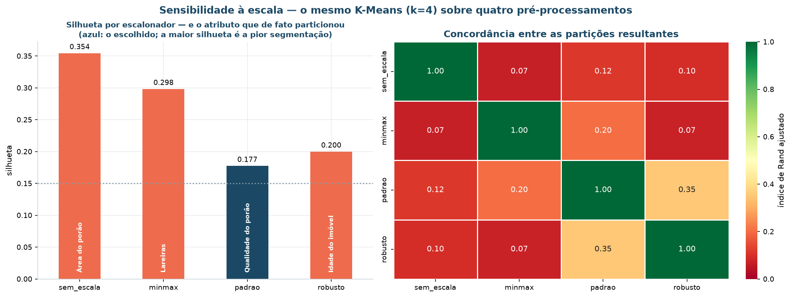

# Preparação dos dados

**CRISP-DM fase 3.** Esta página descreve **o que foi feito com os dados** entre a
origem e a análise: como são materializados, que regras de limpeza foram aplicadas e
como a transformação é conferida.

Ela é o par de [Entendimento dos dados](entendimento-dados.md): lá ficam os achados de
qualidade, aqui ficam as decisões tomadas a respeito deles.

## Arquitetura em camadas



| Camada | Diretório | Papel |
|:---|:---|:---|
| Bruta | `data/raw` | cópia imutável da origem, assinada por `sha256` |
| Curada | `data/processed/imoveis_curados.parquet` | colunas renomeadas, tipadas, limpas e derivadas, em unidades originais |
| Modelagem | `data/processed/matriz_modelagem.parquet` | recorte com o espaço de atributos, sem rótulo reservado |
| Transacional | `data/processed/transacoes.parquet` | matriz booleana imóveis × itens, para as regras de associação |
| Segmentada | `data/processed/imoveis_segmentados.parquet` | base curada + segmento, persona e sinalizadores |

A camada bruta é tratada como **imutável**: nenhuma outra parte do projeto escreve em
`data/raw`. Reprocessar sempre parte dela, nunca de um arquivo editado à mão.

## Materialização da camada bruta

O arquivo tabulado é copiado como veio e, em seguida, convertido para `parquet`. Os
dois convivem: o `.txt` é o que o manifesto assina, o `.parquet` é o que o pipeline lê.

```
data/raw/ames_housing.txt        # 960 KB, cópia da origem
data/raw/ames_housing.parquet    # a mesma coisa, com tipos preservados
data/raw/manifesto_carga.json    # origem, data, sha256, dimensões conferidas
```

A operação é **idempotente**: se o arquivo já existe, o download não é refeito. E é
**verificada**: a carga compara as dimensões contra o que a fonte declara e **falha**
se não baterem, em vez de seguir com dado diferente.

```python
if dados.shape != (LINHAS_ESPERADAS, COLUNAS_ESPERADAS):
    raise ValueError("A fonte mudou — registre o fato antes de prosseguir.")
```

!!! note "Decisão técnica: por que também um parquet"
    A leitura passa de cerca de 1 s para 20 ms, e — o que importa mais — o tipo de
    cada coluna deixa de ser reinferido a cada execução. Nesta base isso não é
    detalhe: a inferência padrão do `pandas` converte a categoria `None` em nulo. Ver
    [valores sentinela](entendimento-dados.md#valores-sentinela).

## Regras de limpeza

Implementadas em `src/data/preparacao.py`, em uma única passada, e publicadas em
`REGRAS_LIMPEZA` — a mesma lista que alimenta esta tabela e o notebook `02b`.

| # | Regra | Motivo |
|:-:|:---|:---|
| 1 | Renomear as 82 colunas para `snake_case` em português | Os nomes originais têm espaço no meio (`Gr Liv Area`), o que obriga a usar colchetes em toda referência. O resultado é lido por gente de negócio. |
| 2 | Ler o arquivo com `na_values=['NA', '']`, em vez do padrão do `pandas` | A palavra `None` em `Mas Vnr Type` é categoria legítima. A leitura padrão a converte em nulo e transforma 1.752 imóveis descritos em desconhecidos, inflando a ausência de 0,8% para 60,6%. |
| 3 | Converter `NA` em rótulo de ausência estrutural em 14 colunas | Nessas colunas `NA` significa "o item não existe" — sem porão, sem garagem, sem lareira. Imputar pela mediana inventaria porões que nunca existiram. |
| 4 | Mapear 20 colunas ordinais para inteiro, com **0** para ausência | `Ex > Gd > TA > Fa > Po` tem ordem semântica. *One-hot* destruiria a ordem e multiplicaria a dimensionalidade sem ganho. |
| 5 | Corrigir `ano_garagem = 2207` para o ano de construção do imóvel | Erro de digitação evidente: o imóvel foi vendido em 2007. Sem a correção, a idade da garagem fica negativa em 200 anos e domina qualquer padronização. |
| 6 | Imputar `testada_lote` pela mediana do **bairro** | 16,7% de ausência concentrada em lotes de esquina e de fundo — ausência MAR, explicada pela geometria. A mediana global achataria a variação entre bairros. |
| 7 | Preencher com 0 as áreas e contagens de itens inexistentes | Área de garagem ausente em imóvel sem garagem é zero, não desconhecida. |
| 8 | Remover os 5 imóveis com área habitável acima de 4.000 pés² | Recomendação explícita do autor da base (De Cock, 2011, §4): são vendas parciais de imóveis atípicos. Decisão citável, não arbitrária. |
| 9 | Derivar 8 atributos: áreas somadas, banheiros equivalentes, idades e flags | Cinco colunas de varanda medem a mesma coisa; separadas, cada uma é quase toda zero e nenhuma tem poder de separação. Somadas, viram um atributo com variância útil. |
| 10 | **Manter** as vendas não normais (17,7% dos registros) | A condição da venda descreve a transação, não o produto. Para segmentar o imóvel, uma venda entre familiares continua sendo um imóvel válido. |

### Os atributos derivados

| Atributo | Fórmula | O que ele separa que o original não separava |
|:---|:---|:---|
| `area_varandas` | soma de deck, varanda aberta, fechada, de tela e de três estações | Cada parcela é quase toda zero; a soma tem variância útil |
| `banheiros_total` | completos + ½ lavabos, incluindo os do porão | Quatro colunas viram uma medida comparável entre imóveis |
| `idade_imovel` | `ano_venda − ano_construcao` | Idade na data da transação, e não o ano absoluto |
| `anos_desde_reforma` | `ano_venda − ano_reforma` | Distingue o imóvel antigo reformado do antigo intocado |
| `tem_porao`, `tem_garagem`, `tem_lareira`, `tem_segundo_pavimento` | presença do item | O zero da área é categoria, não medida — a flag preserva essa distinção |

!!! note "Por que a idade é truncada em zero"
    Alguns imóveis foram vendidos na planta, com a venda parcial registrada no ano
    anterior à conclusão — o que produziria idade negativa. O piso em zero mantém o
    registro sem inventar uma idade impossível, e a condição da venda continua
    disponível para quem quiser isolar esses casos.

## O espaço de atributos

Das 82 colunas da origem, **22** compõem o espaço de atributos e 4 binárias derivadas
se somam a ele no espaço euclidiano.

| Natureza | Nº | Variáveis |
|:---|:-:|:---|
| Numéricas | 11 | `area_habitavel`, `area_porao`, `area_terreno`, `area_garagem`, `area_varandas`, `banheiros_total`, `comodos`, `dormitorios`, `lareiras`, `idade_imovel`, `anos_desde_reforma` |
| Ordinais | 6 | `qualidade_geral`, `conservacao_geral`, `qualidade_externa`, `qualidade_cozinha`, `qualidade_porao`, `acabamento_garagem` |
| Nominais | 5 | `zoneamento`, `tipo_construcao`, `estilo`, `tipo_garagem`, `ar_central` |
| Binárias derivadas | 4 | `tem_porao`, `tem_garagem`, `tem_lareira`, `tem_segundo_pavimento` |
| **Reservadas** | 2 | `preco_venda` (rótulo), `bairro` (validação externa) |



### O que ficou de fora, e por quê

| Variável | Decisão | Motivo |
|:---|:---|:---|
| `preco_venda` | **reservada** | Rótulo. Uso exclusivo na avaliação a posteriori — critério eliminatório |
| `bairro` | **reservada** | Proxy de preço (explica 56% da qualidade geral) e 28 categorias |
| `infraestrutura`, `tipo_via`, `area_piscina` | descartadas | Concentração acima de 99,5% em um único valor |
| `area_terreo`, `area_pavimento_superior` | descartadas | A soma das duas **é** a área habitável — redundância exata |
| `qualidade_aquecimento`, `conservacao_externa`, `funcionalidade` | descartadas | Correlacionadas com qualidade geral e sem leitura de negócio própria |
| `mes_venda`, `ano_venda`, `tipo_venda`, `condicao_venda` | reservadas | Descrevem a transação, não o produto. Usadas na análise temporal e no *drift* |
| `comodos` | **mantida**, apesar de ρ = 0,81 com a área | Mede configuração, não tamanho: dois imóveis de mesma área com 5 e 9 cômodos são produtos diferentes |
| `conservacao_geral` | mantida sob observação | Baixo poder de separação (56% no nível 5), mas é a única variável de estado de conservação |

## Formatação e escala

### `log1p`, e só onde a assimetria justifica

O limiar é **0,75** de assimetria absoluta — convenção usual. Abaixo dele, o ganho não
compensa a perda de legibilidade da unidade original.

| Variável | Assimetria | Decisão |
|:---|---:|:---|
| `area_terreno` | 13,20 | `log1p` |
| `area_varandas` | 1,36 | `log1p` |
| `area_habitavel` | 0,88 | `log1p` |
| `area_porao` | 0,40 | — |
| `comodos` | 0,71 | — |
| `idade_imovel` | 0,60 | — |

A área do porão fica de fora deliberadamente: transformá-la seria hábito, não decisão.

### O experimento de sensibilidade à escala

Quatro escalonadores, o **mesmo** K-Means, o **mesmo** *k*. Se as partições
resultantes discordarem, quem definiu os segmentos foi o pré-processamento.



| Escalador | Silhueta | Davies-Bouldin | Menor grupo | Maior grupo | Atributo que de fato particionou | Razão entre/dentro |
|:---|---:|---:|---:|---:|:---|---:|
| `sem_escala` | **0,3545** | 0,909 | 294 | 1.361 | Área do porão | 5,23 |
| `minmax` | 0,2983 | 1,431 | 535 | 889 | Lareiras | 4,22 |
| `padrao` | 0,1775 | 1,800 | 80 | 1.041 | Qualidade do porão | **2,46** |
| `robusto` | 0,2000 | 1,720 | 283 | 1.102 | Idade do imóvel | 1,20 |

A última coluna mede a razão entre a variância **entre** grupos e a variância
**dentro** dos grupos, para o atributo em que ela é máxima. Quanto maior, mais o
resultado depende de uma variável só.

!!! danger "A armadilha: a maior silhueta é a pior segmentação"
    `sem_escala` tem a **melhor** métrica de todas — e é o pior resultado.

    Sem padronização, a variável com maior amplitude numérica domina a distância
    euclidiana. Aqui é `area_porao`, cuja amplitude bruta é de **3.206** contra 9 da
    qualidade geral e 8 dos dormitórios. O K-Means acaba particionando quase pelo
    tamanho do porão sozinho — e a silhueta fica alta porque um agrupamento
    praticamente **unidimensional** é, de fato, bem separado.

    Só que "imóveis com porão grande" não é uma linha de produto: é uma coluna que já
    existia na base, e para descobri-la não era preciso algoritmo nenhum.

    O `minmax` troca o problema de lugar em vez de resolvê-lo: leva tudo para [0, 1],
    mas variáveis com poucos valores distintos — `lareiras` tem 5 — passam a ter saltos
    enormes entre níveis adjacentes, e é ela que assume o comando.

    **A conclusão que o experimento entrega:** silhueta mais alta não significa
    segmentação melhor. A métrica mede separação geométrica; ela não sabe se o que
    separou faz sentido de negócio.

O `StandardScaler` é o escolhido — não por ter a melhor métrica, mas por ser aquele em
que a razão entre/dentro do atributo dominante é a mais equilibrada entre os que
produzem grupos interpretáveis: **nenhuma variável isolada define a partição**.

### Concordância entre as partições

| | `sem_escala` | `minmax` | `padrao` | `robusto` |
|:---|---:|---:|---:|---:|
| **`sem_escala`** | 1,000 | 0,070 | 0,116 | 0,097 |
| **`minmax`** | 0,070 | 1,000 | 0,203 | 0,072 |
| **`padrao`** | 0,116 | 0,203 | 1,000 | 0,354 |
| **`robusto`** | 0,097 | 0,072 | 0,354 | 1,000 |

Nenhum par passa de **0,354** de índice de Rand ajustado. Trocar o escalonador não
ajusta a segmentação: **produz outra**. É a demonstração mais direta de que, em
algoritmos baseados em distância, o pré-processamento não é uma etapa preparatória —
é parte da modelagem.

## Conferências

Validações executadas antes de seguir para a análise:

| Conferência | O que é comparado | Resultado |
|:---|:---|---:|
| Contagem de linhas na carga | arquivo lido × dimensões declaradas pela fonte | 2.930 = 2.930 |
| Unicidade da chave | `PID` distintos × linhas | 2.930 = 2.930 |
| Registros removidos | recomendação de De Cock | 5 |
| Nulos remanescentes na matriz de modelagem | soma de nulos em 34 colunas | **0** |
| Soma das áreas do porão | partes × total declarado | 0 divergências |
| Faixa da dissimilaridade de Gower | mínimo e máximo | [0,000; 1,000] |
| Reprodução pelo pipeline serializado | classificação do artefato × classificação do treino | **100,00%** |

## Agregados

| Agregado | Objetivo | Grão |
|:---|:-:|:---|
| `matriz_modelagem` | 1 | um imóvel, 22 atributos de produto + 4 binárias |
| `transacoes` | 3 | um imóvel, 62 itens booleanos |
| `imoveis_segmentados` | 1, 2, 4, 5 | um imóvel, com segmento, persona, confiança e sinalizador de fora de padrão |

## Tratamento de outliers

Os valores extremos desta base são, na sua maioria, **legítimos**: lotes grandes de
verdade, casas antigas de verdade, imóveis de alto padrão de verdade.

| Situação | Decisão | Motivo |
|:---|:---|:---|
| Área do terreno com 125 discrepantes por Tukey | **preservados**, com `log1p` | Remover o lote grande apagaria o segmento de alto padrão que a diretoria quer enxergar |
| 5 imóveis acima de 4.000 pés² | **removidos** | Recomendação explícita do autor da base: são vendas parciais atípicas |
| `ano_garagem = 2207` | **corrigido** | Erro de digitação, não valor extremo |
| 147 imóveis (5%) marcados pelo Isolation Forest | **preservados**, e marcados | Viraram hipótese para a modelagem: o DBSCAN os reencontraria como ruído? |

Onde o extremo distorce a leitura, o projeto usa **mediana** em vez de média (toda a
perfilagem) e **escala logarítmica** nos gráficos das variáveis de cauda longa.

## Reprodução

```bash
uv run invoke ingestao      # data/raw
uv run invoke preparacao    # data/processed
```
